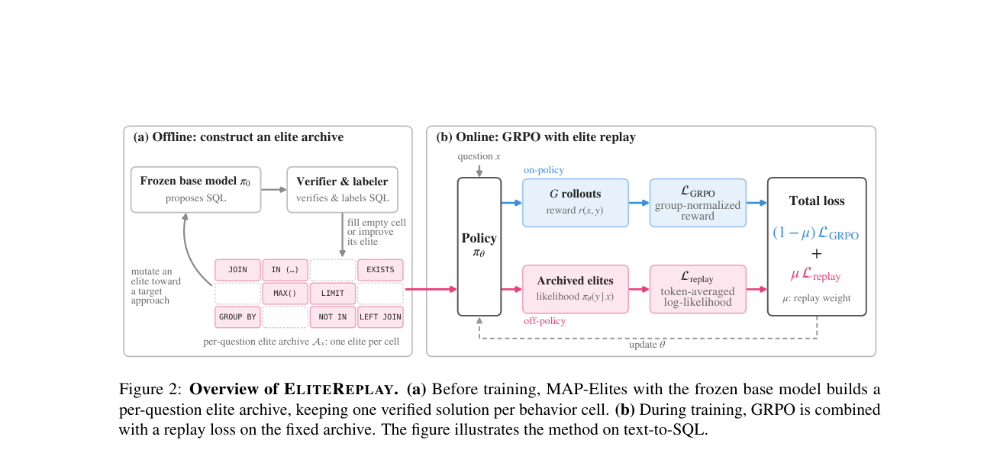

# EliteReplay: Continual replay from a quality–diversity archive with GRPO

<!-- source-sha256: d0496be27d7335124d75caad23d500c88fd5bae24261eb0f39262c09eea82571 -->

[简体中文](README.md)

> **L1 MAP-Elites, archive, sampler, and mixed-loss component.** The local work executes real goal-directed search, but its arithmetic grammar is not the paper's SQL LLM and a reviewed approach list is not an LLM labeler. Tiny results do not establish BIRD or Spider capability. The full experiment was reviewed and not reproduced because of cost.

## Paper information

| Field | Details |
| --- | --- |
| Paper links | [arXiv 2610.22290](https://arxiv.org/abs/2610.22290); [pinned v1 full text](https://arxiv.org/html/2610.22290v1) |
| Company / institution | First author Hanane Nour Moussa, The Ohio State University |
| First public release | 2026-10-15T17:43:31Z (UTC, arXiv v1) |
| Author code | Public [skai-research/EliteReplay](https://github.com/skai-research/EliteReplay) |
| Local adapter / method key | `elite-replay`; `adapter: null` |
| Local implementation | [`elite_replay.py`](https://github.com/daiwk/auto-research/blob/main/src/auto_research/post_training/elite_replay.py) |
| Local implementation directory | [`src/auto_research/post_training/`](https://github.com/daiwk/auto-research/tree/main/src/auto_research/post_training) |
| Runner | [`run_oct17_post_components.py`](https://github.com/daiwk/auto-research/blob/main/scripts/run_oct17_post_components.py) |

## Paper summary

### Background and main changes

RL that only raises correctness can narrow the range of correct strategies. EliteReplay uses a frozen base model and MAP-Elites to collect diverse correct strategies, then continually replays the fixed archive during training. Cells are indexed by **question, approach, and structural descriptor**, retaining only the shortest verified solution per cell. It is not an ordinary IID replay buffer.

~~~mermaid
flowchart LR
  A[Base-model seeds and approach vocabulary] --> B[Prefer uncovered, less-attempted targets]
  B --> C[Frozen base generates from target and parent]
  C --> D[Actual verifier]
  D --> E[Insert into achieved cell or replace with shorter solution]
  E --> B
  E --> F[Frozen archive]
  F --> G[Replay balanced across questions and cells]
  H[Student on-policy rollouts] --> I[GRPO]
  G --> J[Length-normalized NLL]
  I --> K[Fixed-weight mixed update]
  J --> K
~~~

<!-- paper-figure:start -->
### Original paper figure

> **Paper Figure 2:** Training flow and main optimization stages. From the [original paper](https://arxiv.org/abs/2610.22290); copyright remains with the authors. Click the image to open its source.
<!-- paper-figure:end -->

### Core equations

Maintain $\mathcal A_x[b(y)]$ for training question $x$. Candidates must pass the verifier and are archived by their **achieved** descriptor $b(y)$. Insert only in an empty cell or when shorter. Requested and achieved approaches can differ.

$$
L_{replay}=-\frac1{|\mathcal E|}\sum_{(x,y)\in\mathcal E}\frac1{|y|}\log\pi_\theta(y|x),\qquad
L=(1-\mu)L_{GRPO}+\mu L_{replay},\quad\mu=0.05.
$$

Replay balances questions first, then occupied cells within each question so larger archives do not get more weight. GRPO rewards, old log probabilities, and normalized advantages are detached. Normalize each response by valid length first. Clear padding before exponentiating the ratio.

### Offline and online results reported in the paper

BIRD pass@128 is 74.8% with 9.1 distinct correct strategies per question. Spider pass@128 is 93.2%, and AmbiQT dual-interpretation coverage is 27.0%. Comparisons include GRPO, MaxRL, SetPO, DPH-F, and IID replay. Diversity evaluation uses an independent deterministic SQL AST representation rather than the LLM approach labels used during search. No online A/B is reported.

## Local reproduction

### Data protocol and execution

The runner has three fixed integer addition tasks and four parseable expression forms. A small frozen linear policy **actually samples** candidates conditional on task, target approach, and parent availability. An AST allowlist computes results without executing arbitrary generated programs. Candidates can fail verification or miss the requested approach; failure counts are kept.

The archive starts with reviewed seeds and runs 24 directed mutations per question. After freezing, a balanced sampler supplies replay. The student is a trainable copy of the same small model; one random grammar decision selects an expression, with deterministic remaining tokens. This is not natural-language or SQL generation. Actual log probabilities support the mixed GRPO/NLL objective and four parameter updates.

~~~bash
PYTHONPATH=src python scripts/run_oct17_post_components.py \
  --methods elite-replay --device cpu --seeds 42,43,44 \
  --output runs/elite-replay-component.json
~~~

Use `--device cuda` for CUDA; no fallback. Four updates by default and at most 12, with no download, LLM API, or result-dependent retry.

### Results, code mapping, and limits

Real A100 execution on 2026-10-17 used seeds 42/43/44; see [per-seed metrics](metrics/component-cuda-seeds42-44.json) and [sanitized GPU receipt](../../gpu-validations/elite-replay-a100-20261017.json). Each seed runs 72 mutations, growing on average from three seed cells to 8.67 achieved cells. Question sampling counts have zero difference; the frozen base does not change. Mean NLL reference error is about $9.25\times10^{-17}$. A 100% verified archive is an **admission rule**, not a 100% model answer rate; failed mutations remain counted.

- `EliteArchive.insert` calls the verifier and keeps the shortest solution in the achieved cell. It does not trust a caller's pre-labeled correct flag.
- `choose_target` orders by uncovered status, attempts, and cross-question coverage. Prefer a parent with another approach.
- `map_elites_search` uses the frozen base under `no_grad` and eval and returns denominators for all attempts, failures, and insertions.
- `freeze/sample_balanced` holds the archive fixed during training; cumulative selections differ by at most one across questions and across cells within each question.
- `grpo_replay_loss` independently verifies length-normalized NLL. Averaging whole-sequence log probabilities does not replace token/response two-level normalization.

Metrics show executable formulas, search, and gradients, not extrapolated success or strategy coverage gains. No LLM labeler vocabulary induction, real SQL generation/database, full benchmark, or Evolve integration.

**Full experiment not reproduced:** Qwen3.5-4B full-parameter training uses 4×A100 80 GB, split two training and two rollout GPUs. It runs 100 steps of 128 questions × eight responses, 16K prompts, 4K responses, and 128 samples per evaluation question. A single A100/A30 does not meet the full multi-arm throughput and duration. No probe was run. `full_experiment_status: not_reproduced_high_cost`.
