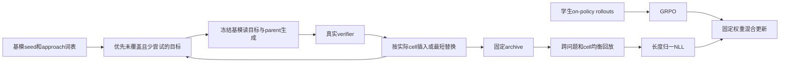
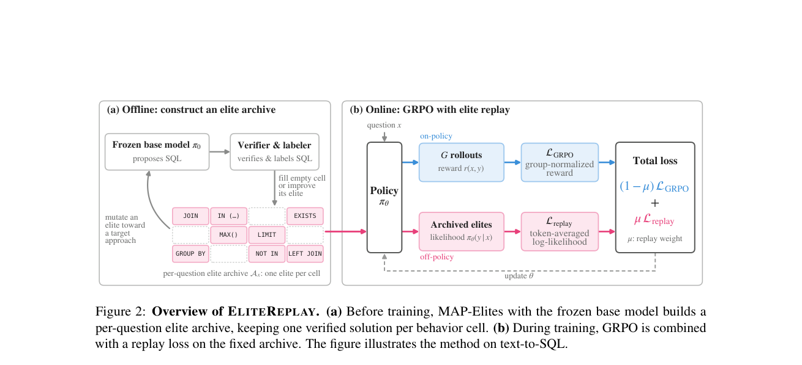

# EliteReplay：质量–多样性档案与 GRPO 的持续回放

> **L1 MAP-Elites / archive / sampler / mixed loss 组件。** 本地保留真实目标导向搜索，但算术 grammar 不是论文的 SQL LLM，审阅 approach 列表不是 LLM labeler；不以微型结果宣称 BIRD/Spider 能力。完整实验成本过高，不复现（审查 DONE）。

## 论文信息

| 字段 | 内容 |
|---|---|
| 论文链接 | [arXiv 2610.22290](https://arxiv.org/abs/2610.22290)；[固定 v1 全文](https://arxiv.org/html/2610.22290v1) |
| 公司 / 机构 | 第一作者 Hanane Nour Moussa，The Ohio State University |
| 首次公开日期 | 2026-10-15T17:43:31Z（UTC，arXiv v1） |
| 原作者代码 | [skai-research/EliteReplay](https://github.com/skai-research/EliteReplay)，已公开 |
| 本地 adapter / 方法键 | `elite-replay`；`adapter: null` |
| 本地复现代码 | [`elite_replay.py`](https://github.com/daiwk/auto-research/blob/main/src/auto_research/post_training/elite_replay.py) |
| 本地复现代码目录 | [`src/auto_research/post_training/`](https://github.com/daiwk/auto-research/tree/main/src/auto_research/post_training) |
| 运行入口 | [`run_oct17_post_components.py`](https://github.com/daiwk/auto-research/blob/main/scripts/run_oct17_post_components.py) |

## 原始论文总结

### 背景与主要改动

单纯提高正确率的 RL 可能压缩正确解法的覆盖范围。EliteReplay 先用冻结基模和 MAP-Elites 收集不同正确策略，训练时持续回放固定档案。档案按**问题、approach 与结构特征**分 cell，每格只保留最短已验证解；不是把 IID 样本放进普通 replay buffer。



<!-- paper-figure:start -->
### 原论文关键图

[](https://arxiv.org/pdf/2610.22290#page=3)

> **原论文 Figure 2（关键图）**：展示原论文的训练流程与关键优化环节。图片来自[原论文](https://arxiv.org/abs/2610.22290)，版权归原作者所有；点击图片可查看来源。
<!-- paper-figure:end -->

### 核心公式

对训练问题 $x$ 维护 $\mathcal A_x[b(y)]$。候选必须通过 verifier；按**实际实现的** descriptor $b(y)$ 存档，只有空 cell 或更短解才插入。请求 approach 与实际 approach 可以不同。

$$
L_{replay}=-\frac1{|\mathcal E|}\sum_{(x,y)\in\mathcal E}\frac1{|y|}\log\pi_\theta(y|x),\qquad
L=(1-\mu)L_{GRPO}+\mu L_{replay},\quad\mu=0.05.
$$

回放先平衡问题、再平衡各问题 occupied cells，不能让 archive 更大的问题占更多权重。GRPO reward、old log probabilities 与归一化 advantage 都 detach；每条 response 先按有效长度归一。padding 必须在 ratio exponentiation 之前清理。

### 论文离线与线上效果

原文 BIRD pass@128 为74.8%，每题9.1种不同正确策略；Spider pass@128为93.2%，AmbiQT双解释覆盖27.0%。比较 GRPO、MaxRL、SetPO、DPH-F 与 IID replay；策略多样性评测使用独立的确定性 SQL AST 表征，而非搜索时的 LLM approach label。线上 A/B：未报告。

## 本地复现

### 数据协议与运行

runner 提供三个固定整数加法任务，候选为四种可解析表达式。一个小型冻结线性策略在原任务、目标 approach、parent 是否存在的条件下**实际采样**候选；AST whitelist 计算表达式结果进行验证，不执行任意生成程序。候选可能失败，也可能没有实现请求的 approach，失败数量均记录。

档案先有审阅的种子解，再执行每题24次 directed mutations；经过 freeze 后，均衡 sampler 提供回放。学生是相同小模型的可训练副本，随机首个 grammar 决策选择整条表达式，之后为确定性 token；该简化不会伪装成自然语言/SQL 生成。训练仍通过真实 log probability 执行 GRPO/NLL 混合与四次参数更新。

```bash
PYTHONPATH=src python scripts/run_oct17_post_components.py \
  --methods elite-replay --device cpu --seeds 42,43,44 \
  --output runs/elite-replay-component.json
```

CUDA 仅改 `--device cuda`，无 CUDA 不回退。默认四步、上限12，无下载、无LLM API、不按结果重试。

### 结果、代码映射与边界

2026-10-17 已在真实 NVIDIA A100 上完成 seeds 42/43/44：[逐 seed 指标](metrics/component-cuda-seeds42-44.json)、[净化 GPU 收据](../../gpu-validations/elite-replay-a100-20261017.json)。每种子72次 mutation，平均从3个seed cells扩展至8.67个实际cells；回放题目采样计数差为0、冻结基模变化为0，NLL 独立 reference 误差均值约 $9.25\times10^{-17}$。档案100%通过 verifier 是**插入门槛**，不是模型100%答题率；失败的 mutation 计数仍保留。

- `EliteArchive.insert` 自行调用 verifier，仅按实际 cell 最短替换；不能信任外部预标的 correct 字段。
- `choose_target` 保留未覆盖优先、尝试次数和跨问题 coverage 的排序；parent 优先取不同 approach。
- `map_elites_search` 在 `no_grad` 的 eval 模式使用冻结基模，返回所有尝试/失败/插入的分母。
- `freeze/sample_balanced` 使训练档案不再在线变化；每题和每题内 cell 的累计选择次数差至多一。
- `grpo_replay_loss` 独立检查长度归一的 NLL，禁止用整条 sequence logp 平均替代 token/response 双层归一。

本地指标只说明公式、搜索和梯度路径可执行，不说明搜索成功率或策略覆盖改善可外推到论文。未实现 LLM labeler 词表诱导、真实 SQL 生成器/数据库与完整 benchmark；不进入 evolve。

**不复现的完整实验：** 原文 Qwen3.5-4B全参训练使用4×A100 80GB，其中2卡训练、2卡rollout；100步，每步128题×8响应，16k prompt/4k response，评测每题128sample。单张 A100/A30 不满足该完整多臂吞吐与时长预算，未探跑；`full_experiment_status: not_reproduced_high_cost`。
