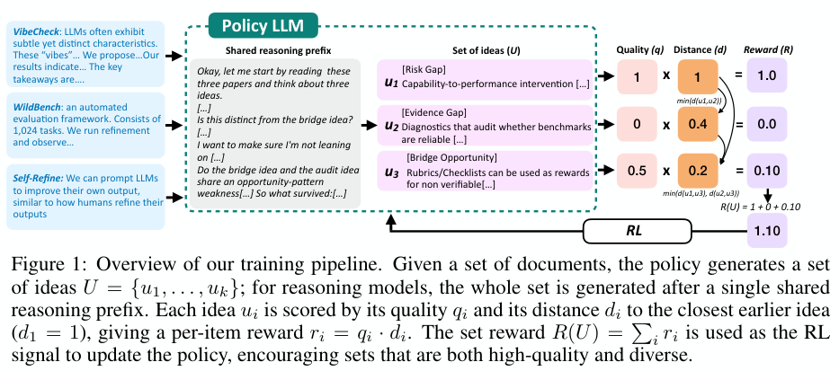

# DIVERGE ideation: Rewarding quality and difference across a set of scientific ideas

<!-- source-sha256: bd24e8b2de14f1909e4634462dbd579e41d89024dc579ce58e5f3295f8d53adf -->

[简体中文](README.md)

> **L1 CPU reward and evaluation protocol, not a reproduction of a scientific ideation model.** No fabricated SciJudge or semantic distances. The full experiment was reviewed and not reproduced because of cost, with no Evolve promotion.

## Paper information

| Field | Details |
| --- | --- |
| Paper links | [arXiv 2610.22324](https://arxiv.org/abs/2610.22324); [pinned v1 full text](https://arxiv.org/html/2610.22324v1) |
| Company / institution | First author Manya Wadhwa lists New York University first. Work was done at Salesforce AI Research; other authors include Salesforce and Stony Brook. |
| First public release | 2026-10-15T17:52:12Z (UTC, arXiv v1). Announced October 16, not first released October 19. |
| Author code | [Official placeholder](https://github.com/ManyaWadhwa/diverge_ideation) contains a README only, with code, data, and models forthcoming. Not a released training implementation. |
| Code license | No code license found in the placeholder. The paper is CC BY-NC-SA 4.0. |
| Local adapter / method key | `diverge-ideation`; `adapter: null`, CPU protocol interface |
| Local implementation | [`src/auto_research/post_training/reviewed_oct19.py`](https://github.com/daiwk/auto-research/blob/main/src/auto_research/post_training/reviewed_oct19.py): `set_reward`, judge observation contract, and `creative_utility` |
| Runner | [`scripts/run_oct19_post_components.py`](https://github.com/daiwk/auto-research/blob/main/scripts/run_oct19_post_components.py) |

## Paper summary

### Background and main changes

Independent samples of high-scoring ideas may repeatedly explore the same direction. DIVERGE generates the entire set in one response, letting each new idea see earlier ones, and trains for quality and mutual difference. An idea card has problem gap, core claim, method, and inspiration. Quality compares impact with a gold idea. Semantic distance equally averages judge results over three evaluated fields. Different strings do not establish scientific novelty. See [Sections 2–3](https://arxiv.org/html/2610.22324v1#S2).

~~~mermaid
flowchart LR
  A[Source paper cards] --> B[Generate K ideas together]
  B --> C{Schema valid}
  C -->|No| D[Zero reward and no judge call]
  C -->|Yes| E[Impact comparison in both orders]
  C -->|Yes| F[Semantic distance for gap, claim, and method]
  E --> G[Nearest predecessor reward in generation order]
  F --> G
  G --> H[Format bonus minus evaluated-field length penalty]
  H --> I[Whole set is one GRPO rollout]
~~~

Figure 1 covers training. Figure 2's Creative Utility–grounding plot shows the objective's limits, not just higher CU.

<!-- paper-figure:start -->
### Original paper figure

> **Paper Figure 1:** Whole-set idea generation and quality times nearest earlier distance, including document inputs, shared reasoning, reward terms, and RL loop. Figure numbers are not local scientific quality measurements. From the [original paper](https://arxiv.org/abs/2610.22324); copyright remains with the authors. Click the image to open its source.
<!-- paper-figure:end -->

### Core equations

Training uses **generation order**, not an optimal or greedy reordering, and no patience discount:

$$
R_{set}(U)=\sum_{i=1}^Kq(u_i)\min_{j<i}d(u_i,u_j),\quad d_1=1,
$$

The impact judge uses both placements, giving win rate $q$ of 0, 0.5, or 1. Distance $d$ averages normalized semantic distances for three fields. Appendix B's schema gate, bonus, and length penalty give

$$
R=\mathbf1[schema]\left[0.05+R_{set}-\min\{\max(0,L/1000-1),3\}\right].
$$

$L$ counts tokens in problem_gap, core_claim, and method only, **not inspiration or think**. The caller supplies the appropriate tokenizer count, not character count.

Evaluation CU differs from training reward: it reorders ideas, discounts by $\gamma=0.9$, and divides by the sum of discounts. The author's greedy approximation is a lower bound on the maximum, not an exact maximum. The local exact reference enumerates only $K\le8$.

### Offline and online results reported in the paper

Author non-thinking SFT+RL gives CU 0.64, thinking gives 0.51, and quality-only RL gives 0.38. Grounding is 0.61 without thinking versus 0.81 with thinking. Higher CU does not improve all scientific metrics. An execution study on 132 ideas uses a separate coding agent and has limited conclusions. No production online A/B is reported. See the [experiments and limitations](https://arxiv.org/html/2610.22324v1#S5).

## Local reproduction

### Data protocol and execution

The CPU runner constructs 12 explicitly synthetic judge groups per seed: two order-dependent Boolean votes and normalized distances in three fields. They check the protocol and are not from SciJudge, an LLM, or real scientific evaluation. Users can explicitly configure judge callbacks. The component does not quietly call a commercial API, download a model, or use textual similarity as a semantic judge.

~~~bash
PYTHONPATH=src python scripts/run_oct19_post_components.py \
  --methods diverge-ideation --device cpu --seeds 42,43,44 \
  --output runs/diverge-protocol.json
~~~

There is no CUDA path; `--device cuda --methods diverge-ideation` is rejected. CPU results are not GPU validation. Non-overwriting output retains source hash, commit, fixed protocol revision, raw per-group observations, callback count, training reward, greedy CU lower bound, and independently enumerated CU.

### Results, code mapping, and limits

`validate_idea_schema` checks four fields, two blocks, and supplied taxonomy validators, not raw-text parsing or semantic grounding. `observe_idea_judgments` uses explicit callbacks and never calls a judge for invalid schema. `set_reward` keeps ordering and length gates; `creative_utility` distinguishes greedy lower bound and bounded enumeration.

Three-seed CPU checks used commit `8c963f810e45ce3886e43b1b5da39980e41c95c0`; see [per-seed metrics](metrics/component-cpu-seeds42-44.json). Each seed has 12 synthetic groups and 108 fixture calls. Maximum reward and independent enumeration errors are at most $2.23\times10^{-16}$. Greedy bound violations and duplicate idea marginal-credit errors are zero. The ordering negative control differs by 0.58, and invalid schema triggers zero judge calls.

No real model or API judge was called: `actual_model_or_api_judge_used: false` and `scientific_quality_measured: false`. Fixture checks do not measure scientific quality, novelty, or grounding. No model training, benchmark improvement, execution success, or Evolve promotion.

**Full experiment: reviewed, not reproduced.** The paper uses eight H200s, about 46 minutes per SFT epoch, roughly ten hours per 600-step GRPO round, two GPUs for a 30B quality judge, and an external API for a 120B distance judge. It also uses 7B/8B models, 16K outputs, multiple configurations, and coding-agent trials capped at 90 minutes and USD 30 per idea. These are paper costs, not local measurements. No full run was launched on a single card or Mac.
