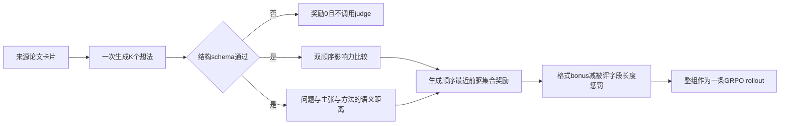
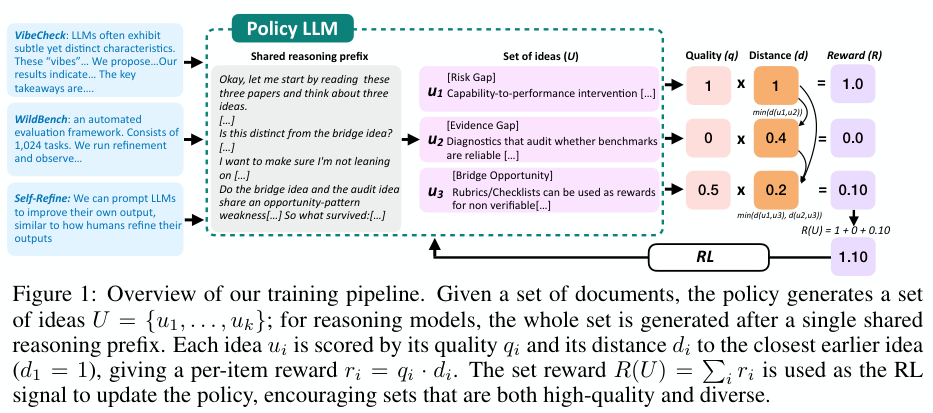

# DIVERGE ideation：给整组科学想法奖励质量与差异

> **L1 CPU reward/evaluation protocol 接口，不是科学创意模型复现。** 不伪造 SciJudge 或语义距离；完整实验成本过高，不复现（审查 DONE），不进入 Evolve 晋级。

## 论文信息

| 字段 | 内容 |
|---|---|
| 论文链接 | [arXiv 2610.22324](https://arxiv.org/abs/2610.22324)；[固定 v1 全文](https://arxiv.org/html/2610.22324v1) |
| 公司 / 机构 | 一作 Manya Wadhwa 首署 New York University；工作在 Salesforce AI Research 期间完成，其他作者来自 Salesforce、Stony Brook |
| 首次公开日期 | 2026-10-15T17:52:12Z（UTC，arXiv v1；10月16日公告，不是10月19日首发） |
| 原作者代码 | [官方占位仓库](https://github.com/ManyaWadhwa/diverge_ideation)当前仅 README，明确代码、数据及模型待发布；不能标作已发布训练实现 |
| 代码许可 | 官方占位仓库未见代码许可，未确认；论文 CC BY-NC-SA 4.0 |
| 本地 adapter / 方法键 | `diverge-ideation`；`adapter: null`，CPU协议接口 |
| 本地代码位置 | [`src/auto_research/post_training/reviewed_oct19.py`](https://github.com/daiwk/auto-research/blob/main/src/auto_research/post_training/reviewed_oct19.py)：`set_reward`、judge观测合同及 `creative_utility` |
| 运行入口 | [`scripts/run_oct19_post_components.py`](https://github.com/daiwk/auto-research/blob/main/scripts/run_oct19_post_components.py) |

## 原始论文总结

### 背景与主要改动

独立采样多个高分想法可能反复得到同一个方向。论文让模型在一次生成中写出整组想法，每个新想法都能看到前面写过的内容，再按整组质量和相互差异训练。每张卡包含 problem gap、core claim、method、inspiration；质量由与 gold idea 的影响力比较提供，语义距离由三个被评字段的 judge 结果等权平均。不是用字符串不同就代表科研创新。[原文 §2–3](https://arxiv.org/html/2610.22324v1#S2)



原图建议 Figure 1：训练流程；Figure 2 的 Creative Utility–grounding 图可用于展示目标的局限，而不是只展示更高 CU。

<!-- paper-figure:start -->
### 原论文关键图

[](https://arxiv.org/pdf/2610.22324v1#page=2)

> **原论文 Figure 1（关键图）**：DIVERGE 的整组想法生成与质量乘以前序最近距离的集合奖励流程；完整保留文档输入、共享推理、各项奖励及 RL 回路，图中数值不是本地科学质量评测。图片来自[原论文](https://arxiv.org/abs/2610.22324)，版权归原作者所有；点击图片可查看来源。
<!-- paper-figure:end -->

### 核心公式

训练按**生成顺序**，不按最优或贪心顺序重排，也不使用 patience 折扣：

$$
R_{set}(U)=\sum_{i=1}^Kq(u_i)\min_{j<i}d(u_i,u_j),\quad d_1=1,
$$

其中影响力 judge 用正反两个摆放顺序，$q$为赢率0、0.5或1；$d$为三个字段归一化语义距离的均值。完整奖励保留原文附录B的结构gate、bonus和长度项：

$$
R=\mathbf1[schema]\left[0.05+R_{set}-\min\{\max(0,L/1000-1),3\}\right].
$$

$L$只包含 problem_gap、core_claim、method 的 token 数，**不计 inspiration 或 think**。调用方需使用相应 tokenizer提供这个数；本地不拿字符数冒充 token 数。

评测 CU 与训练奖励不同：它对想法重排、使用 $\gamma=0.9$ 并除以折扣和。作者用贪心重排近似最大化值，故它只是最大化 CU 的一个下界；本地仅对 $K\le8$ 提供精确枚举参考，不把贪心结果标作严格最大值。

### 论文离线与线上效果

作者无思考 SFT＋RL 模型 CU为0.64、思考版0.51；只优化质量的 RL为0.38。无思考版 grounding为0.61，思考版0.81，不能把 CU提升宣传成每个科研质量指标都改善。132个想法的执行试验使用独立编码 Agent，结论有限。未报告生产线上 A/B。[原文实验与局限](https://arxiv.org/html/2610.22324v1#S5)

## 本地复现

### 数据协议与运行

CPU runner每 seed构造12组明确标为 synthetic 的 judge 观测：双顺序Boolean赢票，以及三个字段的归一化距离。它们用于检验协议，不来自 SciJudge、LLM或真实科研评价。回调接口可替换为用户明确配置的 judge；本地不偷偷调用商业API、下载模型或用文本相似度替代语义judge。

```bash
PYTHONPATH=src python scripts/run_oct19_post_components.py \
  --methods diverge-ideation --device cpu --seeds 42,43,44 \
  --output runs/diverge-protocol.json
```

本接口没有 CUDA 路径，`--device cuda --methods diverge-ideation`明确拒绝，不能把 CPU结果写成GPU验收。输出不可覆盖，保存源码hash、commit、固定协议revision、每组原始观测、回调次数、训练reward、贪心CU下界和独立枚举CU。

### 结果、代码映射与边界

`validate_idea_schema`检查四字段、两个块的存在及调用方提供的 taxonomy validators；它不是原始文本解析器，也不验证语义grounding。`observe_idea_judgments`只接受明确回调，schema无效时不调用judge。`set_reward`保留顺序与长度gate，`creative_utility`区分贪心下界和有界枚举。

已用源码 commit `8c963f810e45ce3886e43b1b5da39980e41c95c0` 在 CPU 完成 seeds 42、43、44 三种子协议验收，见[逐seed协议指标](metrics/component-cpu-seeds42-44.json)。每个 seed 检查12组显式 synthetic judge 观测、108次 fixture 回调；奖励与独立枚举 CU 的最大绝对误差不超过 $2.23\times10^{-16}$，贪心下界违规量和重复想法的新增信用误差均为0。顺序负对照差值为0.58，确认训练奖励保留生成顺序；无效 schema 的 judge 调用数为0。

本轮没有调用真实模型或 API judge，`actual_model_or_api_judge_used: false`、`scientific_quality_measured: false`；这些 fixture 结果不表示测量了科学质量、创新性或 grounding。没有模型训练、基准提升或执行成功率主张；固定诊断、不可晋级、未接 Evolve。

**完整实验不复现（审查 DONE）：** 原文使用8 H200；SFT约46分钟/epoch，600步GRPO约10小时/轮；30B质量judge占2卡，120B距离judge经外部API提供。还涉及7B/8B模型、16K输出、多配置及每想法最多90分钟/30美元的编码Agent试验。这些为论文成本，不是本地测量；现有单卡或Mac不启动完整复现。
