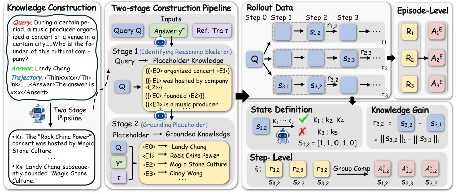

# KnowGPO: Assigning credit by acquired knowledge rather than surface observations

<!-- source-sha256: f21ad1a9b327d9849f0493c57cea900b2a8c2a89de66a0f57082ef828d69e2bb -->

[简体中文](README.md)

> **L1 defining algorithm component and gradient diagnostic, not a reproduction of search-agent capability.** The full experiment was reviewed and not reproduced because of cost. No Evolve promotion.

## Paper information

| Field | Details |
| --- | --- |
| Paper links | [arXiv 2610.22331](https://arxiv.org/abs/2610.22331); [pinned v1 full text](https://arxiv.org/html/2610.22331v1) |
| Company / institution | First author Siqi Chen lists Zhejiang University first and also Tencent. Categorized by first affiliation. |
| First public release | 2026-10-15T17:52:33Z (UTC, arXiv v1). Announced October 16, not first released October 19. |
| Author code | [Official placeholder repository](https://github.com/ZJU-REAL/KnowGPO) has assets, LICENSE, and README only. The README says method code is forthcoming; the paper's availability claim does not establish training implementation release. |
| Code license | Placeholder declares Apache-2.0, but unreleased method source cannot be described as open source on that basis. |
| Local adapter / method key | `knowgpo`; `adapter: null`, standalone component |
| Local implementation | [`src/auto_research/post_training/reviewed_oct19.py`](https://github.com/daiwk/auto-research/blob/main/src/auto_research/post_training/reviewed_oct19.py): accumulation, grouping, broadcasting, PPO+KL |
| Runner | [`scripts/run_oct19_post_components.py`](https://github.com/daiwk/auto-research/blob/main/scripts/run_oct19_post_components.py) |

## Paper summary

### Background and main changes

Search trajectories can learn the same facts through different queries, pages, and wording. Surface-observation matching separates steps that should be comparable. KnowGPO decomposes required facts into atomic conditions and uses a training verifier to check which were learned at each step. State is a monotonic set of verified conditions. Actions starting from the same knowledge state are compared by new knowledge and trained alongside final-answer rewards. See [Section 3 and Appendix A](https://arxiv.org/html/2610.22331v1#S3).

~~~mermaid
flowchart LR
  A[Actor samples from public history only] --> B[Search environment observation]
  B --> C[Training-only knowledge verifier]
  C --> D[Monotonic OR accumulation]
  D --> E[Group by question and pre-action knowledge]
  E --> F[Within-group knowledge gain advantage]
  G[Within-group final outcome advantage] --> H[Mix and broadcast to generated tokens]
  F --> H
  H --> I[Clipped PPO plus reference KL]
~~~

[Figure 2](https://arxiv.org/html/2610.22331v1/method_v1.png) shows knowledge-condition construction on the left and grouping/credit on the right. The local component does not implement the LLM labeling on the left.

<!-- paper-figure:start -->
### Original paper figure

> **Paper Figure 2:** Training-only knowledge conditions and pre-state grouping. Answers and reference trajectories on the left belong to the verifier, not evaluated actor inputs. From the [original paper](https://arxiv.org/abs/2610.22331); copyright remains with the authors. Click the image to open its source.
<!-- paper-figure:end -->

### Core equations

Given training-only verifier increment $\Delta s_{i,t}$, cumulative state and immediate process reward are

$$
s_{i,t}=s_{i,t-1}\lor\Delta s_{i,t},\qquad r_{i,t}=\|s_{i,t}\|_1-\|s_{i,t-1}\|_1.
$$

Group on the **pre-action state**: $\mathcal G(Q,s)=\{(i,t):Q_i=Q,\ s_{i,t-1}=s,\ a_{i,t}\ne\mathrm{answer}\}$. Eq. 5 is ambiguous, but Appendix Algorithm 1 line 13, the text, and author README specify the pre-state rather than post-state.

$$
A_i^E=\frac{R_i-\mu_Q}{\sigma_Q+\epsilon},\qquad
A_{i,t}^S=\frac{r_{i,t}-\mu_{\mathcal G}}{\sigma_{\mathcal G}+\epsilon},\qquad
A_{i,t}=(1-\omega)A_i^E+\omega A_{i,t}^S.
$$

Singleton and constant groups have zero process advantage. Answer steps do not join process groups but retain the outcome term. Broadcast only to generated reasoning and action tokens, not tool observations, prompts, or padding. The objective is a clipped PPO surrogate minus reverse KL to the reference. The local loss averages all valid generated tokens and differentiates neither verifier, behavior policy, nor reference.

### Offline and online results reported in the paper

Author Qwen3-8B scores are 48.0, 38.8, and 40.2 on Xbench-2505, BrowseComp-ZH, and GAIA. Knowledge grouping yields 97.8% effective steps versus 51.8% with observation grouping. These are full-system results, not local fixture success. No production user A/B is reported. See the [paper experiments](https://arxiv.org/html/2610.22331v1#S4).

## Local reproduction

### Data protocol and execution

A randomly initialized causal policy uses vocabulary 16 and width 8. Each question has six sampled three-step trajectories: two search steps and one answer. Public inputs are question tokens, own actions, and external document IDs. Private conditions and training outcomes are used outside actor calls. The exact small-environment verifier is not a natural-language LLM verifier or real search.

~~~bash
PYTHONPATH=src python scripts/run_oct19_post_components.py \
  --methods knowgpo --device cpu --seeds 42,43,44 \
  --output runs/knowgpo-component.json
~~~

Use `--device cuda` for CUDA; unavailability fails without fallback. Default three and maximum eight updates per seed. Non-overwriting output stores source SHA256, full commit, device, seeds, condition increments, pre/post states, group membership, and per-group credit at each update.

### Results, code mapping, and limits

`accumulate_knowledge` retains pre- and post-states. `knowledge_advantages` rejects state regression or new knowledge on an answer. `broadcast_step_advantages` isolates observations. `knowgpo_policy_loss` computes the clipped surrogate and full-vocabulary KL. Independent set/scalar references check grouping and objective; additional checks cover singleton and answer process credit, zero observation credit, and frozen reference.

Real A100 validation used seeds 42, 43, and 44 and source `8c963f810e45ce3886e43b1b5da39980e41c95c0`. See [GPU receipt](../../gpu-validations/knowgpo-a100-20261019.json) and [per-seed metrics](metrics/component-cuda-seeds42-44.json). Each seed made three updates; parameter-update L2 values are 0.012678, 0.010608, and 0.013292, and minimum gradient norms exceed 0.1036. Maximum absolute grouping-credit error is $3.34\times10^{-16}$ and PPO+KL error at most $8.64\times10^{-17}$. Reference parameter changes and gradients, singleton/answer process credit, and observation credit errors are all zero.

These results validate defining operators and actual gradients only on synthetic inputs. Full condition construction, a natural-language verifier, search engine, SFT, and deployment are not implemented. Fixed diagnostic, no promotion or Evolve.

**Full experiment: reviewed, not reproduced.** The 8B policy first uses eight A100s for three SFT epochs over about 8,100 search trajectories. RL uses 64 H20s, 32 questions × 16 rollouts per batch, and three epochs, plus DeepSeek-v3.2 verifier, 8B observation compressor, and search service. No weights or full training probe were used on the single A100/A30 or Mac budget.
