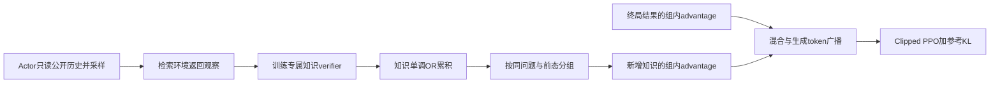
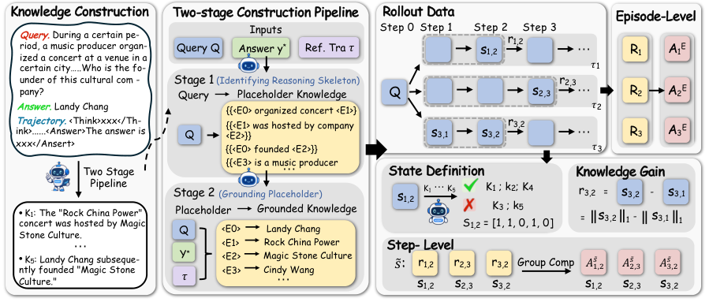

# KnowGPO：按已有知识而不是表面观察分组分配信用

> **L1 定义性算法组件／梯度诊断，不是搜索 Agent 能力复现。** 完整实验成本过高，不复现（审查 DONE）；不进入 Evolve 晋级。

## 论文信息

| 字段 | 内容 |
|---|---|
| 论文链接 | [arXiv 2610.22331](https://arxiv.org/abs/2610.22331)；[固定 v1 全文](https://arxiv.org/html/2610.22331v1) |
| 公司 / 机构 | 一作 Siqi Chen 首署 Zhejiang University，同时署名 Tencent；按首机构聚合到浙江大学 |
| 首次公开日期 | 2026-10-15T17:52:33Z（UTC，arXiv v1；10月16日公告，不是10月19日首发） |
| 原作者代码 | [官方占位仓库](https://github.com/ZJU-REAL/KnowGPO)仅有 assets、LICENSE 和 README；README 明确方法代码待发布。论文称 code available 不等于已提供训练实现 |
| 代码许可 | 占位仓库有 Apache-2.0 声明；当前未发布的方法源码不能据此宣称已开源 |
| 本地 adapter / 方法键 | `knowgpo`；`adapter: null`，独立组件 |
| 本地代码位置 | [`src/auto_research/post_training/reviewed_oct19.py`](https://github.com/daiwk/auto-research/blob/main/src/auto_research/post_training/reviewed_oct19.py)：知识累积、分组、广播及 PPO+KL |
| 运行入口 | [`scripts/run_oct19_post_components.py`](https://github.com/daiwk/auto-research/blob/main/scripts/run_oct19_post_components.py) |

## 原始论文总结

### 背景与主要改动

不同搜索轨迹即使读到了相同事实，也可能使用完全不同的 query、网页和表述，按表面观察匹配会把可比较的步骤拆散。KnowGPO 将问题所需事实拆为原子条件，训练 verifier 检查每步获得了哪些条件。状态是已验证条件的单调集合；从相同知识前态出发的动作互相比较新增知识，再与最终回答的奖励共同更新策略。[原文 §3与附录A](https://arxiv.org/html/2610.22331v1#S3)



原图建议：[Figure 2 方法总览](https://arxiv.org/html/2610.22331v1/method_v1.png)，左侧为训练知识条件构建，右侧为分组与信用；这不表示本地实现了左侧 LLM 标注流程。

<!-- paper-figure:start -->
### 原论文关键图

[](https://arxiv.org/html/2610.22331v1/method_v1.png)

> **原论文 Figure 2（关键图）**：训练专属知识条件构造与前态分组信用分配；左侧答案和参考轨迹属于 verifier 侧数据，不是可供被评估 actor 读取的输入。图片来自[原论文](https://arxiv.org/abs/2610.22331)，版权归原作者所有；点击图片可查看来源。
<!-- paper-figure:end -->

### 核心公式

对训练专用 verifier 增量 $\Delta s_{i,t}$，累计状态与即时过程奖励为

$$
s_{i,t}=s_{i,t-1}\lor\Delta s_{i,t},\qquad
r_{i,t}=\|s_{i,t}\|_1-\|s_{i,t-1}\|_1.
$$

**分组使用动作前态**：$\mathcal G(Q,s)=\{(i,t):Q_i=Q,\ s_{i,t-1}=s,\ a_{i,t}\ne answer\}$。正文式5有索引歧义，但附录算法1第13行、正文说明和作者 README 均明确是前态；不能使用动作后状态分组。

$$
A_i^E=\frac{R_i-\mu_Q}{\sigma_Q+\epsilon},\qquad
A_{i,t}^S=\frac{r_{i,t}-\mu_{\mathcal G}}{\sigma_{\mathcal G}+\epsilon},\qquad
A_{i,t}=(1-\omega)A_i^E+\omega A_{i,t}^S.
$$

singleton 或常量组的过程 advantage 为0；answer 步不进入过程分组，但仍接收混合式中的终局项。各步 advantage 只广播到生成的推理和动作 token，不广播到工具观察、提示或 padding。目标为 clipped PPO surrogate 减参考策略 reverse KL；本地按所有有效生成 token 取均值，verifier、行为策略和参考策略不求导。

### 论文离线与线上效果

作者 Qwen3-8B 在 Xbench-2505、BrowseComp-ZH、GAIA 分别报告48.0、38.8、40.2分；知识分组有效步骤比例97.8%，观察分组为51.8%。这些是完整系统的作者结果，不是本地分组 fixture 的任务成功率。未报告生产用户线上 A/B。[原文实验](https://arxiv.org/html/2610.22331v1#S4)

## 本地复现

### 数据协议与运行

随机初始化16词表、8维因果策略，每个问题采样6条三步轨迹，前两步为搜索、最后一步为 answer。公开输入只有题目 token、自己生成的动作和外部文档 ID；私有条件表与训练 outcome 只在 actor 调用外使用。精确小环境 verifier 不是自然语言 LLM verifier，不提供真实搜索能力。

```bash
PYTHONPATH=src python scripts/run_oct19_post_components.py \
  --methods knowgpo --device cpu --seeds 42,43,44 \
  --output runs/knowgpo-component.json
```

CUDA 使用 `--device cuda`；没有 CUDA 时失败，不静默回退。每 seed 默认3次、最多8次更新，输出不可覆盖，保存源码 SHA256、完整 commit、设备、种子，以及每次更新的条件增量、前后态、分组成员和逐组信用。

### 结果、代码映射与边界

`accumulate_knowledge` 保留前后状态；`knowledge_advantages` 拒绝状态回退和 answer 引入新知识；`broadcast_step_advantages` 隔离观察；`knowgpo_policy_loss` 真正计算 clipped surrogate 与全词表 KL。独立 Python 集合/标量参考核对分组与训练目标，另测 singleton、answer、观察零过程信用，以及冻结 reference。

已在真实 NVIDIA A100 上以 seeds 42、43、44 完成三种子 CUDA 验收，执行源码 commit 为 `8c963f810e45ce3886e43b1b5da39980e41c95c0`，见[GPU回执](../../gpu-validations/knowgpo-a100-20261019.json)与[逐seed指标](metrics/component-cuda-seeds42-44.json)。每个 seed 均实际执行3次优化更新，参数更新 L2 分别为0.012678、0.010608、0.013292；最小梯度范数均大于0.1036。分组信用相对独立参考的最大绝对误差不超过 $3.34\times10^{-16}$，PPO＋KL 目标误差不超过 $8.64\times10^{-17}$；reference 参数变化和梯度数均为0，singleton、answer 的过程信用及观察 token 信用误差均为0。

这些结果只验证合成小环境中的定义性算子和真实梯度路径，不支撑原论文 benchmark 效果。完整知识条件构建、自然语言 verifier、搜索引擎、SFT 和部署路径未实现；固定诊断、不可晋级、未接 Evolve。

**完整实验不复现（审查 DONE）：** 原文8B策略先在8 A100上对约8100条搜索轨迹做3epochs SFT；RL为64 H20、batch32题×16rollout、3epochs，另需 DeepSeek-v3.2 verifier、8B观察压缩器及搜索服务。现有单 A100/A30 或 Mac 不满足该配置，未下载权重或试跑完整训练。
