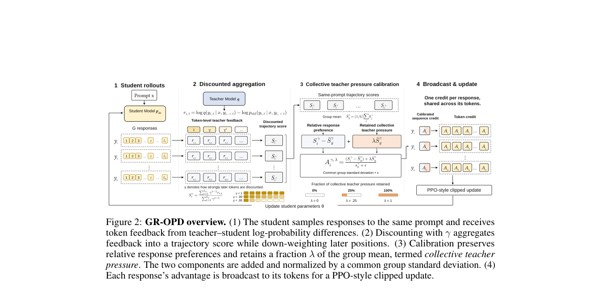

# GR-OPD: Turning teacher feedback into group-relative sequence credit

<!-- source-sha256: f8a13321f771ae684f4d49ed3fca250cbfe54f325a5b542105261426bfc9358a -->

[简体中文](README.md)

> **L1 defining component and gradient diagnostic, not a reproduction of mathematical reasoning capability.** The full experiment was reviewed and not reproduced because of cost. No Evolve integration or promotion eligibility.

## Paper information

| Field | Details |
| --- | --- |
| Paper links | [arXiv 2610.23042](https://arxiv.org/abs/2610.23042); [pinned v1 full text](https://arxiv.org/html/2610.23042v1) |
| Company / institution | First author Yushu Wang lists Shanghai Jiao Tong University first; collaboration with Alibaba Group. Categorized by first affiliation. |
| First public release | 2026-10-16T07:22:31Z (UTC, arXiv v1; announced October 19) |
| Author code | No verifiable author GR-OPD method repository was found in this review. |
| Code license | Unverified; generic distillation framework licenses do not establish the GR-OPD code license. |
| Local adapter / method key | `gr-opd`; `adapter: null`, standalone defining component |
| Local implementation | [`src/auto_research/post_training/gr_opd.py`](https://github.com/daiwk/auto-research/blob/main/src/auto_research/post_training/gr_opd.py) |
| Runner | [`scripts/run_oct19_evening_post_components.py`](https://github.com/daiwk/auto-research/blob/main/scripts/run_oct19_evening_post_components.py) |

## Paper summary

### Background and main changes

Higher teacher confidence at each token does not establish that the entire reasoning sequence is worth imitating. Mismatched teacher and student reasoning modes can also collapse training. GR-OPD replays the teacher on student trajectories, aggregates log-probability differences into sequence scores, and assigns relative credit among responses to the same problem. It preserves part of the group mean pressure so centering does not erase overall teacher preference, then applies clipped PPO. See the [paper method](https://arxiv.org/html/2610.23042v1#S3).

~~~mermaid
flowchart LR
  A[Old student samples responses to the same problem] --> B[Frozen teacher replay scores]
  B --> C[Clip token feedback]
  C --> D[Normalized discounted sequence mean]
  D --> E[Group-relative credit and mean pressure]
  E --> F[Clip advantage and broadcast to actor tokens]
  F --> G[PPO update averaged per response]
~~~

Figure 2 shows discounting, group-relative credit, and broadcasting together.

<!-- paper-figure:start -->
### Original paper figure

> **Paper Figure 2:** The method's overall design and components. From the [original paper](https://arxiv.org/abs/2610.23042); copyright remains with the authors. Click the image to open its source.
<!-- paper-figure:end -->

### Core equations

The actual training path in the main text and Appendix C, not the simpler theoretical raw-sum estimator, uses

$$
r_{it}=\operatorname{clip}\!\left(\log q(y_{it}\mid h)-\log p_{old}(y_{it}\mid h),-5,5\right),\qquad
S_i=\frac{\sum_t\gamma^{t-1}r_{it}}{\sum_t\gamma^{t-1}}.
$$

Group responses by question and use population standard deviation:

$$
A_i=\operatorname{clip}\!\left(\frac{S_i-\mu+\lambda\mu}{\sigma+\epsilon},-5,5\right).
$$

$$
\mathcal L=-\frac1B\sum_i\frac1{T_i}\sum_{t\in actor_i}
\min\!\left(ratio_{it}A_i,\operatorname{clip}(ratio_{it},1-\varepsilon,1+\varepsilon)A_i\right).
$$

Detach teacher, old student, and credit. Average within responses before averaging across them; a global token mean would overweight long responses. Default $\gamma=.99$ and local $\lambda=.25$; the paper also uses $\lambda=0$ in Base or mode-mismatched settings. Gradient properties for the theoretical raw sum do not automatically extend to discounting, standardization, clipping, and repeated PPO.

`teacher_scoring_copy` aligns terminal EOS only on a scoring copy, leaving the actual rollout and padding unchanged. The tiny-vocabulary diagnostic needs no Qwen-specific token ID.

### Offline and online results reported in the paper

Six-suite math macro Avg@K for 4B-Base → 1.7B-Base is 23.333 for vanilla OPD versus 27.800 for GR-OPD. For 4B-Instruct nothink → 1.7B-Instruct nothink it is 34.118 versus 45.066. A larger teacher is not always better: some 32B pairings trail 4B pairings. These are author large-model results, not local reproduction. No production user A/B is reported. See [Table 1](https://arxiv.org/html/2610.23042v1#S4.T1).

## Local reproduction

### Data protocol and execution

Randomly initialized causal GRUs use a vocabulary of 16 and hidden width of 8. The teacher is separately initialized and frozen. The old student actually samples responses of lengths 2, 3, and 4 per public prompt, then the teacher replays the same trajectories. Different lengths test response balancing; no prewritten candidates or gold answers are supplied.

~~~bash
PYTHONPATH=src python scripts/run_oct19_evening_post_components.py \
  --methods gr-opd --device cuda --seeds 42,43,44 \
  --output runs/gr-opd-component.json
~~~

The same runner supports CPU diagnostics. CUDA does not fall back. The default is three real updates per seed. Non-overwriting output records groups, sequence scores, advantages, the full commit, source SHA256, and the pinned synthetic protocol.

### Results, code mapping, and limits

`sequence_credit` implements clipping, normalized discounting, population std, and mean pressure. `clipped_policy_loss` preserves per-response averaging; `teacher_scoring_copy` isolates teacher inputs. PPO chooses equivalent branches in log-ratio space so clipped huge positive-advantage ratios do not cause `0×inf` during backward. A genuinely selected negative-advantage branch outside the dtype's range fails explicitly rather than saturating. Independent scalar references verify credit and PPO; global token averaging is the negative control. Teacher freezing, masked NaN exclusion, and nonzero updates are checked.

Targeted CPU tests and real A100 runs passed for seeds 42/43/44. Frozen source `73a1e8b8` produced three tiny policy updates per seed, matched sequence-credit and response-balanced PPO references, and kept the teacher frozen. See [per-seed CUDA artifact](metrics/component-cuda-seeds42-44.json) and [A100 receipt](../../gpu-validations/gr-opd-a100-20261019.json). This is a mathematical mechanism diagnostic, not a formal math benchmark.

**Full experiment: reviewed, not reproduced.** The reference uses 8×H20, 64 questions × 8 responses, up to 28,672 tokens, and 221 rollout updates with eight optimization updates each. Multiple 4B/32B teachers and 1.7B student combinations and six math benchmarks add cost. No weights or probe were used on the single-A100/A30 or Mac budget. A random tiny teacher has no mathematical capability; the results establish the defining component and gradient path, not Evolve gains.
