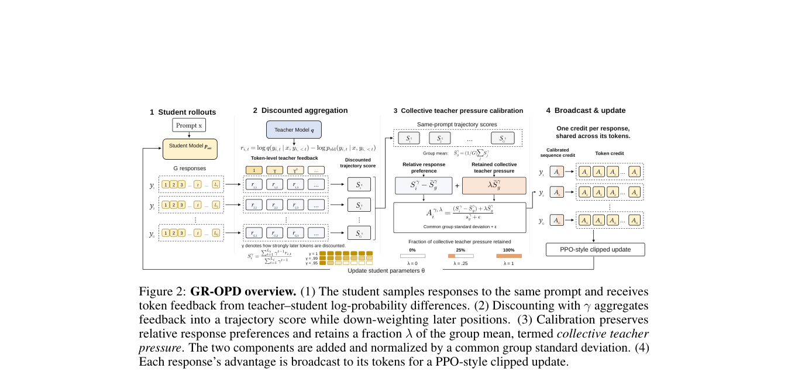

# GR-OPD：将教师反馈变成组相对的序列信用

> **L1 定义性组件／梯度诊断，不是数学推理能力复现。** 完整实验成本过高，不复现（审查 DONE）；不可晋级，未接 Evolve。

## 论文信息

| 字段 | 内容 |
|---|---|
| 论文链接 | [arXiv 2610.23042](https://arxiv.org/abs/2610.23042)；[固定 v1 全文](https://arxiv.org/html/2610.23042v1) |
| 公司 / 机构 | 一作 Yushu Wang 首署 Shanghai Jiao Tong University；与 Alibaba Group 合作，按首机构归入上海交通大学 |
| 首次公开日期 | 2026-10-16T07:22:31Z（UTC，arXiv v1；10月19日公告） |
| 原作者代码 | 本轮未找到可核验的原作者 GR-OPD 方法源码仓库 |
| 代码许可 | 作者源码许可未确认；未将通用蒸馏框架许可当成 GR-OPD 代码许可 |
| 本地 adapter / 方法键 | `gr-opd`；`adapter: null`，独立定义性组件 |
| 本地代码位置 | [`src/auto_research/post_training/gr_opd.py`](https://github.com/daiwk/auto-research/blob/main/src/auto_research/post_training/gr_opd.py) |
| 运行入口 | [`scripts/run_oct19_evening_post_components.py`](https://github.com/daiwk/auto-research/blob/main/scripts/run_oct19_evening_post_components.py) |

## 原始论文总结

### 背景与主要改动

教师在每个 token 上更自信，不一定意味着整段推理更值得复制；教师与学生的推理模式不同还可能造成训练崩溃。GR-OPD 在学生轨迹上重放教师，把 log-prob 差聚合为序列分数，在同题回答之间分配相对信用；保留一部分组均值压力，以免纯中心化抹掉教师总体偏好，然后使用 clipped PPO 更新。[原文方法](https://arxiv.org/html/2610.23042v1#S3)


原图建议：Figure 2 总览，保留折扣、组相对信用与广播三个阶段。

<!-- paper-figure:start -->
### 原论文关键图

[](https://arxiv.org/pdf/2610.23042#page=6)

> **原论文 Figure 2（关键图）**：展示原论文方法的总体设计和关键组成。图片来自[原论文](https://arxiv.org/abs/2610.23042)，版权归原作者所有；点击图片可查看来源。
<!-- paper-figure:end -->

### 核心公式

以下是正文与附录C的**实际训练路径**，不是简化的理论裸求和估计器：

$$
r_{it}=\operatorname{clip}\!\left(\log q(y_{it}\mid h)-\log p_{old}(y_{it}\mid h),-5,5\right),\qquad
S_i=\frac{\sum_t\gamma^{t-1}r_{it}}{\sum_t\gamma^{t-1}}.
$$

同一问题分组，标准差使用 population std：

$$
A_i=\operatorname{clip}\!\left(
\frac{S_i-\mu+\lambda\mu}{\sigma+\epsilon},-5,5\right).
$$

$$
\mathcal L=-\frac1B\sum_i\frac1{T_i}\sum_{t\in actor_i}
\min\!\left(ratio_{it}A_i,\operatorname{clip}(ratio_{it},1-\varepsilon,1+\varepsilon)A_i\right).
$$

教师、旧学生和信用均停止梯度。先对每条回答取均值，再跨回答平均，不能变成长回答权重更高的全局 token 均值。默认 $\gamma=.99$，本地取 $\lambda=.25$；原文 Base或模式不匹配设置也使用 $\lambda=0$。理论裸求和的梯度性质不能自动推广到折扣、标准化、裁剪和重复PPO后的实现。

`teacher_scoring_copy` 只在评分副本中对齐终止 EOS，不修改学生实际轨迹或 padding；小词表诊断本身不依赖 Qwen 的特殊 token ID。

### 论文离线与线上效果

六个数学套件的 macro Avg@K：4B-Base→1.7B-Base，vanilla OPD为23.333，GR-OPD为27.800；4B-Instruct nothink→1.7B-Instruct nothink为34.118→45.066。教师变大并不保证更好，32B配对有低于4B配对的结果。以上是作者大模型实验，未在本地重现；未报告生产用户线上 A/B。[原文表1](https://arxiv.org/html/2610.23042v1#S4.T1)

## 本地复现

### 数据协议与运行

随机初始化16词表、8维因果 GRU，教师单独随机初始化后冻结；旧学生实际为每个公开 prompt 采样长度2、3、4的回答，教师重放同一学生轨迹。不同长度用于检查逐响应均值，不提供预置候选或 gold 答案。

```bash
PYTHONPATH=src python scripts/run_oct19_evening_post_components.py \
  --methods gr-opd --device cuda --seeds 42,43,44 \
  --output runs/gr-opd-component.json
```

CPU可用相同入口诊断，CUDA不可用时不回退。默认每seed3次真实梯度更新，结果不可覆盖，记录每个组、序列分数、优势、完整 commit、源码 SHA256 和固定合成协议版本。

### 结果、代码映射与边界

`sequence_credit` 实现反馈裁剪、归一化折扣均值、population std及压力；`clipped_policy_loss` 保持逐响应平均；`teacher_scoring_copy` 隔离评分副本。PPO在log-ratio空间直接选择等价分支，避免极大正优势ratio被裁剪后仍在反向中产生`0×inf`；真正被选中但超过dtype可表示范围的负优势分支明确报错，不静默饱和。独立标量参考核对信用和PPO，负对照检查全局 token 平均与正确实现不同；同时验证教师冻结、masked NaN不进入损失和非零策略更新。

CPU 专项测试与真实 A100 seeds 42/43/44 均已通过；固定源码 `73a1e8b8` 下每 seed 三次实际微型策略更新，序列信用和响应均衡 PPO 参考一致，教师保持冻结。[CUDA逐seed产物](metrics/component-cuda-seeds42-44.json)、[A100回执](../../gpu-validations/gr-opd-a100-20261019.json)只支持数学机制诊断，未评测正式数学 benchmark。

**完整实验不复现（审查 DONE）：** 作者参考配置8×H20、64题×8回答、最长28,672 token、221次rollout更新，每次含8个优化更新，并比较多个4B/32B教师与1.7B学生组合及六个数学benchmark。本轮单A100/A30或Mac不承担该长训练，不下载权重、不试跑。随机小教师不具备数学能力，结果只证明定义性组件和梯度路径，不能用作 Evolve 效果证据。
