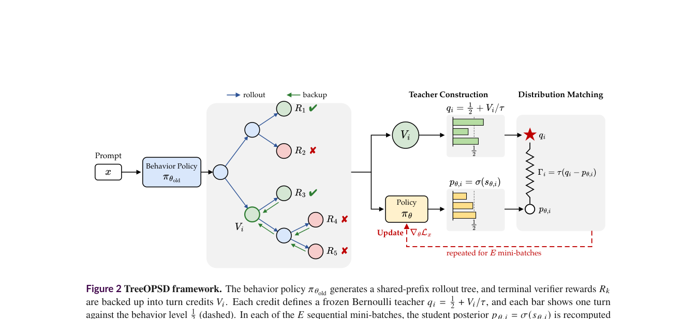

# TreeOPSD: Building finite posterior distillation targets from shared-prefix trees

<!-- source-sha256: 4f3ccade6cebd5da769aa83706997118c5459a69a4e3ef50409c3f695ed83100 -->

[简体中文](README.md)

> **L1 defining component and gradient diagnostic, not a reproduction of search-agent capability.** The full experiment was reviewed and not reproduced because of cost. No Evolve integration or promotion eligibility.

## Paper information

| Field | Details |
| --- | --- |
| Paper links | [arXiv 2610.23181](https://arxiv.org/abs/2610.23181); [pinned v1 full text](https://arxiv.org/html/2610.23181v1) |
| Company / institution | First author Heming Zou lists Tsinghua University first and also lists Tencent. Categorized by the first affiliation. |
| First public release | 2026-10-16T09:17:26Z (UTC, arXiv v1). Announced October 19, not first released then. |
| Author code | No verifiable author method repository found; the full text and abstract provide no verifiable training-code link. |
| Code license | Unverified; the paper license does not establish a code license. |
| Local adapter / method key | `treeopsd`; `adapter: null`, standalone defining component |
| Local implementation | [`src/auto_research/post_training/tree_opsd.py`](https://github.com/daiwk/auto-research/blob/main/src/auto_research/post_training/tree_opsd.py) |
| Runner | [`scripts/run_oct19_evening_post_components.py`](https://github.com/daiwk/auto-research/blob/main/scripts/run_oct19_evening_post_components.py) |

## Paper summary

### Background and main changes

With only terminal rewards on long trajectories, good and bad actions in the same trajectory can be rewarded or punished together. Repeated updates on the same trajectories also lack a signal telling the optimizer when to stop. TreeOPSD merges continuations into a shared-prefix tree, backs up leaf rewards weighted by behavior-policy likelihood, and maps each turn's credit to a frozen bounded Bernoulli teacher. As the student's change relative to the old policy reaches the target, the gradient vanishes; overshooting reverses it. See [Sections 2–3](https://arxiv.org/html/2610.23181v1#S3).

~~~mermaid
flowchart LR
  A[Frozen behavior policy samples full trajectories] --> B[Sample continuations from nonterminal prefixes]
  B --> C[Merge prefixes with identical full history]
  C --> D[Standardize leaves and back up likelihood-weighted credit]
  D --> E[Frozen bounded Bernoulli teacher]
  F[Current-policy turn score relative to behavior policy] --> G[Forward KL update]
  E --> G
~~~

Figure 2 shows tree credit, the frozen posterior teacher, and repeated updates. Figure 1 is conceptual, not an algorithm diagram.

<!-- paper-figure:start -->
### Original paper figure

> **Paper Figure 2:** The architecture, major modules, and their connections. From the [original paper](https://arxiv.org/abs/2610.23181); copyright remains with the authors. Click the image to open its source.
<!-- paper-figure:end -->

### Core equations

Keeping initial trajectories and branches gives $K=M(N+1)$ terminal samples. Use the **sample standard deviation** for leaf rewards, with all zeros for constant rewards. Count a shared turn once. Child weights use behavior likelihood over the entire actor span, not mean token likelihood:

$$
A_k=\frac{R_k-\bar R}{\operatorname{std}_{sample}(R)},\qquad
\omega_{ic}=\operatorname{softmax}_{c}\log\pi_{old}(a_c\mid h_c),\qquad
V_i=\sum_c\omega_{ic}V_c.
$$

For a unique turn with $L_i$ valid actor tokens:

$$
s_i=\frac1{L_i}\sum_j\log\frac{\pi_\theta(a_{ij}\mid h_{ij})}{\pi_{old}(a_{ij}\mid h_{ij})},\quad
p_i=\sigma(s_i),\quad
\tau=\frac{K-1}{\rho\sqrt K},\quad
q_i=\frac12+\frac{V_i}{\tau},\quad 0<\rho<\frac12.
$$

$$
\mathcal L=\frac{\tau}{L_x}\sum_iL_i\,D_{KL}(Ber(q_i)\Vert Ber(p_i)),\qquad L_x=\sum_iL_i.
$$

The standardized-leaf credit bound keeps targets valid without arbitrary clipping. The behavior policy and $q_i$ are detached. Observations are history only, excluded from the token denominator and loss. Gradient is zero at target and reverses after overshoot. The posterior is binary for a sampled turn, not a full next-token distribution.

### Offline and online results reported in the paper

The authors report improvements over compared methods in multi-hop QA and Deep Research. The abstract reports a 4.97-percentage-point gain over GRPO for 30B-A3B in Deep Research. The paper also analyzes seeds and update-target radii. These are results from complete large-model search systems, not accuracy from the synthetic tree diagnostic. No production user A/B is reported. See the [experiments and appendix](https://arxiv.org/html/2610.23181v1#S4).

## Local reproduction

### Data protocol and execution

A randomly initialized causal GRU with a 16-token vocabulary and width 8 samples actual three-turn trajectories and continuations from middle prefixes. Each turn has two actor tokens and, if nonterminal, one public observation ID. An explicit synthetic terminal reward is computed from last-turn tokens and never given to the actor; it is not a natural-language search verifier. Merging preserves full history, observations, and termination, while duplicate leaves still count toward $K$ and reward statistics.

~~~bash
PYTHONPATH=src python scripts/run_oct19_evening_post_components.py \
  --methods treeopsd --device cuda --seeds 42,43,44 \
  --output runs/treeopsd-component.json
~~~

CUDA requests never silently fall back. Use `--device cpu` for local math diagnostics. Default three and maximum eight updates per seed; no downloads, pretrained weights, or network judges. Non-overwriting output records the full commit, runner and three module SHA256 digests, per-seed gradients, and complete small trees.

### Results, code mapping, and limits

`merge_rollout_prefixes` verifies full prefixes; `tree_credit` computes sample-std and likelihood-weighted backup; `posterior_loss` computes exact forward KL. Independent Python scalars check credit and loss, with checks for shared-prefix savings, a frozen behavior policy, zero target gradient, and overshoot reversal.

Targeted CPU tests and real A100 runs for seeds 42/43/44 passed. At frozen source `73a1e8b8` each seed performed three tiny policy updates and passed tree-credit, loss-reference, target-gradient, and overshoot checks. See [per-seed CUDA artifact](metrics/component-cuda-seeds42-44.json) and [A100 receipt](../../gpu-validations/treeopsd-a100-20261019.json). This supports L1 mechanism claims only.

**Full experiment: reviewed, not reproduced.** The authors use 4B and 30B-A3B on a single eight-GPU node. The 30B configuration uses 96 GB H20s and TP4. It runs 100 policy updates, with Deep Research up to 60 training turns and 80 evaluation turns, real search, and large-scale generation. This is outside the single-A100/A30 or Mac budget. No weights were downloaded or full probe launched. Tiny gradients do not support benchmark, search-capability, or Evolve promotion claims.
