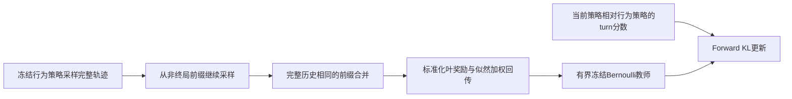
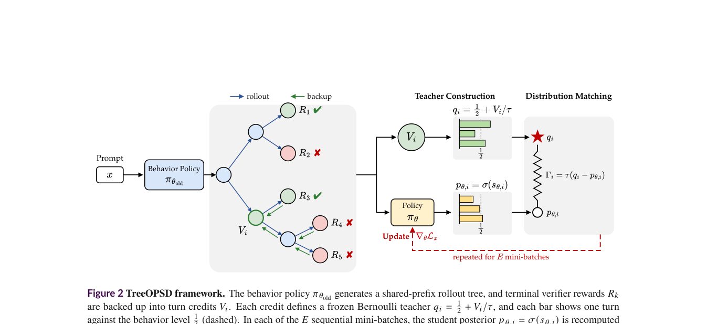

# TreeOPSD：从共享前缀树构造有限的后验蒸馏目标

> **L1 定义性组件／梯度诊断，不是搜索 Agent 能力复现。** 完整实验成本过高，不复现（审查 DONE）；不可晋级，未接 Evolve。

## 论文信息

| 字段 | 内容 |
|---|---|
| 论文链接 | [arXiv 2610.23181](https://arxiv.org/abs/2610.23181)；[固定 v1 全文](https://arxiv.org/html/2610.23181v1) |
| 公司 / 机构 | 一作 Heming Zou 首署 Tsinghua University，同时署名腾讯；按首机构归入清华大学 |
| 首次公开日期 | 2026-10-16T09:17:26Z（UTC，arXiv v1；10月19日公告，不是10月19日首发） |
| 原作者代码 | 本轮未找到可核验的原作者方法源码仓库；正文、摘要未提供可核验训练代码链接 |
| 代码许可 | 未找到作者源码，不能推定源码许可；论文许可不等于代码许可 |
| 本地 adapter / 方法键 | `treeopsd`；`adapter: null`，独立定义性组件 |
| 本地代码位置 | [`src/auto_research/post_training/tree_opsd.py`](https://github.com/daiwk/auto-research/blob/main/src/auto_research/post_training/tree_opsd.py) |
| 运行入口 | [`scripts/run_oct19_evening_post_components.py`](https://github.com/daiwk/auto-research/blob/main/scripts/run_oct19_evening_post_components.py) |

## 原始论文总结

### 背景与主要改动

长轨迹仅有终局奖励时，同一轨迹的好坏动作容易一起获奖或受罚；同一批轨迹又会经历多次更新，旧信用不能告诉优化器何时停止。TreeOPSD 将续写分支整理成共享前缀树，把叶奖励按行为策略似然向上回传，再把每个 turn 的信用映射为一个冻结且有界的 Bernoulli 教师。学生相对旧策略的变化达到目标时梯度消失，超过目标则反向，不再只有无限推进的方向。[原文 §2–3](https://arxiv.org/html/2610.23181v1#S3)



原图建议：Figure 2 方法总览，展示树信用、冻结后验教师与多次更新；Figure 1 是概念插图，不宜代替算法图。

<!-- paper-figure:start -->
### 原论文关键图

[](https://arxiv.org/pdf/2610.23181#page=5)

> **原论文 Figure 2（关键图）**：展示原论文提出的核心架构、主要模块及其连接关系。图片来自[原论文](https://arxiv.org/abs/2610.23181)，版权归原作者所有；点击图片可查看来源。
<!-- paper-figure:end -->

### 核心公式

保留初始轨迹及分支后有 $K=M(N+1)$ 个终局样本。叶奖励用 **sample std** 标准化，常量奖励时全零；共享 turn 只计一次。子节点权重使用完整 actor span 的行为似然，而不是 token 平均似然：

$$
A_k=\frac{R_k-\bar R}{\operatorname{std}_{sample}(R)},\qquad
\omega_{ic}=\operatorname{softmax}_{c}\log\pi_{old}(a_c\mid h_c),\qquad
V_i=\sum_c\omega_{ic}V_c.
$$

对每个唯一 turn 的有效 actor token 数 $L_i$：

$$
s_i=\frac1{L_i}\sum_j\log\frac{\pi_\theta(a_{ij}\mid h_{ij})}{\pi_{old}(a_{ij}\mid h_{ij})},\quad
p_i=\sigma(s_i),\quad
\tau=\frac{K-1}{\rho\sqrt K},\quad
q_i=\frac12+\frac{V_i}{\tau},\quad 0<\rho<\frac12.
$$

$$
\mathcal L=\frac{\tau}{L_x}\sum_iL_i\,D_{KL}(Ber(q_i)\Vert Ber(p_i)),\qquad L_x=\sum_iL_i.
$$

目标由标准化叶信用的上界保证有效，不做任意 clipping。行为策略与 $q_i$ 均停止梯度；观察只是历史，不进入 token 分母或损失。目标处梯度为零；越过目标后反号。该后验是相对已采样 turn 的二点分布，不是完整下一 token 词表分布。

### 论文离线与线上效果

作者在多跳问答及 Deep Research 报告优于所比较方法；摘要报告30B-A3B在 Deep Research 设置相对 GRPO 提升4.97个百分点。论文另保留不同随机种子、更新目标半径等分析。这些是大模型完整搜索系统的结果，不是下述合成树诊断的准确率。未报告生产用户线上 A/B。[原文实验与附录](https://arxiv.org/html/2610.23181v1#S4)

## 本地复现

### 数据协议与运行

随机初始化16词表、8维 GRU 因果策略，实际采样三 turn 轨迹并从中间前缀继续采样；每个 turn 两个 actor token，非终局附带一个公开观察 ID。显式合成终局奖励由末 turn 的 token 计算，不传入 actor；它不是自然语言搜索 verifier。树合并保留完整历史、观察和终止标记，重复叶仍保留在 $K$ 和奖励统计中。

```bash
PYTHONPATH=src python scripts/run_oct19_evening_post_components.py \
  --methods treeopsd --device cuda --seeds 42,43,44 \
  --output runs/treeopsd-component.json
```

无 CUDA 时不静默回退；本地数学诊断可改为 `--device cpu`。默认每 seed 3次更新，最大8次，无下载、无预训练权重、无网络 judge。输出不可覆盖，含实际完整 commit、runner与三个模块 SHA256、逐 seed 梯度和完整小树记录。

### 结果、代码映射与边界

`merge_rollout_prefixes` 验证完整前缀；`tree_credit` 执行 sample-std 及似然加权回传；`posterior_loss` 执行精确 forward KL。独立 Python 标量参考核对信用和损失，另外检查共享前缀节省、冻结行为策略、目标零梯度及 overshoot 反向。

CPU 专项测试与真实 A100 seeds 42/43/44 均已通过；固定源码 `73a1e8b8` 下每 seed 完成三次微型 policy 更新，树信用、loss 参考和目标/overshoot 梯度检查通过。[CUDA逐seed产物](metrics/component-cuda-seeds42-44.json)、[A100回执](../../gpu-validations/treeopsd-a100-20261019.json)仅支持 L1 机制结论，不代表搜索任务能力。

**完整实验不复现（审查 DONE）：** 作者使用4B和30B-A3B，单节点8 GPU；30B配置为96GB H20、TP4。100次策略更新，Deep Research 最长60轮训练／80轮评测，依赖真实搜索与大规模生成。现有单A100/A30或Mac明显不符合本轮低成本预算，因此不下载权重、不试跑完整实验。小模型梯度只支持 L1 定义性算子，不支持 benchmark、搜索能力或 Evolve 晋级。
