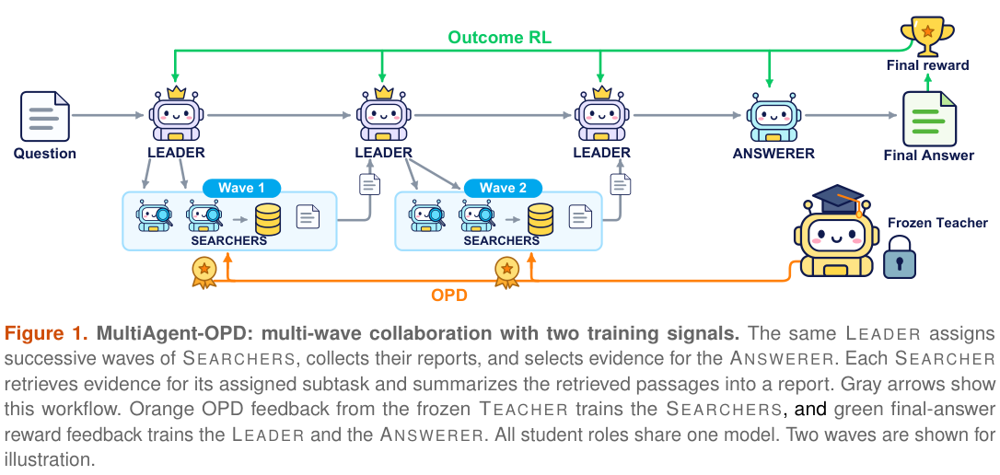

# MultiAgent-OPD: Giving hierarchical teams local supervision from a task-trained teacher

<!-- source-sha256: 0df5c877577caebf83af62e8f59bc7c4b8ec63ae6999f341ea514682038a2070 -->

[简体中文](README.md)

> **Reference only; reviewed and not reproduced because of cost.** A fixed workflow, random teacher, or single distillation operator is not an end-to-end multi-agent system. No Evolve integration.

## Paper information

| Field | Details |
| --- | --- |
| Paper links | [arXiv 2610.23234](https://arxiv.org/abs/2610.23234); [pinned v1 full text](https://arxiv.org/html/2610.23234v1) |
| Company / institution | First author Yuhan Sun lists Alibaba Group first. The entry follows the first affiliation rather than splitting by coauthors' universities. |
| First public release | 2026-10-16T10:01:52Z (UTC, arXiv v1; announced October 19) |
| Author code | The paper mentions anonymous materials. No verifiable public training-source URL or license was found in this review. |
| Code license | Unverified; a reference to anonymous materials does not establish reusable source. |
| Local adapter / method key | `multiagent-opd`; `adapter: null`, cost-deferred reference |
| Local implementation | Not implemented; no reproduction directory. Metadata: `src/auto_research/paper_specs/catalog/post-training/multiagent-opd.json`. |

## Paper summary

### Background and main changes

A hierarchical team's final answer can supervise the Leader but does not reveal whether the Searcher's retrieval and summaries helped. MultiAgent-OPD trains a teacher in a simpler Searcher–Answerer workflow, then **restarts from the same base checkpoint** to train a shared-parameter Leader–Searcher–Answerer team. The frozen teacher supplies local OPD feedback on actual student search trajectories. The Leader learns from team outcomes; the Answerer learns from its own candidate's correctness. See [Section 3](https://arxiv.org/html/2610.23234v1#S3).

~~~mermaid
flowchart LR
  A[Base model] --> B[Stage 1 trains Searcher and Answerer]
  B --> C[Frozen task-trained teacher]
  A --> D[Stage 2 reinitializes hierarchical student]
  D --> E[Leader delegates parallel subtasks]
  E --> F[Searcher retrieves and summarizes]
  F --> G[Answerer produces candidates]
  C --> H[Local Searcher OPD]
  F --> H
  G --> I[Team and candidate outcome RL]
  H --> J[Joint update of shared parameters]
  I --> J
~~~

Figure 1 shows the hierarchy, including the Stage 1 teacher and Stage 2 role division.

<!-- paper-figure:start -->
### Original paper figure

> **Paper Figure 1:** Multi-wave Leader–Searcher–Answerer workflow, with role-local OPD from the frozen teacher and outcome RL. From the [original paper](https://arxiv.org/abs/2610.23234); copyright remains with the authors. Click the image to open its source.
<!-- paper-figure:end -->

### Core equations

Searcher-generated reasoning, query, and summary tokens get detached local feedback. Environment observations are masked:

$$
A^S_t=0.01\,M_t\left(\log\pi_T(y_t\mid h)-\log\pi_{old}(y_t\mid h)\right).
$$

The teacher sees the same role prompt, subtask, retrieved passages, and generation prefix, not global gold. This log ratio is a local preference, not an identified causal contribution. The Leader uses team exact match (EM) and a capped search-activity term:

$$
R_L=0.9\,EM_{team}+0.1\,\frac{\min(C_{tool},6)}6.
$$

$C_{\mathrm{tool}}$ counts environment steps with at least one Searcher retrieval action, not raw retrieval calls. The Answerer uses its candidate's EM, normalized among candidates within the workflow. Leader and Answerer also have a 0.001 reference KL to the frozen teacher. The Searcher does not receive that same direct KL. Masks retain valid outputs by role, so shared parameters do not imply shared training signals.

### Offline and online results reported in the paper

On seven QA datasets, macro avg@4 is 38.68% versus 34.62% for Prompted Critic and 36.07% for C-MAS+RL; macro pass@4 is 48.73%. Pass@4 measures coverage of at least one correct answer in four attempts, not deployment-time answer selection. The paper records more retrieval and input processing, so the accuracy difference is not a same-cost gain. No production user A/B is reported. See [Tables 1–4 and resource use](https://arxiv.org/html/2610.23234v1#S4).

The outcome-only Searcher ablation suffers retrieval collapse. High formatting success for reports or final answers does not establish effective search. Training curves and question bootstraps are not independent training seeds.

## Local reproduction

### Cost review and data protocol

**Reviewed and not reproduced because of cost.** The base is Qwen3-4B-Instruct-2507. Two stages use 79,168 NQ and 90,447 HotpotQA examples, batches of 32 questions × 5 trajectories, multiple PPO updates, multi-wave delegation, up to 12 environment steps and five candidate answers per request, and a real search service. Evaluation uses 5,000 fixed questions in total across seven datasets, not 5,000 per dataset, with four independent workflows per method and question. Total GPU count is not explicit; no hardware count or runtime is inferred.

The setup exceeds the single-A100/A30 or Mac low-cost component budget. No weights or data were downloaded, no probe was run, and no GPU receipt is required. The task-trained teacher, real retrieval, and end-to-end joint role optimization are not implemented.

### Results, code mapping, and limits

Only method notes and cost assessment are retained: no algorithm, benchmark result, implementation directory, or runner. `implementation_status=deferred_high_cost` and `full_experiment_status=not_reproduced_high_cost`. This terminal review does not block the batch or enter an automatic retry or implementation queue. A future standalone log-ratio implementation would still not reproduce multi-agent capability.
