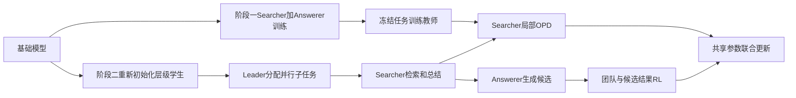
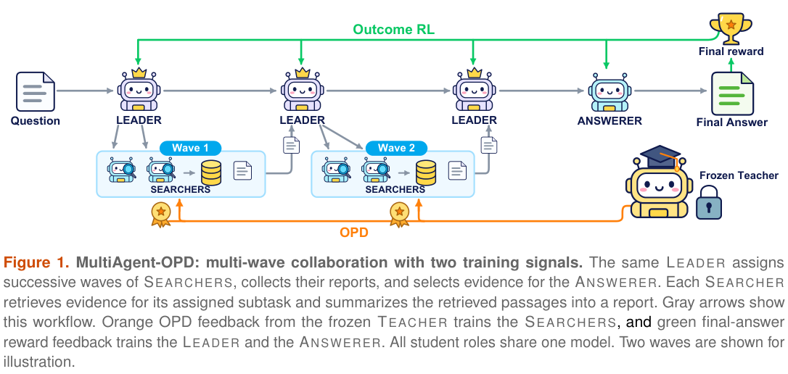

# MultiAgent-OPD：用任务训练教师给层级团队提供局部监督

> **仅收录，成本过高，不复现（审查 DONE）。** 不用固定工作流、随机教师或单个蒸馏算子冒充端到端多Agent系统；未接 Evolve。

## 论文信息

| 字段 | 内容 |
|---|---|
| 论文链接 | [arXiv 2610.23234](https://arxiv.org/abs/2610.23234)；[固定 v1 全文](https://arxiv.org/html/2610.23234v1) |
| 公司 / 机构 | 一作 Yuhan Sun 首署 Alibaba Group；按一作首机构归入阿里巴巴，不按其他作者所属学校拆分 |
| 首次公开日期 | 2026-10-16T10:01:52Z（UTC，arXiv v1；10月19日公告） |
| 原作者代码 | 正文提到匿名材料，但本轮未找到可核验的作者公开训练源码地址与许可 |
| 代码许可 | 未确认；匿名材料说明不等于已发布可复用源码 |
| 本地 adapter / 方法键 | `multiagent-opd`；`adapter: null`，高成本资料条目 |
| 本地代码位置 | **未实现，无复现代码目录**；元数据在 `src/auto_research/paper_specs/catalog/post-training/multiagent-opd.json` |

## 原始论文总结

### 背景与主要改动

层级团队的最终答案能监督Leader，却难以判断Searcher的检索、总结是否真正有效。MultiAgent-OPD先在较简单的Searcher–Answerer流程训练教师，再从**相同的基础checkpoint重新开始**训练共享参数的Leader–Searcher–Answerer团队。冻结教师为学生实际搜索轨迹提供局部OPD反馈；Leader根据团队结果、Answerer根据自己的候选正确性学习。[原文 §3](https://arxiv.org/html/2610.23234v1#S3)

原图建议：Figure 1 层级工作流；如只保留一张，应同时可读出阶段一教师和阶段二角色分工。

<!-- paper-figure:start -->
### 原论文关键图

> **原论文 Figure 1（关键图）**：MultiAgent-OPD 的多波 Leader–Searcher–Answerer 工作流及冻结教师提供的角色局部 OPD 与结果 RL 两条信号。图片来自[原论文](https://arxiv.org/abs/2610.23234)，版权归原作者所有；点击图片可查看来源。
<!-- paper-figure:end -->

### 核心公式

Searcher对学生生成的推理、查询和总结token接收停止梯度的局部反馈，环境观察被mask：

$$
A^S_t=0.01\,M_t\left(\log\pi_T(y_t\mid h)-\log\pi_{old}(y_t\mid h)\right).
$$

教师读取同一角色prompt、子任务、已检索片段与生成前缀，而不是全局gold答案。该log-ratio是局部偏好，不是已经识别的因果贡献。Leader使用团队EM及有上限的搜索活动项：

$$
R_L=0.9\,EM_{team}+0.1\,\frac{\min(C_{tool},6)}6.
$$

$C_{tool}$计数的是至少包含一个Searcher检索动作的环境步，不是原始检索调用总数。Answerer使用候选自己的EM，按工作流内部候选归一化。Leader和Answerer还有相对冻结教师的0.001参考KL；Searcher没有再叠加同样的直接KL，不能把三种角色统一成一个奖励公式。各角色采用mask保留自己的有效输出，虽然底层参数共享，训练信号并不相同。

### 论文离线与线上效果

七个问答数据集的macro avg@4为38.68%，Prompted Critic为34.62%，C-MAS+RL为36.07%；macro pass@4为48.73%。pass@4只表示四次尝试中至少一次正确的覆盖上界，不包含部署时选择正确答案的算法。论文也记录更多检索和输入处理，不能把准确率差值直接当作同成本提升。未报告生产用户线上 A/B。[原文表1–4与资源使用](https://arxiv.org/html/2610.23234v1#S4)

失败消融同样重要：仅用终局结果监督Searcher的变体出现检索崩溃，并非生成报告或最终答案的高格式成功率就等于有效搜索。训练曲线及题目bootstrap也不等于多次独立训练种子。

## 本地复现

### 成本审查与数据协议

**成本过高，不复现（审查 DONE）**。基础模型Qwen3-4B-Instruct-2507，两阶段使用79,168条NQ和90,447条HotpotQA，batch32题×5轨迹、每次多个PPO更新，层级流程包含多波委派、最多12环境步及每请求5个回答候选；还需真实搜索服务。评测是七个数据集合计固定5,000题，每个方法每题四次独立工作流，不是每数据集5,000题。原文当前配置未明确完整GPU数，不臆造显卡数量或训练时长。

上述规模明显超过单A100/A30或Mac的低成本组件预算；未下载权重或数据，未启动试跑，不要求GPU回执。任务训练教师、真实检索与端到端角色联合优化均未实现。

### 结果、代码映射与边界

本条只有方法资料和成本判断，无本地算法实现、benchmark结果、代码目录或运行命令。`implementation_status=deferred_high_cost`、`full_experiment_status=not_reproduced_high_cost`；审查终态不阻塞批次，不自动进入重试或实现队列。未来若只实现单个log-ratio函数，也不能把本条改成完整多Agent能力复现。
