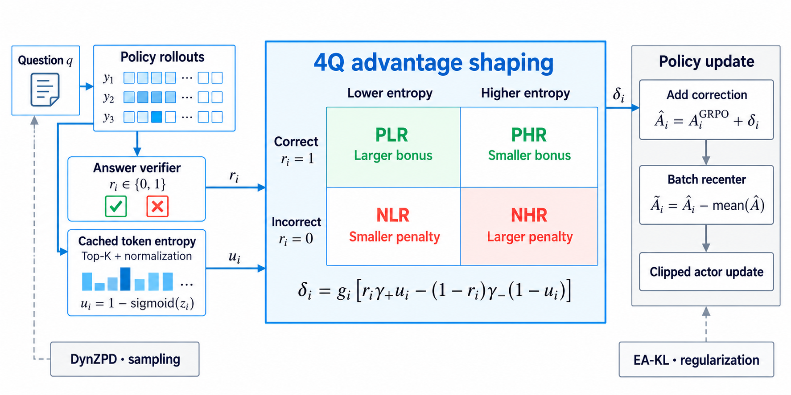

# MGE-PO: Assigning training credit with correctness and generation entropy

<!-- source-sha256: 79061d44785edab478a0b825f1d92f1fb96520f5a5f8742945638b3d78f3c2c7 -->

[简体中文](README.md)

> Reference only. **Reviewed and not reproduced because of cost.** No local implementation, metrics, capability comparison, or Evolve integration. This terminal review status does not block the review watermark.

## Paper information

| Field | Details |
| --- | --- |
| Paper links | [arXiv 2610.23245](https://arxiv.org/abs/2610.23245); [pinned v1 full text](https://arxiv.org/html/2610.23245v1) |
| Company / institution | First author Jihao Huang. The paper lists no affiliation; none is inferred from the `cylingo.com` email domain. |
| First public release | 2026-10-16T10:15:02Z (UTC, arXiv v1; announced October 19) |
| Author code | No verifiable author method repository found in this review. |
| Code license | Unverified; author source not located |
| Local adapter / method key | `mge-po`; `adapter: null`, cost-deferred reference with no executable component |
| Local implementation | Not implemented; no reproduction directory. Metadata: `src/auto_research/paper_specs/catalog/post-training/mge-po.json`. |

## Paper summary

### Background and main changes

GRPO gives same-prompt responses with the same correctness the same advantage, ignoring uncertainty during generation. MGE-PO distinguishes responses using token entropies cached at generation time. It adjusts credit across four quadrants of success/failure and high/low entropy, schedules the curriculum with online problem entropy statistics, and constrains optimization using entropy-weighted reference KL. See [Section 4 and Appendix B](https://arxiv.org/html/2610.23245v1#S4).

~~~mermaid
flowchart LR
  A[Generate with policy and cache token entropy] --> B[Summarize high-entropy response tokens]
  B --> C[Running statistics and four-quadrant credit correction]
  D[Verifiable correctness] --> C
  A --> E[Problem entropy EMA and next-round curriculum]
  C --> F[Recenter within batch]
  F --> G[PPO and entropy-weighted reference KL]
  E --> A
~~~

Figure 1 gives the method overview. Its entropy threshold illustration is not a local result.

<!-- paper-figure:start -->
### Original paper figure

> **Paper Figure 1:** The paper's method design and key components. From the [original paper](https://arxiv.org/abs/2610.23245); copyright remains with the authors. Click the image to open its source.
<!-- paper-figure:end -->

### Core equations

From the rollout policy, compute $H_t=-\sum_vp_{\mathrm{old}}(v\mid h_t)\log p_{\mathrm{old}}(v\mid h_t)$ and average over high-entropy tokens within the valid response. Standardize using the running mean and scale, then invert uncertainty as $u=1-\sigma(z)$. The default two-term correction is

$$
\Delta=g\big[r\gamma_+u-(1-r)\gamma_-(1-u)\big],\qquad
\widetilde A=A_{GRPO}+\Delta,
\qquad A=\widetilde A-\operatorname{mean}_{batch}(\widetilde A).
$$

Here $r$ is verifiable correctness and the default positive and negative correction magnitudes are 0.5 and 0.3. For truncated responses $g=0$, meaning only the **direct correction** is zero; the final advantage may not be zero after recentering. The curriculum uses a lagged problem-entropy EMA, not future rollouts to choose current problems. EA-KL has its own token weighting. Implementing the above correction alone would not reproduce MGE-PO.

### Offline and online results reported in the paper

Across three Qwen3-8B-Base optimization settings, the authors report that 4Q raises six-suite macro avg@32 by 3.23–3.69 percentage points. On Qwen2.5-7B-Base, the full setup gives four-suite macro avg@32 of 45.4% versus 41.5% for GRPO. These are author results, not local runs or validation. No production user A/B is reported. See [results and configuration limits](https://arxiv.org/html/2610.23245v1#S6).

The full-configuration comparison uses differing KL coefficients, and some ablations choose parameters on the final test set. Repeated training seeds and uncertainty statistics are incomplete, so the differences are not isolated single-factor causal effects. The denominator of the 0.4% entry in the curriculum concentration table is unclear; it does not verify a sampling bound.

## Local reproduction

### Cost review and data protocol

**The full experiment was reviewed and not reproduced because of cost.** The paper uses 2×H200 141 GB, with about 22.6 hours for one full MGE-PO run and about 22.8 for Math-7B-Instruct. The timing table does not separately identify the base-setting checkpoint; the first number should not be assigned to 8B. The 8B training separately reports 624 updates, eight epochs, and eight responses up to 20,480 tokens per problem. Qwen2.5 uses 17,398 problems and an approximately 12K generation limit. See [Appendices C and D.8](https://arxiv.org/html/2610.23245v1#A4.SS8).

The available budget is one A100 or A30 or a local Mac. The full setup clearly requires hours of training. No data or weights were downloaded, no probe was launched, and no scaled-down configuration, proxy metric, or GPU receipt was invented.

### Results, code mapping, and limits

Only metadata, method notes, author results, and the cost basis are retained. There are no local results, implementation directory, runner, or L1/L2/L3 reproduction claims. `implementation_status=deferred_high_cost` and `full_experiment_status=not_reproduced_high_cost`; the review is complete and is not queued for automatic retry or implementation.
