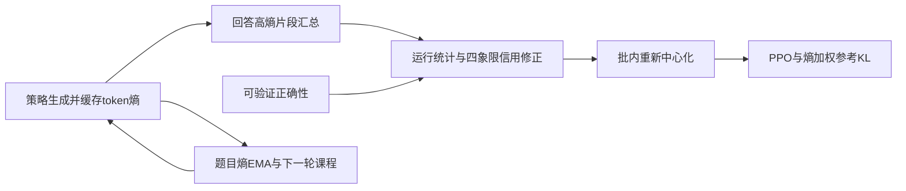
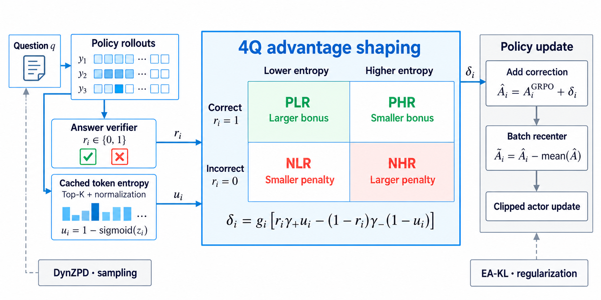

# MGE-PO：结合正确性和生成熵分配训练信用

> **仅收录，成本过高，不复现（审查 DONE）。** 无本地实现、指标或能力比较，不进入 Evolve；该终态不阻塞审查水位。

## 论文信息

| 字段 | 内容 |
|---|---|
| 论文链接 | [arXiv 2610.23245](https://arxiv.org/abs/2610.23245)；[固定 v1 全文](https://arxiv.org/html/2610.23245v1) |
| 公司 / 机构 | 一作 Jihao Huang；论文未列机构，不根据 `cylingo.com` 邮箱域名推断所属公司 |
| 首次公开日期 | 2026-10-16T10:15:02Z（UTC，arXiv v1；10月19日公告） |
| 原作者代码 | 本轮未找到可核验的原作者方法源码仓库 |
| 代码许可 | 未找到作者源码，许可未确认 |
| 本地 adapter / 方法键 | `mge-po`；`adapter: null`，高成本资料条目，无可执行组件 |
| 本地代码位置 | **未实现，无复现代码目录**；元数据在 `src/auto_research/paper_specs/catalog/post-training/mge-po.json` |

## 原始论文总结

### 背景与主要改动

GRPO会给同题、同正确性的回答相同 advantage，忽略生成的不确定性。MGE-PO 用生成时缓存的 token 熵区分回答，在成功／失败与高熵／低熵四象限上调整信用；再用在线题目熵统计安排课程，并以熵加权参考KL约束优化。[原文 §4及附录B](https://arxiv.org/html/2610.23245v1#S4)

原图建议：Figure 1 方法总览，不能把熵阈值示意图当成本地实验结果。

<!-- paper-figure:start -->
### 原论文关键图

> **原论文 Figure 1（关键图）**：展示原论文方法的总体设计和关键组成。图片来自[原论文](https://arxiv.org/abs/2610.23245)，版权归原作者所有；点击图片可查看来源。
<!-- paper-figure:end -->

### 核心公式

从生成策略得到 $H_t=-\sum_vp_{old}(v\mid h_t)\log p_{old}(v\mid h_t)$，有效响应内取高熵 token 的均值。运行均值、尺度标准化后得到不确定性反向分数 $u=1-\sigma(z)$。默认二项修正为：

$$
\Delta=g\big[r\gamma_+u-(1-r)\gamma_-(1-u)\big],\qquad
\widetilde A=A_{GRPO}+\Delta,
\qquad A=\widetilde A-\operatorname{mean}_{batch}(\widetilde A).
$$

$r$为可验证正确性，默认正／负修正幅度为0.5／0.3；截断响应的门 $g=0$。这只意味着其**直接修正**为零，批内中心化后最终 advantage 不一定为零。课程使用滞后的题目熵EMA，不从未来rollout反向选择当前题目；EA-KL还具有自己的token权重，不能只实现上述修正就宣称复现完整MGE-PO。

### 论文离线与线上效果

作者在Qwen3-8B-Base的三类优化设置上报告4Q带来的六套件macro avg@32提高3.23–3.69个百分点；Qwen2.5-7B-Base完整配置的四套件macro avg@32为45.4%，GRPO为41.5%。这是作者结果，本地没有运行或验证。未报告生产用户线上 A/B。[作者结果与配置边界](https://arxiv.org/html/2610.23245v1#S6)

完整配置比较中的KL系数不同，部分消融又在最终测试集选参数；重复训练种子和误差统计并不完整，不能把相关差值解释为已经隔离的单因素因果收益。论文课程集中度表中0.4%条目的分母未明确，也不宜据此声称已验证某个采样上界。

## 本地复现

### 成本审查与数据协议

**成本过高，不复现（审查 DONE）**。原实验硬件为2×H200 141GB，完整单次MGE-PO记录约22.6小时，另有Math-7B-Instruct约22.8小时；该计时表的base setting没有单独checkpoint标识，不能强指为8B配置。8B训练另报告624次更新、8epochs、每题8条最长20,480 token回答；Qwen2.5系列使用17,398题和约12k生成上限。[附录C与D.8](https://arxiv.org/html/2610.23245v1#A4.SS8)

可用资源是一张A100或A30，或本地Mac；完整配置明显需要小时级长训练。未下载数据／权重，未启动试跑，未制造缩小配置、代理指标或GPU回执。

### 结果、代码映射与边界

仅保存论文元数据、方法说明、作者结果及成本依据；无本地结果，无实现目录，无命令入口，无L1/L2/L3复现声明。`implementation_status=deferred_high_cost`、`full_experiment_status=not_reproduced_high_cost`，审查已完成，不进入自动重试或待实现队列。
