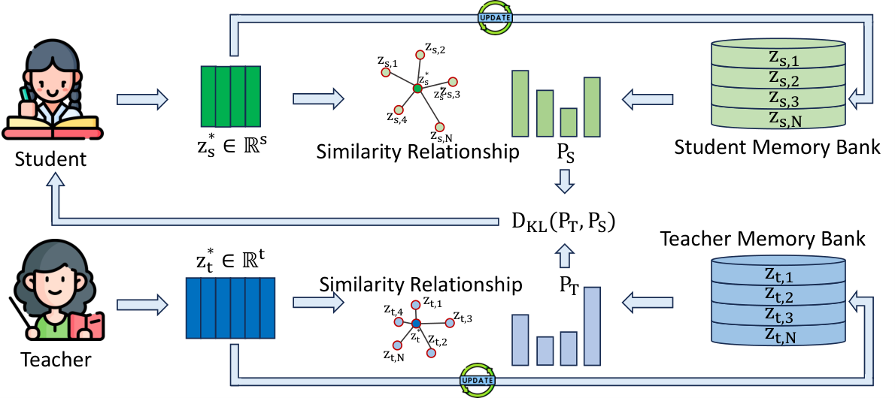

# SimOPD: Matching response relationships in separate representation spaces

<!-- source-sha256: 80aedc14d94e4d836ea201d78ce845120210026bfa57b3d441d9eafbab532516 -->

[简体中文](README.md)

> **L1 defining component and gradient diagnostic, not a result about large-model knowledge transfer.** The full experiment was reviewed and not reproduced because of cost. No Evolve integration or promotion eligibility.

## Paper information

| Field | Details |
| --- | --- |
| Paper links | [arXiv 2610.23306](https://arxiv.org/abs/2610.23306); [pinned v1 full text](https://arxiv.org/html/2610.23306v1) |
| Company / institution | First author Kai Tang lists Zhejiang University first; collaboration with Ant Group. The catalog uses the first affiliation. |
| First public release | 2026-10-16T11:10:21Z (UTC, arXiv v1; announced October 19) |
| Author code | No verifiable author method repository found in this review. Third-party paper lists are not author implementations. |
| Code license | Unverified; author source not located |
| Local adapter / method key | `simopd`; `adapter: null`, standalone defining component |
| Local implementation | [`src/auto_research/post_training/sim_opd.py`](https://github.com/daiwk/auto-research/blob/main/src/auto_research/post_training/sim_opd.py) |
| Runner | [`scripts/run_oct19_evening_post_components.py`](https://github.com/daiwk/auto-research/blob/main/scripts/run_oct19_evening_post_components.py) |

## Paper summary

### Background and main changes

Probability distillation sees only output distributions. Direct hidden-state matching requires the student to fit the teacher's coordinates and width. SimOPD instead compares relationships among responses: both models encode the same student responses, compute how similar each current response is to historical ones in their own spaces, and match the resulting distributions. Teacher and student widths can differ without any cross-model projection. See [Section 3 and Algorithm 1](https://arxiv.org/html/2610.23306v1#S3).

~~~mermaid
flowchart LR
  A[Student generates responses] --> B[Student response hidden states]
  A --> C[Frozen teacher replays the same responses]
  B --> D[Student similarities to its paired FIFO bank]
  C --> E[Teacher similarities to its paired FIFO bank]
  E --> F[Forward KL]
  D --> F
  F --> G[Update only student]
  G --> H[Enqueue paired pre-update representations]
~~~

Figure 2 shows the method, including the paired bank and two independent representation spaces.

<!-- paper-figure:start -->
### Original paper figure

> **Paper Figure 2:** The paper's overall design and components. From the [original paper](https://arxiv.org/abs/2610.23306); copyright remains with the authors. Click the image to open its source.
<!-- paper-figure:end -->

### Core equations

Normalize each hidden state at a selected layer and response position before averaging:

$$
z_M(y)=\frac1{|\mathcal L||y|}\sum_{\ell\in\mathcal L,t\in y}
\frac{h_{M,\ell,t}}{\|h_{M,\ell,t}\|_2}.
$$

For ordered paired banks of past responses:

$$
P_M(j\mid y)=\operatorname{softmax}_j
\left(\frac{\cos(z_M(y),B_{M,j})}{\tau}\right),\qquad
\mathcal L_{SimOPD}=D_{KL}(P_T\Vert P_S).
$$

Differentiate only the current student representation. The teacher query and both history banks are frozen. The first batch warms up the bank without an update. After optimization, enqueue detached pairs **extracted before the update** and evict synchronously in FIFO order. A single bank item creates a constant one-point distribution with no useful relational signal; the component rejects such updates.

### Offline and online results reported in the paper

The authors report maximum overall-average gains of 2.6 and 3.1 percentage points over the strongest baselines for same- and cross-architecture settings respectively. Not every task improves. Standalone cross-architecture SimOPD scores 49.1 on MBPP versus 53.4 for OPD and makes more formatting errors. Combined distillation helps some of these issues. These capability metrics were not reproduced locally. No production user A/B is reported. See the [experiments and limitations](https://arxiv.org/html/2610.23306v1#S4).

## Local reproduction

### Data protocol and execution

Randomly initialized causal GRUs use a 16-token vocabulary, student width 8, and frozen teacher width 12, selecting embeddings and recurrent states as the two layers. The student generates responses autoregressively. The teacher sees the same public prompt and response, with neither human gold nor replacement responses generated by the teacher. Batches have four responses and bank capacity is six. The first batch is warm-up, followed by three real optimizer updates by default. The random teacher checks the relational path, not pretrained knowledge or natural-language teaching capability.

~~~bash
PYTHONPATH=src python scripts/run_oct19_evening_post_components.py \
  --methods simopd --device cuda --seeds 42,43,44 \
  --output runs/simopd-component.json
~~~

Use `--device cpu` for local CPU diagnostics; unavailable CUDA fails. The result cannot be overwritten and records paired response IDs, warm-up, FIFO ordering before and after, source SHA256, the full commit, and per-seed gradients.

### Results, code mapping, and limits

`pool_response_states` normalizes tokens before pooling. `PairedMemoryBank` stores paired frozen representations of differing dimensions. `loss` computes only forward KL between the relation distributions. A separate Python cosine and softmax reference checks the loss; misaligning only the teacher bank is a negative control. Tests verify zero teacher gradients, no warm-up update, and enqueueing pre-update states.

Targeted CPU tests and real A100 runs for seeds 42/43/44 passed. Frozen source `73a1e8b8` produced three tiny student updates per seed and passed the relation KL reference, pair-misalignment negative control, pre-update FIFO, and frozen-teacher checks. The [per-seed CUDA artifact](metrics/component-cuda-seeds42-44.json) and [A100 receipt](../../gpu-validations/simopd-a100-20261019.json) do not establish task capability of a pretrained teacher or student.

**Full experiment: reviewed, not reproduced.** The paper uses 8×A100 80 GB for 200 steps. The reported same-architecture configuration runs at about 87.20 seconds per step, roughly 4.84 hours for one configuration before full warm-up, evaluation, and saving. It includes a 4B teacher and a cross-architecture 8B teacher, 4,096-token responses, and bank capacity 2,048. No weights were downloaded and no full training ran on the single-A100/A30 or Mac budget. Joint token-level OPD, real math and coding benchmarks, and Evolve promotion are not implemented.
