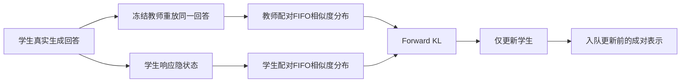
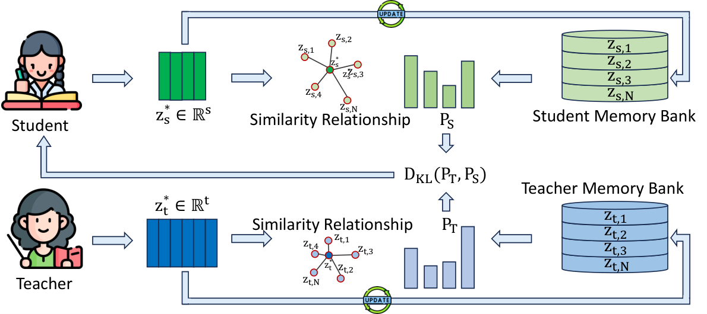

# SimOPD：在各自表示空间匹配回答之间的关系

> **L1 定义性组件／梯度诊断，不是大模型知识迁移结果。** 完整实验成本过高，不复现（审查 DONE）；不可晋级，未接 Evolve。

## 论文信息

| 字段 | 内容 |
|---|---|
| 论文链接 | [arXiv 2610.23306](https://arxiv.org/abs/2610.23306)；[固定 v1 全文](https://arxiv.org/html/2610.23306v1) |
| 公司 / 机构 | 一作 Kai Tang 首署 Zhejiang University；与 Ant Group 合作，按首机构归入浙江大学 |
| 首次公开日期 | 2026-10-16T11:10:21Z（UTC，arXiv v1；10月19日公告） |
| 原作者代码 | 本轮未找到可核验的原作者方法源码仓库，不把第三方论文列表标成作者开源实现 |
| 代码许可 | 未找到作者源码，源码许可未确认 |
| 本地 adapter / 方法键 | `simopd`；`adapter: null`，独立定义性组件 |
| 本地代码位置 | [`src/auto_research/post_training/sim_opd.py`](https://github.com/daiwk/auto-research/blob/main/src/auto_research/post_training/sim_opd.py) |
| 运行入口 | [`scripts/run_oct19_evening_post_components.py`](https://github.com/daiwk/auto-research/blob/main/scripts/run_oct19_evening_post_components.py) |

## 原始论文总结

### 背景与主要改动

概率蒸馏只利用输出分布，直接匹配隐状态又要求学生迁就教师的坐标和维数。SimOPD 改为比较回答之间的关系：两模型分别编码同一批学生回答，在自己的空间里计算“当前回答与历史回答有多像”，再匹配这两个相似度分布。教师和学生维数可不同，不需要跨模型投影。[原文 §3及算法1](https://arxiv.org/html/2610.23306v1#S3)



原图建议：Figure 2 方法图，重点保留 paired bank 和两个独立表示空间。

<!-- paper-figure:start -->
### 原论文关键图

[](https://arxiv.org/html/2610.23306v1/method2.png)

> **原论文 Figure 2（关键图）**：展示原论文方法的总体设计和关键组成。图片来自[原论文](https://arxiv.org/abs/2610.23306)，版权归原作者所有；点击图片可查看来源。
<!-- paper-figure:end -->

### 核心公式

先对选定层和响应位置的每个隐状态做单位化，再取均值：

$$
z_M(y)=\frac1{|\mathcal L||y|}\sum_{\ell\in\mathcal L,t\in y}
\frac{h_{M,\ell,t}}{\|h_{M,\ell,t}\|_2}.
$$

对同序的配对历史回答 bank：

$$
P_M(j\mid y)=\operatorname{softmax}_j
\left(\frac{\cos(z_M(y),B_{M,j})}{\tau}\right),\qquad
\mathcal L_{SimOPD}=D_{KL}(P_T\Vert P_S).
$$

只对当前学生表示求导；教师 query 和两侧历史 bank 均冻结。第一批只暖启动 bank，不更新学生。优化后入队的是**优化前提取**的 detached 成对表示，按 FIFO 同步淘汰。一个 bank 元素只产生恒定的单点分布，不能作为有效关系监督；本组件明确拒绝这种更新。

### 论文离线与线上效果

作者报告同架构和跨架构设置的总体平均较最强基线最多分别提升2.6和3.1个百分点，但不是所有单任务都改善：跨架构独立 SimOPD 的 MBPP 为49.1，OPD为53.4，格式错误率也更高；组合蒸馏改善了部分问题。本地不复现这些能力指标。未报告生产用户线上 A/B。[原文实验与局限](https://arxiv.org/html/2610.23306v1#S4)

## 本地复现

### 数据协议与运行

随机初始化16词表因果 GRU，学生8维、冻结教师12维，选择 embedding 和循环状态两个层次。学生实际自回归生成回答，教师读取同一公开 prompt 与回答，不提供人工 gold 或教师生成的替代回答。每批4个回答，bank容量6，首批暖启动，之后默认3次真实优化更新。随机教师仅用来检查关系蒸馏路径，不具备预训练知识或自然语言教师能力。

```bash
PYTHONPATH=src python scripts/run_oct19_evening_post_components.py \
  --methods simopd --device cuda --seeds 42,43,44 \
  --output runs/simopd-component.json
```

可用 `--device cpu` 做本地诊断；CUDA 不可用则失败。结果不可覆盖，保存配对回答 ID、暖启动标记、FIFO前后顺序、源码 SHA256、完整 commit 和逐 seed 梯度。

### 结果、代码映射与边界

`pool_response_states` 保留 token 先归一化再池化的顺序；`PairedMemoryBank` 保存不同维数的成对冻结表示；`loss` 只计算两个关系分布的 forward KL。独立 Python cosine／softmax 参考核对损失，教师 bank 单边错位为负对照；同时验证教师零梯度、暖启动零更新和预更新表示入队。

CPU 专项测试与真实 A100 seeds 42/43/44 均已通过；固定源码 `73a1e8b8` 下每 seed 三次实际微型学生更新，关系 KL 参考、配对错位负对照、更新前 FIFO 和教师冻结检查通过。[CUDA逐seed产物](metrics/component-cuda-seeds42-44.json)、[A100回执](../../gpu-validations/simopd-a100-20261019.json)不代表预训练教师或学生的任务能力。

**完整实验不复现（审查 DONE）：** 原文使用8×A100 80GB、200步，所报告同架构配置约87.20秒/步，单配置约4.84小时，尚未计完整暖启动、评估和保存；包含4B教师以及跨架构8B教师、4,096-token回答和2,048容量bank。本轮单A100/A30或Mac预算不运行该训练，不下载权重。未接完整 token OPD 联合训练、真实数学／代码benchmark或Evolve晋级。
