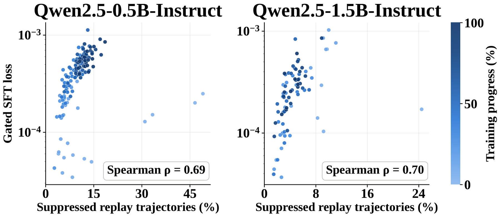

# TAR: Replaying only base-model behaviors suppressed by the current policy

<!-- source-sha256: d2aaf3b7d71dd8191e8458db6ecb30ec347ac3770f8ad1e8e7864e1ba784c269 -->

[简体中文](README.md)

> **L1 defining component and gradient diagnostic, not a reproduction of mathematical reasoning or semantic diversity.** The full experiment was reviewed and not reproduced because of cost. No Evolve integration or promotion eligibility.

## Paper information

| Field | Details |
| --- | --- |
| Paper links | [arXiv 2610.24236](https://arxiv.org/abs/2610.24236); [pinned v1 full text](https://arxiv.org/html/2610.24236v1) |
| Company / institution | First author Wen-Zhi Li, Cornell University; categorized by first author's first affiliation |
| First public release | 2026-10-16T21:04:19Z (UTC, arXiv v1; announced October 20) |
| Author code | [Official TAR repository](https://github.com/wenzhilics/tar), including the verl-based `recipe/tar` training and memory-bank construction code |
| Code license | Apache-2.0, preserving separate license boundaries for upstream verl and other dependencies |
| Local adapter / method key | `tar-adaptive-replay`; `adapter: null`, standalone defining component |
| Local code | [`src/auto_research/post_training/tar.py`](https://github.com/daiwk/auto-research/blob/main/src/auto_research/post_training/tar.py) |
| Runner | [`scripts/run_oct20_post_components.py`](https://github.com/daiwk/auto-research/blob/main/scripts/run_oct20_post_components.py) |

## Paper summary

### Background and main changes

Limited on-policy sampling may gradually suppress reasoning modes that are correct but less frequent. Reweighting current rollouts alone cannot readily recover modes the policy no longer samples. TAR draws many samples from the base policy, filters for correct responses, and retains dispersed prototype trajectories. Training replays only trajectories suppressed relative to the base policy and focuses the gradient on suppressed tokens within them. This avoids continuously imitating a limited bank at the expense of adaptation. See [Sections 3–4](https://arxiv.org/html/2610.24236v1#S4).

~~~mermaid
flowchart LR
  A[Actual sampling from the base policy] --> B[Training verifier keeps correct trajectories]
  B --> C[Semantic embeddings and cosine FPS prototypes]
  C --> D[Rescore with frozen base and current policy]
  D --> E[Soft trajectory gate]
  D --> F[Soft token weights]
  E --> G[Weighted NLL with both weights detached]
  F --> G
  H[Current-policy GRPO] --> I[Joint parameter update]
  G --> I
~~~

Figure 3 analyzes the proportion of suppressed trajectories and gated replay loss. The paper does not give a full architecture diagram; the Mermaid diagram above redraws the method, not the original figure.

<!-- paper-figure:start -->
### Original paper figure

> **Paper Figure 3:** Relationship between the fraction of suppressed replay trajectories and gated SFT loss. This scatter plot analyzes the mechanism, not the architecture or local training outcomes. From the [original paper](https://arxiv.org/abs/2610.24236); copyright remains with the authors. Click the image to open its source.
<!-- paper-figure:end -->

### Core equations

Memory candidates must come from actual base-policy generations and pass a training verifier. The paper uses BGE-M3 representations and cosine farthest-point sampling (FPS) to keep at most three trajectories per problem. No bank is created for a problem with no correct candidates. Replay is defined as

$$
\delta_t=\log p_{base}(y_t\mid h_t)-\log p_\theta(y_t\mid h_t),\quad
\phi(z)=\max(1-e^{-z},0),\quad
g=\phi\!\left(\frac1T\sum_t\delta_t\right),\quad w_t=\phi(\delta_t).
$$

$$
L_{rep}=\frac1{|B_{rep}|}\sum_{\tau\in B_{rep}}
\operatorname{sg}[g(\tau)]
\frac{\sum_t\operatorname{sg}[w_t]\bigl(-\log p_\theta(y_t\mid h_t)\bigr)}{10^{-8}+\sum_t\operatorname{sg}[w_t]},\qquad
L_{total}=L_{GRPO}+\lambda_{rep}L_{rep}.
$$

The default is $\lambda_{\mathrm{rep}}=1$. Both the gate and token weights are detached. Without suppression, replay is zero. Average over every sampled bank trajectory, including zero-gate trajectories, rather than renormalizing over active trajectories or prompts. The implementation uses $-\operatorname{expm1}(-\max(z,0))$ to compute the same soft gate stably. FP16/BF16 loss calculations are promoted to FP32 internally so the $10^{-8}$ denominator does not underflow when all weights are zero.

### Offline and online results reported in the paper

On six benchmarks, the authors report mean pass@1 / pass@8 of 41.2 / 61.1 for the 1.5B model, versus 37.9 / 60.2 for GRPO. The 0.5B results are 24.9 / 46.9 versus 24.8 / 45.4. Not every task improves: for example, the 0.5B GSM8K pass@1 is below GRPO. Pass@8 measures coverage over eight attempts, not deployment success when a system must select the correct answer. The reasoning and diversity results are from the authors, not local reproduction. No production user A/B test is reported. See [Tables 1–3](https://arxiv.org/html/2610.24236v1#S5).

## Local reproduction

### Data protocol and execution

A randomly initialized GRU uses a 16-token vocabulary and hidden width of 8. The base is a frozen copy of the initial policy. It samples eight actual responses per public prompt. After an external synthetic verifier checks them, FPS on actual base hidden states keeps up to three. Gold, template answers, and hand-written candidates are not used to fill the bank. Those randomly initialized hidden states are **not semantic encodings**: they test the FPS definition, not coverage of semantic reasoning modes.

The current policy generates two groups of six responses and performs a small GRPO update, with full-vocabulary base-reference KL and TAR replay added. Across three updates the runner records whether replay actually activates and what gradients it contributes. The actor does not read verifier outputs, and the base receives no gradient.

~~~bash
PYTHONPATH=src python scripts/run_oct20_post_components.py \
  --methods tar-adaptive-replay --device cuda --seeds 42,43,44 \
  --output runs/tar-component.json
~~~

The same entry point supports CPU diagnostics. CUDA requests do not fall back to CPU when CUDA is unavailable. Output is not overwritten and preserves actual base candidates, training-verifier bits, FPS indices, gates and token weights for each update, source SHA256, and the full commit. The pinned recipe is `synthetic:oct20-tar-adaptive-replay-v1`.

### Results, code mapping, and limits

`farthest_point_prototypes` accepts explicit embeddings and correctness observations and provides neither an encoder nor a verifier. `adaptive_replay_loss` implements the detached soft gate, detached token weights, and weighted NLL. Independent Python formulas and analytical gradients serve as checks; constant SFT is a negative control. Tests cover filtering incorrect candidates, no correct candidates, zero gates, token locality, padding, and extreme FP16/FP32/FP64 differences. Positive log probabilities at active positions and vectors whose norms overflow are rejected rather than producing negative replay losses or spurious cosine orderings.

The core path ran on CPU for three seeds. CUDA results are recorded in the [per-seed artifact](metrics/component-cuda-seeds42-44.json) and [A100 receipt](../../gpu-validations/tar-adaptive-replay-a100-20261020.json). Replay loss and synthetic success bits do not measure mathematical capability or diversity gains.

**Full experiment: reviewed, not reproduced.** The paper samples 128 base responses for each of 7,500 problems and uses BGE-M3 to build the bank. The 0.5B and 1.5B configurations use 2×A6000 and 2×A100 respectively, for five and three epochs. The reported runtime is under 15 hours per run, at most 30 GPU-hours, not a fixed 15 hours each time. The full training and six-benchmark matrix does not fit a single A100 or A30 or local Mac. No models or data were downloaded, no probe was launched, and no Evolve integration was added.
