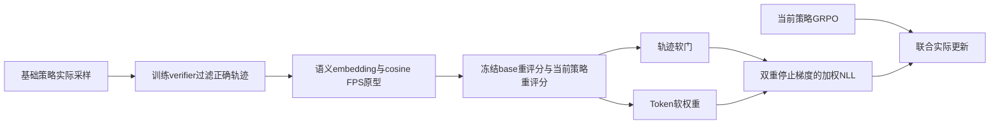
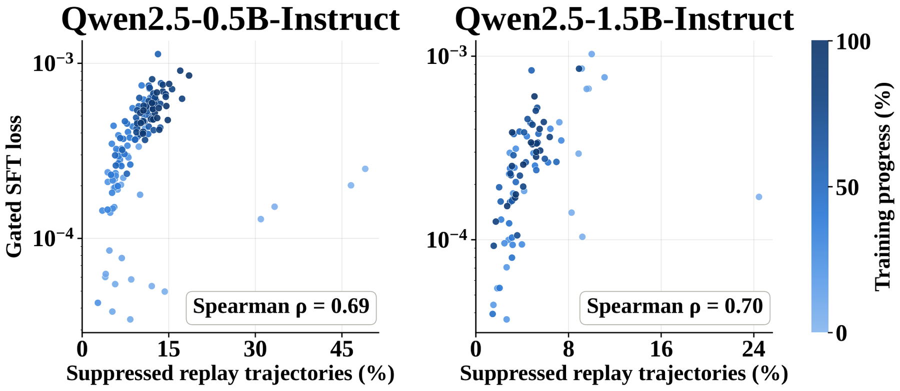

# TAR：只重放被当前策略压制的基础模型行为

> **L1 定义性组件／梯度诊断，不是数学推理或语义多样性复现。** 完整实验成本过高，不复现（审查 DONE）；不可晋级，未接Evolve。

## 论文信息

| 字段 | 内容 |
|---|---|
| 论文链接 | [arXiv 2610.24236](https://arxiv.org/abs/2610.24236)；[固定v1全文](https://arxiv.org/html/2610.24236v1) |
| 公司 / 机构 | 一作Wen-Zhi Li，Cornell University；按一作首机构归入康奈尔大学 |
| 首次公开日期 | 2026-10-16T21:04:19Z（UTC，arXiv v1；10月20日公告） |
| 原作者代码 | [作者官方TAR仓库](https://github.com/wenzhilics/tar)，已有基于verl的`recipe/tar`训练与memory-bank构建代码 |
| 代码许可 | Apache-2.0，保留上游verl及其他依赖的独立许可边界 |
| 本地 adapter / 方法键 | `tar-adaptive-replay`；`adapter: null`，独立定义性组件 |
| 本地代码位置 | [`src/auto_research/post_training/tar.py`](https://github.com/daiwk/auto-research/blob/main/src/auto_research/post_training/tar.py) |
| 运行入口 | [`scripts/run_oct20_post_components.py`](https://github.com/daiwk/auto-research/blob/main/scripts/run_oct20_post_components.py) |

## 原始论文总结

### 背景与主要改动

有限on-policy采样可能逐步压低同样正确但较少出现的推理模式；仅在当前rollout上重加权，难以恢复已经采不到的模式。TAR先从基础策略大量生成，过滤正确回答，再保留分散的原型轨迹。训练时只重放相对base已经被压制的轨迹，并将梯度集中到其中被压制的token，避免始终模仿有限bank限制策略适应。[原文§3–4](https://arxiv.org/html/2610.24236v1#S4)



原图建议：Figure 3压制比例与gated replay loss的机制分析图；原文未提供完整架构图，以上Mermaid是方法重绘，不冒充原图。

<!-- paper-figure:start -->
### 原论文关键图

[](https://arxiv.org/html/2610.24236v1/gate.png)

> **原论文 Figure 3（关键图）**：原论文中被压制重放轨迹比例与门控SFT损失的关系；是方法机制分析散点，不是架构图或本地训练效果。图片来自[原论文](https://arxiv.org/abs/2610.24236)，版权归原作者所有；点击图片可查看来源。
<!-- paper-figure:end -->

### 核心公式

记忆候选必须来自base实际生成，并通过训练verifier；原文用BGE-M3表征，cosine FPS每题最多留3条，没有正确候选则不建该题bank。重放定义为：

$$
\delta_t=\log p_{base}(y_t\mid h_t)-\log p_\theta(y_t\mid h_t),\quad
\phi(z)=\max(1-e^{-z},0),\quad
g=\phi\!\left(\frac1T\sum_t\delta_t\right),\quad w_t=\phi(\delta_t).
$$

$$
L_{rep}=\frac1{|B_{rep}|}\sum_{\tau\in B_{rep}}
\operatorname{sg}[g(\tau)]
\frac{\sum_t\operatorname{sg}[w_t]\bigl(-\log p_\theta(y_t\mid h_t)\bigr)}{10^{-8}+\sum_t\operatorname{sg}[w_t]},\qquad
L_{total}=L_{GRPO}+\lambda_{rep}L_{rep}.
$$

默认 $\lambda_{rep}=1$。gate与token权重都detach；没有压制时零重放。按全部bank轨迹平均，包括零gate轨迹，不按活跃轨迹或prompt重新归一化。实现用 $-\operatorname{expm1}(-\max(z,0))$ 稳定计算同一软门；FP16/BF16损失内部升至FP32，避免零权重下 $10^{-8}$ 分母下溢。

### 论文离线与线上效果

作者1.5B模型六benchmark平均pass@1／pass@8为41.2／61.1，GRPO为37.9／60.2；0.5B为24.9／46.9，GRPO为24.8／45.4。并非所有任务都提高，例如0.5B的GSM8K pass@1低于GRPO。pass@8是八次尝试的覆盖率，不等于可以选出正确答案的部署成功率。上述推理与多样性均为作者结果，未本地复现；未报告生产用户线上A/B。[原文表1–3](https://arxiv.org/html/2610.24236v1#S5)

## 本地复现

### 数据协议与运行

随机初始化16词表、8维GRU，base为当前初始策略的冻结副本。每个公开prompt实际采8个回答，外部合成verifier检查后，在base真实隐状态上做FPS并保留至多3条；未用gold、模板答案或手写候选填充bank。该随机初始隐状态**不是语义encoder**，只能验证FPS的定义，不能说明语义推理模式覆盖。

当前策略实际生成两组各6条回答并做小型GRPO，另加全词表base参考KL和TAR重放；三次更新中记录重放是否真正激活及其梯度。actor不读取verifier结果，base不接收梯度。

```bash
PYTHONPATH=src python scripts/run_oct20_post_components.py \
  --methods tar-adaptive-replay --device cuda --seeds 42,43,44 \
  --output runs/tar-component.json
```

CPU可用同入口诊断；CUDA不可用不回退。结果不可覆盖，保存真实base候选、训练verifier位、FPS索引、逐次gate／token权重、源码SHA256及完整commit；固定配方`synthetic:oct20-tar-adaptive-replay-v1`。

### 结果、代码映射与边界

`farthest_point_prototypes`只处理显式embedding和正确性观察，不提供编码器或verifier；`adaptive_replay_loss`执行双detach软门与加权NLL。独立Python公式和解析梯度核对，恒定SFT为负对照；测试覆盖非正确候选排除、无正确候选、零gate、token局部性、padding及FP16/32/64极端差值。有效位置的正数log概率和范数溢出的向量都会明确拒绝，不把非法输入变成负重放损失或虚假的cosine排序。

CPU三seed核心路径已运行；CUDA结果以[逐seed产物](metrics/component-cuda-seeds42-44.json)和[A100回执](../../gpu-validations/tar-adaptive-replay-a100-20261020.json)为准，不将重放loss或合成成功位写成数学能力、多样性提升。

**完整实验不复现（审查 DONE）：** 原文7500题×每题128次base采样、BGE-M3建bank；0.5B／1.5B分别用2×A6000／2×A100、5／3epochs，报告每run在15小时以内、最多30GPU-hours，并非每次固定15小时。单A100或A30／Mac不承担该完整训练与六benchmark矩阵；本轮不下载模型或数据、不试跑、不接Evolve。
