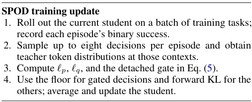

# SPOD: Preserving successful student choices that the teacher does not favor

<!-- source-sha256: fc77c99d7ef92137fe29e15080e6d79fbf955f5b51af0f0622cc6cfd786d8ff9 -->

[简体中文](README.md)

> **L1 defining component and gradient diagnostic, not a reproduction of agent capability.** The full experiment was reviewed and not reproduced because of cost. No Evolve integration or promotion eligibility.

## Paper information

| Field | Details |
| --- | --- |
| Paper links | [arXiv 2610.25034](https://arxiv.org/abs/2610.25034); [pinned v1 full text](https://arxiv.org/html/2610.25034v1) |
| Company / institution | First author Jike Zhong lists the University of Southern California first. Other authors include the University of Florida and Amazon AGI. The catalog uses the first author's first affiliation. |
| First public release | 2026-10-18T05:44:26Z (UTC, arXiv v1). Announced October 20, not first released then. |
| Author code | The [official SPOD repository](https://github.com/Jike338/SPOD) includes `configs`, `spod` training code, and `sgate` method code. |
| Code license | MIT, as stated in the repository LICENSE rather than inferred from the paper's license. |
| Local adapter / method key | `spod`; `adapter: null`, standalone defining component |
| Local code | [`src/auto_research/post_training/spod.py`](https://github.com/daiwk/auto-research/blob/main/src/auto_research/post_training/spod.py) |
| Runner | [`scripts/run_oct20_post_components.py`](https://github.com/daiwk/auto-research/blob/main/scripts/run_oct20_post_components.py) |

## Paper summary

### Background and main changes

In multi-turn agent distillation, the student may first surpass the teacher, then regress as imitation continues. The authors separate two processes: the teacher repairs weak student decisions but can erode behavior that already works when student and teacher preferences differ. SPOD protects a decision only within a successful training episode and only when the teacher assigns its full action a lower probability. It removes distillation pressure at that decision and applies a soft probability floor to counter indirect erosion from updates at other states. All other decisions are distilled normally. See [Sections 3–4](https://arxiv.org/html/2610.25034v1#S4).

~~~mermaid
flowchart LR
  A[Student generates training trajectories] --> B[External environment returns episode success]
  A --> C[Teacher replays the same history and action]
  C --> D[Compare raw probabilities of the full action]
  B --> E[Gate on success and lower teacher support]
  D --> E
  E --> F[Replace KL with a soft floor at protected decisions]
  E --> G[Keep full-vocabulary forward KL elsewhere]
  F --> H[Average over tokens, states, and episodes]
  G --> H
~~~

Appendix Figure 9 shows the training pipeline. Figure 1 illustrates overshoot and the repair-versus-erosion pattern. Neither figure is a local result.

<!-- paper-figure:start -->
### Original paper figure

> **Paper Figure 9:** Update pseudocode. Roll out the current student, obtain success feedback for training episodes, recompute the gate, and use a soft probability floor for protected actions or forward KL elsewhere. It is not an architecture diagram or a local capability result. From the [original paper](https://arxiv.org/abs/2610.25034); copyright remains with the authors. Click the image to open its source.
<!-- paper-figure:end -->

### Core equations

For action $a=(a_1,\ldots,a_n)$, including the native end token, use model probabilities **before applying temperature or action constraints**:

$$
\ell_p=\sum_j\log p_\theta(a_j\mid h_j),\quad
\ell_q=\sum_j\log q(a_j\mid h_j),\quad
g=\mathbf1\{R_{episode}=1\land\ell_q<\ell_p\}.
$$

$$
L_{floor}=\frac1n[\log\tau_0-\ell_p]_+,\qquad
L=(1-g)\frac1n\sum_jD_{KL}(q_j\Vert p_{\theta,j})+\lambda gL_{floor}.
$$

The defaults are $\tau_0=.5$ and $\lambda=1$. Recompute the gate from current scores before each update and hold it fixed while differentiating. The teacher and sampled history are detached. Average over tokens within each action, states within each episode, and finally over episodes, so longer actions or episodes with more states do not get more weight.

Protection applies to an entire action, not to independently selected tokens or all decisions in a successful episode. A soft floor is not a hard probability guarantee in a shared-parameter network; gradients from other states can still affect the action. Keeping the KL and adding the floor would not implement SPOD.

### Offline and online results reported in the paper

Across three environments, the Qwen3.5-2B ← 27B overall score rises from 53.3% with ordinary OPD to 65.7%; Gemma-4-E4B ← 31B rises from 56.0% to 66.2%. The main method and ordinary OPD use three training seeds, while some other baselines use only one. The authors call checkpoint selection by peak evaluation performance an oracle; it is not a deployable early-stopping rule. These are full-model results from interactive environments and were not reproduced locally. No production user A/B test is reported. See [Table 1 and the reproduction notes](https://arxiv.org/html/2610.25034v1#S5).

## Local reproduction

### Data protocol and execution

A randomly initialized causal GRU with a 16-token vocabulary and hidden width of 8 samples actual multi-state episodes. An independently initialized, frozen random teacher replays and scores the same student actions. An explicit synthetic environment returns a training success bit only at the end of each episode. The actor sees only public history, its own actions, and public observation IDs; it receives no success bit, gold answer, or evaluation result. Fixed-length synthetic actions are not ALFWorld, WebShop, or ScienceWorld language actions.

~~~bash
PYTHONPATH=src python scripts/run_oct20_post_components.py \
  --methods spod --device cuda --seeds 42,43,44 \
  --output runs/spod-component.json
~~~

Use `--device cpu` for CPU. CUDA unavailability causes an explicit failure. The default is three actual updates per seed, with a maximum of eight. No downloads, pretrained weights, or APIs are used. Output cannot be overwritten and includes SHA256 for the runner and three modules, the full commit, per-seed results, and a small action audit. The pinned recipe is `synthetic:oct20-spod-v1`.

### Results, code mapping, and limits

`success_preserving_loss` computes the full-vocabulary KL, sequence-level gate, soft floor, and three-level averaging. An independent Python scalar reference reconstructs the gate and loss; retaining KL at protected positions is the negative control. Regression tests verify that failed episodes receive no protection, the end token is included, the local floor gradient is zero above the floor, padding is isolated, and extreme FP16 logits are handled.

The core path ran for three CPU seeds. CUDA validation is documented in the [per-seed artifact](metrics/component-cuda-seeds42-44.json) and [A100 receipt](../../gpu-validations/spod-a100-20261020.json). A random teacher does not provide meaningful guidance. Loss, protection counts, and gradient norms are not agent success rates.

**Full experiment: reviewed, not reproduced.** The authors use 27B/31B teachers and 2B/E4B students with two GPUs for generation, teacher scoring, and training. The protocol spans three interactive environments, 40–50 updates with 72 questions per update, at most eight decisions per episode, multiple training seeds, and frequent full evaluations. The single-A100/A30 or Mac budget does not cover the full matrix. No large weights were downloaded, no probe was launched, and there is no Evolve integration.
