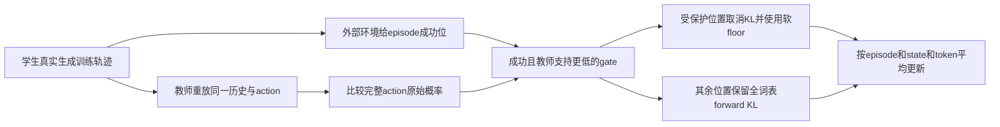
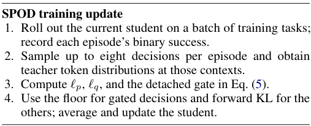

# SPOD：保留学生已经成功、但教师不支持的选择

> **L1 定义性组件／梯度诊断，不是Agent能力复现。** 完整实验成本过高，不复现（审查 DONE）；不可晋级，未接Evolve。

## 论文信息

| 字段 | 内容 |
|---|---|
| 论文链接 | [arXiv 2610.25034](https://arxiv.org/abs/2610.25034)；[固定v1全文](https://arxiv.org/html/2610.25034v1) |
| 公司 / 机构 | 一作Jike Zhong首署University of Southern California；其他作者包括University of Florida与Amazon AGI，按一作首机构归入南加州大学 |
| 首次公开日期 | 2026-10-18T05:44:26Z（UTC，arXiv v1；10月20日公告，不是10月20日首发） |
| 原作者代码 | [作者官方SPOD仓库](https://github.com/Jike338/SPOD)，已有`configs`、`spod`训练及`sgate`方法源码 |
| 代码许可 | MIT；按仓库LICENSE，不以论文许可替代 |
| 本地 adapter / 方法键 | `spod`；`adapter: null`，独立定义性组件 |
| 本地代码位置 | [`src/auto_research/post_training/spod.py`](https://github.com/daiwk/auto-research/blob/main/src/auto_research/post_training/spod.py) |
| 运行入口 | [`scripts/run_oct20_post_components.py`](https://github.com/daiwk/auto-research/blob/main/scripts/run_oct20_post_components.py) |

## 原始论文总结

### 背景与主要改动

多轮Agent蒸馏中，学生可能先超过教师，再随着持续模仿而退步。作者区分两个过程：教师修复学生的弱决策，同时也会侵蚀学生已经成功、但与教师偏好不同的行为。SPOD只在成功训练episode内保护教师整action概率更低的decision，取消该处蒸馏压力，并用软概率floor抵消来自其他状态更新的间接侵蚀；其余decision继续正常蒸馏。[原文§3–4](https://arxiv.org/html/2610.25034v1#S4)



原图建议：附录Figure 9的训练流程；Figure 1展示overshoot与修复／侵蚀现象，可作为辅助结果图。原图不是本地运行结果。

<!-- paper-figure:start -->
### 原论文关键图

[](https://arxiv.org/pdf/2610.25034v1#page=14)

> **原论文 Figure 9（关键图）**：SPOD 原文训练更新伪代码：当前学生rollout、训练episode成功反馈、重新计算门控、受保护action用软概率floor，其余用forward KL。不是架构图或本地能力成绩。图片来自[原论文](https://arxiv.org/abs/2610.25034)，版权归原作者所有；点击图片可查看来源。
<!-- paper-figure:end -->

### 核心公式

对action $a=(a_1,\ldots,a_n)$，包括原生结束token，使用**温度和动作约束之前**的模型概率：

$$
\ell_p=\sum_j\log p_\theta(a_j\mid h_j),\quad
\ell_q=\sum_j\log q(a_j\mid h_j),\quad
g=\mathbf1\{R_{episode}=1\land\ell_q<\ell_p\}.
$$

$$
L_{floor}=\frac1n[\log\tau_0-\ell_p]_+,\qquad
L=(1-g)\frac1n\sum_jD_{KL}(q_j\Vert p_{\theta,j})+\lambda gL_{floor}.
$$

默认 $\tau_0=.5,\lambda=1$。gate每次更新前由当前分数重算，微分期间固定；教师和采样历史停止梯度。先在action内平均token，再在episode内平均state，最后跨episode平均，不让长action或多state episode占更高权重。

这是完整action级保护，不是逐token比较后分别开关，也不是屏蔽整个成功episode。软floor不是共享参数网络下的硬概率保证；其他state梯度仍可能干扰该action。保留KL再叠加floor与SPOD不同。

### 论文离线与线上效果

作者Qwen3.5-2B←27B在三环境的overall由普通OPD的53.3%提高到65.7%；Gemma-4-E4B←31B由56.0%到66.2%。主方法和普通OPD有三训练seed，部分其他基线只有一个训练seed；使用评估峰值选checkpoint的对照被作者标为oracle，不能当作可部署早停器。以上是完整模型与交互环境结果，本地未复现。未报告生产用户线上A/B。[原文表1及复现说明](https://arxiv.org/html/2610.25034v1#S5)

## 本地复现

### 数据协议与运行

随机初始化16词表、8维因果GRU，实际采样多state episode；教师独立随机初始化后冻结，对同一学生action重放评分。显式合成环境在episode结束后返回训练成功位，actor输入只有公开历史、自己的action及公开观察ID；不读取成功位、gold或评估结果。固定长度预算的合成action不是ALFWorld/WebShop/ScienceWorld语言动作。

```bash
PYTHONPATH=src python scripts/run_oct20_post_components.py \
  --methods spod --device cuda --seeds 42,43,44 \
  --output runs/spod-component.json
```

CPU可用`--device cpu`，CUDA不可用时明确失败。默认每seed3次真实更新，最多8次；无下载、预训练权重或API。输出不可覆盖，含runner与3模块SHA256、完整commit、逐seed结果及小型action审计；合成配方固定为`synthetic:oct20-spod-v1`。

### 结果、代码映射与边界

`success_preserving_loss`执行全词表KL、序列gate、软floor及三级平均。独立Python标量参考重建gate和损失，负对照保留受保护位置的KL；专项回归检查失败轨迹不保护、完整action末token、above-floor零局部梯度、padding隔离和FP16极端logits。

CPU三seed核心路径已运行；CUDA验收以本批统一生成的[逐seed产物](metrics/component-cuda-seeds42-44.json)和[A100回执](../../gpu-validations/spod-a100-20261020.json)为准。随机教师不具备真实指导能力，不把loss、保护次数或梯度范数当作Agent成功率。

**完整实验不复现（审查 DONE）：** 作者需要27B／31B教师与2B／E4B学生，双GPU协作生成、教师评分和训练；三个交互环境，40–50更新×每次72题、每episode最多8个decision，多个训练seed并频繁全量评估。可用资源仅单A100或A30／Mac，本轮不下载大型权重，不试跑该完整矩阵，不接Evolve。
