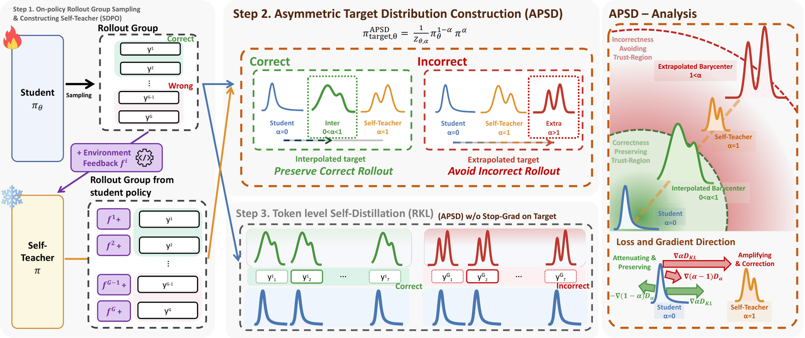

# APSD: Asymmetric self-distillation with gradients through the student-dependent target

<!-- source-sha256: 3736e718c4368a47aac4c5b9f2ceeeea5c43a06480a430f32619a28d60b3ccc5 -->

[简体中文](README.md)

> **L1 defining component and gradient diagnostic, not a reproduction of scientific reasoning, tool use, or coding capability.** The full experiment was reviewed and not reproduced because of cost. No Evolve integration or promotion eligibility.

## Paper information

| Field | Details |
| --- | --- |
| Paper links | [arXiv 2610.25973](https://arxiv.org/abs/2610.25973); [pinned v1 full text](https://arxiv.org/html/2610.25973v1) |
| Company / institution | First author Suwan Yoon lists Korea University first; collaboration with Chung-Ang University. Verified against the PDF front page rather than the misaligned author-to-email mapping in the HTML. |
| First public release | 2026-10-19T08:03:09Z (UTC, arXiv v1; announced October 20) |
| Author code | The paper links to an [anonymous APSD materials repository](https://anonymous.4open.science/r/APSD-0/). Its code could not be accessed and verified in this review; not confirmed as open source. |
| Code license | Unverified; the paper's license does not establish a source-code license. |
| Local adapter / method key | `apsd`; `adapter: null`, standalone defining component |
| Local code | [`src/auto_research/post_training/apsd.py`](https://github.com/daiwk/auto-research/blob/main/src/auto_research/post_training/apsd.py) |
| Runner | [`scripts/run_oct20_post_components.py`](https://github.com/daiwk/auto-research/blob/main/scripts/run_oct20_post_components.py) |

## Paper summary

### Background and main changes

A feedback-conditioned self-teacher can disrupt preferences the student already gets right in correct rollouts and still undercorrect incorrect rollouts. APSD changes the distillation target according to correctness: it interpolates between student and self-teacher for correct rollouts and extrapolates past the self-teacher for incorrect ones. The target's value is not the only change: it must remain dependent on the student distribution in the gradient. Detaching the entire target loses the defining coupled gradient. See [Section 4 and Appendix B](https://arxiv.org/html/2610.25973v1#S4).

~~~mermaid
flowchart LR
  A[Current student generates a rollout] --> B[External training outcome and feedback]
  B --> C[Same policy reads feedback as a self-teacher]
  C --> D[Stop gradients only through the self-teacher]
  A --> E[Student distribution remains differentiable]
  D --> F[Interpolate or extrapolate the PoE target by correctness]
  E --> F
  F --> G[Reverse KL from student to target]
  G --> H[Update with the target's student branch in the gradient]
~~~

Figure 3 gives the method overview, including the gradient geometry and target branch on the right. Figure 1 illustrates interpolation and extrapolation.

<!-- paper-figure:start -->
### Original paper figure

> **Paper Figure 3:** Rollout correctness selects an asymmetric product-of-experts (PoE) coefficient. The feedback-conditioned self-teacher is stopped, but the target's student branch and normalization remain differentiable. From the [original paper](https://arxiv.org/abs/2610.25973); copyright remains with the authors. Click the image to open its source.
<!-- paper-figure:end -->

### Core equations

The self-teacher is produced by the **same current policy** conditioned on training-only feedback:

$$
q=\operatorname{sg}[p_\theta(\cdot\mid x,f,y_{<t})],\quad
t_\theta(v)=\frac{p_\theta(v)^{1-\alpha}q(v)^\alpha}{Z_{\theta,\alpha}},\quad
L=\sum_tD_{KL}(p_{\theta,t}\Vert t_{\theta,t}).
$$

Correct rollouts use $0<\alpha_{\mathrm{corr}}<1$ and incorrect rollouts use $\alpha_{\mathrm{incorr}}>1$. The local defaults are 0.5 / 1.5, matching the paper's RLRF configuration; the original RLVR configuration uses 0.9 / 1.1. The implementation computes the PoE in log space, sums over response positions as in the formula, and then averages across the rollout batch.

The full logit gradient includes an extra term:

$$
\nabla_zL=\alpha\nabla_zD_{KL}(p\Vert q)+(1-\alpha)(t_\theta-p).
$$

Detaching the entire target leaves only $\alpha\nabla_zD_{\mathrm{KL}}(p\Vert q)$. Detaching the self-teacher is therefore not the same as detaching the target. The original KL definition line omits the log in a typesetting error; the implementation follows standard KL, Eq. 5, and the appendix derivation rather than reproducing that error.

### Offline and online results reported in the paper

For RLVR, Table 1 reports a five-suite average of 75.67% for Qwen3-8B versus 70.65% for SDPO. These are **the highest Avg@16 values within a five-hour budget**, not values from a shared final-checkpoint rule. In the RLRF LCBv6 evaluation, the 8B Avg@4 is 49.62% versus 45.04% for SDPO. The reported 2.6× refers to the reduction in training steps needed to reach the same performance, not a wall-clock speedup. These are the authors' large-model results and were not reproduced locally. No production user A/B test is reported. See the [paper experiments](https://arxiv.org/html/2610.25973v1#S5).

## Local reproduction

### Data protocol and execution

A randomly initialized causal GRU with a 16-token vocabulary and hidden width of 8 samples actual student responses. At each update the self-teacher is copied from that same current student, replays its response with additional synthetic training feedback, and receives no gradient. It is not a separately initialized external teacher. The actor samples from the public prompt alone, without feedback, correctness labels, or gold answers. Synthetic feedback IDs are not natural-language execution errors or real successful solutions.

~~~bash
PYTHONPATH=src python scripts/run_oct20_post_components.py \
  --methods apsd --device cuda --seeds 42,43,44 \
  --output runs/apsd-component.json
~~~

The default is three actual updates per seed. CPU diagnostics are supported; requesting unavailable CUDA does not fall back to CPU. There are no model or data downloads, and output files are not overwritten. The runner records source SHA256, full commit, correctness branch, alpha, the self-teacher's conditioning boundary, and per-seed data. The pinned recipe is `synthetic:oct20-apsd-v1`.

### Results, code mapping, and limits

`asymmetric_self_distillation_loss` detaches only the self-teacher and keeps the target's student distribution and normalization differentiable. An independent Python scalar implementation and analytical logit gradient serve as references, with finite differences on selected coordinates. Detaching the entire target is a negative control. Tests cover alpha values 0 and 1, alpha 0.9 in double precision, padding, extreme FP16 logits, a frozen self-teacher, and actor isolation from feedback.

The core path ran on CPU for three seeds. For CUDA, see the [per-seed artifact](metrics/component-cuda-seeds42-44.json) and [A100 receipt](../../gpu-validations/apsd-a100-20261020.json). The small model verifies the defining objective, not feedback quality, code execution, or improved scientific reasoning.

**Full experiment: reviewed, not reproduced.** The RLVR configuration uses 4×H200 for five hours per run, 7B/8B models, 32 questions × 8 rollouts, and 8,192-token responses. RLRF adds 1.7B/4B/8B models, 80 updates, and code-execution feedback. The full matrix was not attempted on a single A100 or A30 or on the Mac. No weights were downloaded, no probe was launched, and the component is not integrated into Evolve.
