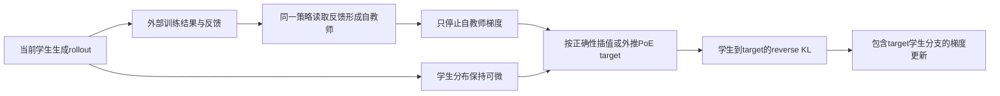
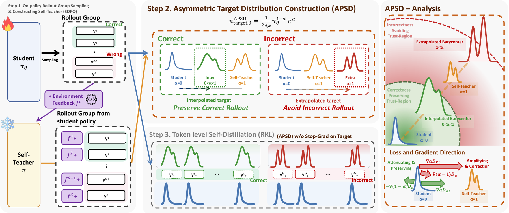

# APSD：保留学生相关target梯度的非对称自蒸馏

> **L1 定义性组件／梯度诊断，不是科学推理、工具或代码能力复现。** 完整实验成本过高，不复现（审查 DONE）；不可晋级，未接Evolve。

## 论文信息

| 字段 | 内容 |
|---|---|
| 论文链接 | [arXiv 2610.25973](https://arxiv.org/abs/2610.25973)；[固定v1全文](https://arxiv.org/html/2610.25973v1) |
| 公司 / 机构 | 一作Suwan Yoon首署Korea University；与Chung-Ang University合作，已按PDF首页核对，不使用HTML错位的作者邮箱映射 |
| 首次公开日期 | 2026-10-19T08:03:09Z（UTC，arXiv v1；10月20日公告） |
| 原作者代码 | 原文链接到[APSD匿名材料仓库](https://anonymous.4open.science/r/APSD-0/)；本轮无法读取并核验源码，不标作已确认开源 |
| 代码许可 | 未确认；论文许可不等于源码许可 |
| 本地 adapter / 方法键 | `apsd`；`adapter: null`，独立定义性组件 |
| 本地代码位置 | [`src/auto_research/post_training/apsd.py`](https://github.com/daiwk/auto-research/blob/main/src/auto_research/post_training/apsd.py) |
| 运行入口 | [`scripts/run_oct20_post_components.py`](https://github.com/daiwk/auto-research/blob/main/scripts/run_oct20_post_components.py) |

## 原始论文总结

### 背景与主要改动

反馈条件自教师可能破坏正确rollout里学生已经成功的偏好，却又对错误rollout纠正不足。APSD依据正确性调整蒸馏target：正确时在学生和自教师之间插值，错误时越过自教师外推。关键不只是换一个target数值，还要保留target对学生分布的依赖；整个target一起detach会丢掉定义性的耦合梯度。[原文§4及附录B](https://arxiv.org/html/2610.25973v1#S4)



原图建议：Figure 3方法总览，保留右侧梯度几何与target分支；Figure 1是插值／外推的概念图。

<!-- paper-figure:start -->
### 原论文关键图

[](https://arxiv.org/html/2610.25973v1/APSD.png)

> **原论文 Figure 3（关键图）**：APSD由rollout正确性选择非对称PoE系数，反馈自教师stop-gradient，但目标内学生分支和归一化保持梯度。图片来自[原论文](https://arxiv.org/abs/2610.25973)，版权归原作者所有；点击图片可查看来源。
<!-- paper-figure:end -->

### 核心公式

自教师由**同一当前策略**读取训练专用反馈产生：

$$
q=\operatorname{sg}[p_\theta(\cdot\mid x,f,y_{<t})],\quad
t_\theta(v)=\frac{p_\theta(v)^{1-\alpha}q(v)^\alpha}{Z_{\theta,\alpha}},\quad
L=\sum_tD_{KL}(p_{\theta,t}\Vert t_{\theta,t}).
$$

正确rollout使用 $0<\alpha_{corr}<1$，错误rollout使用 $\alpha_{incorr}>1$；本地默认0.5／1.5，对应原文RLRF设置，RLVR原配置为0.9／1.1。实现用log-space PoE并对rollout取batch均值，保留式中的响应位置求和。

对logits，完整梯度包含额外项：

$$
\nabla_zL=\alpha\nabla_zD_{KL}(p\Vert q)+(1-\alpha)(t_\theta-p).
$$

若把整个target detach，只剩 $\alpha\nabla_zD_{KL}(p\Vert q)$。因此自教师detach与target detach不是一回事。原文KL定义行有漏写log的排版问题，按标准KL、核心式5与附录推导实现，不照抄错误排版。

### 论文离线与线上效果

作者RLVR表1的Qwen3-8B五套件平均为75.67%，SDPO为70.65%；口径是**五小时预算内最高Avg@16**，不是统一最终checkpoint。RLRF的LCBv6中，8B的Avg@4为49.62%，SDPO为45.04%。作者“2.6倍”指达到相同性能所需的训练步数减少，不是同等墙钟加速。以上均为作者大模型结果，未在本地复现；未报告生产用户线上A/B。[原文实验](https://arxiv.org/html/2610.25973v1#S5)

## 本地复现

### 数据协议与运行

随机初始化16词表、8维因果GRU，学生实际采样回答。每次更新从同一当前学生复制自教师，教师只在额外的合成训练反馈条件下重放学生回答并停止梯度；不是单独初始化的外部教师。actor的采样条件只有公开prompt，不读取反馈、正确性或gold。反馈ID不代表自然语言执行错误或真实成功解答。

```bash
PYTHONPATH=src python scripts/run_oct20_post_components.py \
  --methods apsd --device cuda --seeds 42,43,44 \
  --output runs/apsd-component.json
```

默认每seed3次实际更新；CPU可诊断，CUDA不可用不回退。无模型／数据下载，输出不可覆盖，保留源码SHA256、完整commit、正确性分支、alpha、自教师条件边界与逐seed数据。固定配方`synthetic:oct20-apsd-v1`。

### 结果、代码映射与边界

`asymmetric_self_distillation_loss`只detach自教师，target中的学生与归一化项保持可微。独立Python标量和解析logit梯度核对，并抽取坐标做有限差分；完全detach target作为负对照。测试覆盖alpha=0／1、0.9双精度、padding、FP16极端logits、自教师冻结及actor不读取反馈。

CPU三seed核心路径已运行；CUDA证据以[逐seed产物](metrics/component-cuda-seeds42-44.json)和[A100回执](../../gpu-validations/apsd-a100-20261020.json)为准。小模型只验证定义性目标，不证明反馈质量、代码执行或科学推理改善。

**完整实验不复现（审查 DONE）：** RLVR原配置4×H200、每run五小时，7B／8B、32题×8rollout、8,192-token响应；RLRF另有1.7B／4B／8B、80次更新和代码执行反馈。本轮单A100或A30／Mac不承担完整矩阵，不下载权重、不试跑、不接Evolve。
