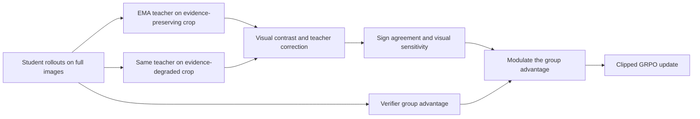
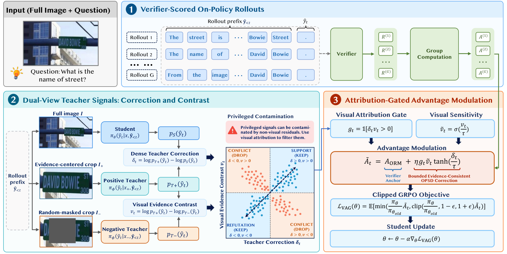

# VAG: Visually attributable on-policy self-distillation

<!-- source-sha256: 0b6e38a966163901c2b78a8fa2523a4f6c83e68b5fa58b2bdeee298f9fec3848 -->

[简体中文](README.md)

> Literature entry only. Full experiments were not reproduced due to cost; review is complete. There is no executable adapter, evaluation interface, mechanism validation, Evolve integration, capability evidence, or automatic retry.

## Paper information

| Field | Details |
|---|---|
| Paper | [arXiv 2610.26856 v1](https://arxiv.org/abs/2610.26856v1); [pinned v1 full text](https://arxiv.org/html/2610.26856v1) |
| Institution | First author Shiao Xie, Baidu Inc.; Siyu Chen is co-first author. |
| First public release | 2026-10-19T17:59:56Z (arXiv v1, UTC) |
| Author code | No author training source was found. The authors released [VAG-Qwen3.5-4B](https://huggingface.co/siyu-ch/VAG-Qwen3.5-4B) and a [9B checkpoint](https://huggingface.co/siyu-ch/VAG-Qwen3.5-9B); weights are not open-source training code. |
| Local adapter or method key | `visually-attributable-opd` is an index key; `adapter: null`. It is distinct from the older Agent paper keyed `vag`. |
| Local reproduction code | None; only this document and packaged catalog metadata. |
| Full experiment status | `not_reproduced_high_cost`; review complete, not a blocker for the reviewed-through date. |

## Paper method and evidence

An evidence crop is privileged information, but the correction it elicits from a teacher may reflect a language prior or stylistic shift. VAG replays identical student prefixes with one EMA teacher under two views: a crop that preserves the evidence and one with random evidence masking. It keeps corrections aligned with the visual contrast and uses a bounded term to modulate the verifier's group-normalized advantage. A text-only teacher or fixed-logit gate would not implement this multimodal path.

### Original paper figure

Figure 3 shows the verifier anchor, the two teacher views evaluated on the same prefix, and the sign-agreement gate. Original [paper](https://arxiv.org/abs/2610.26856v1) figure, visually checked; copyright remains with the authors.

### Core equations

Teacher correction is $\delta_t=\log p_{T+}(y_t)-\log p_S(y_t)$; visual contrast is $v_t=\log p_{T+}(y_t)-\log p_{T-}(y_t)$. Only corrections with matching signs are used:

$$
g_t=\mathbf1[\delta_t v_t>0],\quad
\widetilde A_t=A_{ORM}+\eta g_t\sigma(v_t/\tau)\tanh(\delta_t/\tau).
$$

The branches use the same EMA model with different visual inputs. The original verifier advantage remains the anchor passed into clipped GRPO. These equations describe the paper, not an executed local component.

### Reported results

The authors compare GRPO, OPSD, and VAG across six visual-reasoning benchmarks and report held-out generalization. The image views, judging protocol, and EMA teacher cannot be replaced with a local tensor operation and called a reproduction. No production A/B test was reported; no local metrics are presented here.

## Local reproduction boundary

Section 4.1 uses full-parameter Qwen3.5-4B/9B training for one epoch on 8 NVIDIA H800s, with batch 48, $G=8$ responses per question, and a 1,024-token maximum. This also needs task-specific detail crops, two-view EMA replay, and six benchmark judging protocols. The configuration exceeds the single A100/A30 or Mac budget. No checkpoint download, trial, run command, metrics, GPU pass, or automation was performed for this entry. Revisit only on explicit request after acknowledging the cost, or if a genuinely low-cost validation becomes possible.
