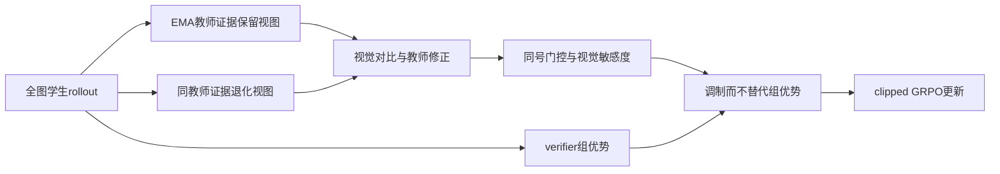
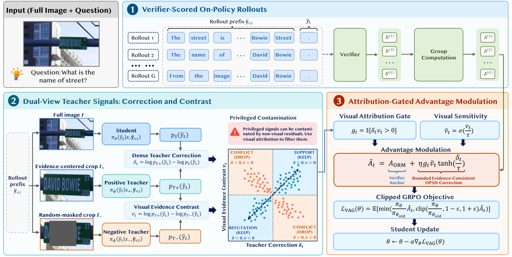

# VAG：视觉归因门控的 on-policy 自蒸馏

> **仅资料收录，成本过高，不复现（审查 DONE）。** 没有本地可执行 adapter、评测接口或机制验证；不接入 Evolve，不作为能力证据，不进入自动重试队列。

## 论文信息

| 字段 | 内容 |
|---|---|
| 论文链接 | [arXiv 2610.26856](https://arxiv.org/abs/2610.26856v1)；[固定 v1 正文](https://arxiv.org/html/2610.26856v1) |
| 公司 / 机构 | 一作 Shiao Xie：Baidu Inc.；Siyu Chen 为共同一作 |
| 首次公开日期 | 2026-10-19T17:59:56Z（arXiv v1，UTC） |
| 原作者代码 | 未找到原作者训练源码；已发布 [VAG-Qwen3.5-4B](https://huggingface.co/siyu-ch/VAG-Qwen3.5-4B) 和 [9B checkpoint](https://huggingface.co/siyu-ch/VAG-Qwen3.5-9B)，权重不等于开源训练代码 |
| 本地 adapter / 方法键 | `visually-attributable-opd` 为资料索引键，`adapter: null`，无本地可执行算子；与已有Agent论文的`vag`键区分 |
| 本地复现代码位置 | 无；仅本页面与 packaged catalog 元数据，没有伪造接口或指标 |
| 完整实验状态 | `not_reproduced_high_cost`；审查 DONE，不阻塞审查水位 |

## 原始论文总结

### 背景与主要改动

特权图像裁剪带来的 teacher 修正，可能混有语言先验或风格变化。VAG 让同一 EMA 教师对证据保留裁剪和随机遮挡裁剪重放相同学生前缀，只接纳与视觉对比方向一致的修正，再以有界项调制 verifier 的组归一化 advantage。纯文本教师或固定 logits 门控不能冒充该多模态链路。

<!-- paper-figure:start -->
### 原论文关键图

> Figure 3：verifier 锚点、同前缀双教师视图与同号门控的完整路径。图片来自[原论文](https://arxiv.org/abs/2610.26856v1)，版权归原作者所有；保留原图并已视觉检查。
<!-- paper-figure:end -->

### 核心公式

教师修正与视觉对比为 $\delta_t=\log p_{T+}(y_t)-\log p_S(y_t)$、$v_t=\log p_{T+}(y_t)-\log p_{T-}(y_t)$。只保留同号修正：

$$
g_t=\mathbf1[\delta_t v_t>0],\quad
\widetilde A_t=A_{ORM}+\eta g_t\sigma(v_t/\tau)\tanh(\delta_t/\tau).
$$

两教师分支为同一个 EMA 模型，只改变视觉输入；不是两套不相关教师。原 verifier advantage 保留为优化锚点，之后进入 clipped GRPO。以上为原文方法说明，未在本库执行。

### 论文离线与线上效果

作者在六套视觉推理基准比较 GRPO、OPSD 与 VAG，并报告 holdout 泛化。完整实验涉及图像视图、判分和 EMA 教师，不能由本地张量运算替代；本页不提供未经复现的本地效果数值。未报告生产线上 A/B。

## 本地复现

**完整实验不复现，审查 DONE。** 原文 §4.1：Qwen3.5-4B/9B 全参数训练一 epoch，batch 48，每题 $G=8$ 条响应，最大 1,024 token，8×NVIDIA H800。需要训练数据的目标细节裁剪、EMA 双视图重放和六基准 judge 协议。单 A100/A30 或 Mac 不承担原矩阵，属于配置直接支持的高成本判断，无需下载权重或试跑。

本条只维护论文、作者权重和关键图来源，无运行入口、无 metrics、无 GPU 通过声明、无自动任务；仅在用户看到成本边界后明确要求重开，或出现新的可廉价核验方案时另议。
