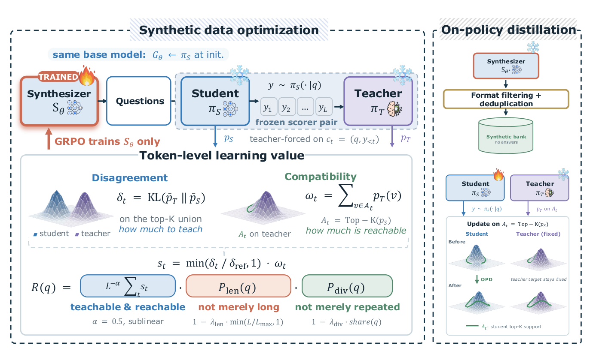

# Ask to Distill: Learning which questions create useful on-policy supervision

<!-- source-sha256: 8737810ef35a2de489e2170908b4ffbaa477564aba792c560681ef133200bfa3 -->

[简体中文](README.md)

> **L1 reward and candidate-update formulas; diagnostic only.** No full question synthesizer or capability run.

## Paper information

| Field | Details |
| --- | --- |
| Paper | [Ask to Distill: Learning to Synthesize Data for On-Policy Distillation](https://arxiv.org/abs/2610.27450v1) |
| Affiliations | First author Jiashuo Sun: UIUC; collaborators include HKUST and Texas A&M. |
| First public release | 2026-10-20 01:00:17 UTC |
| Author code | [Ask_to_Distill](https://github.com/GasolSun36/Ask_to_Distill), Apache-2.0, `1edaf22fc8e2ba35efe6c02fa1a3665875f1f98a`. |
| Local key | `ask-to-distill`; no adapter |
| Local code | `src/auto_research/post_training/oct21_followup_distillation.py` |
| Local evidence | [Local mechanism metrics](metrics/component-cuda-seeds42-44.json); [A100 validation receipt](../../gpu-validations/ask-to-distill-a100-20261021-followup.json) |

## What the paper changes

Train an independent question generator with frozen scoring student/teacher. Reward both disagreement and teacher-favored tokens within student-reachable support. Filter and deduplicate the resulting bank and run OPD from the original student initialization, rather than tuning a student separately to value every question.

### Original paper figure



Original figure from the reviewed paper, reused without redrawing.

### Core equations

$$
\delta_t=\mathrm{KL}(\bar p_T^U\|\bar p_S^U),\qquad
\omega_t=\sum_{v\in A}p_T(v),\qquad
s_t=\min\!\left(\frac{\delta_t}{\delta_{ref}+\epsilon},1\right)\omega_t.
$$

$$
R(q)=\frac{(1-\lambda_{len}\min(L/L_{max},1))
\max(0,1-\lambda_{div}\operatorname{share}(q))}{L^\alpha}\sum_t s_t.
$$

Forward KL uses distributions normalized within union of student/teacher top-K; compatibility uses raw teacher mass on student top-K without renormalization. Freeze the 95th percentile of initial calibration discrepancies. Length, duplicate-cluster share and length power downweight rewards; share is BLEU-distance average-linkage clustering over the full scored batch, not a GRPO group. Downstream fixes rollout student top-K and uses $r_v=\bar p_{S,old}^{A}(v)(\log p_T-\log p_{S,old})$ with signed PPO clipped minimum and current/old ratios. Sum candidates, average valid tokens, no group advantage renormalization.

### Results reported by the authors

Authors report offline math/code/agent improvements, not production A/B. AMC23 and LiveCodeBench select checkpoints, so their results are not isolated test estimates.

## Local reproduction and limits

`a2d_token_signal`, `calibrate_a2d_scale`, `a2d_question_reward` and `a2d_candidate_opd_loss` use random logits, masks and externally provided cluster shares. Checks scalar KL/mass, gradient, wrong support normalization, signed clipping, padding and detach. Caller owns shared tokenizer and same-prefix provenance. No BLEU clustering, synthesizer GRPO, language generation, filtering or complete OPD/Evolve. No CUDA fallback/output overwrite; three seeds remain L1.

```bash
PYTHONPATH=src python scripts/run_oct21_followup_post_components.py \
  --device cuda --seeds 42,43,44 --output runs/a2d-projected-components.json
```

### Full experiment: not reproduced

64 questions/step, 60 synthesis steps, budgets 4,096/7,168 prompt/response tokens, 20,000 raw questions and four responses/question for two epochs. Up to 30B/32B teachers, 4B dedup model, documented long-response memory pressure. No model/data download, long trial or retry.

### Additional references

[Full paper](https://arxiv.org/html/2610.27450v1) · [Paper Figure 2](https://arxiv.org/html/2610.27450v1#S1.F2) · [`run_oct21_followup_post_components.py`](https://github.com/daiwk/auto-research/blob/main/scripts/run_oct21_followup_post_components.py) · [`oct21_followup_distillation.py`](https://github.com/daiwk/auto-research/blob/main/src/auto_research/post_training/oct21_followup_distillation.py)
