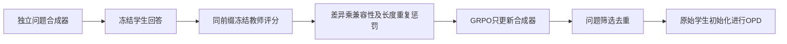
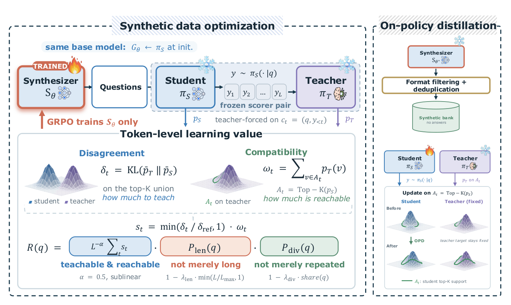

# A2D：为在策略蒸馏学习“值得问什么”

> **仅实现 L1 奖励与更新公式组件，不是完整合成数据系统或能力复现。** `diagnostic_only=true`；不可晋级、未接入 Evolve。完整实验成本过高，不复现（审查 DONE）。本页属于 10 月 21 日同一公告的补审，不是上一批之后的新首发。

## 论文信息

| 字段 | 内容 |
|---|---|
| 论文链接 | [arXiv 2610.27450v1](https://arxiv.org/abs/2610.27450v1)；[固定正文](https://arxiv.org/html/2610.27450v1) |
| 公司 / 机构 | 一作 Jiashuo Sun：University of Illinois Urbana-Champaign；合作机构含 HKUST、Texas A&M |
| 首次公开日期 | 2026-10-20T01:00:17Z（arXiv v1，UTC） |
| 原作者代码 | [Ask_to_Distill](https://github.com/GasolSun36/Ask_to_Distill)，Apache-2.0；核验固定提交 `1edaf22fc8e2ba35efe6c02fa1a3665875f1f98a` |
| 本地 adapter / 方法键 | `ask-to-distill`；`adapter: null`，独立公式组件 |
| 本地代码位置 | [`src/auto_research/post_training/oct21_followup_distillation.py`](https://github.com/daiwk/auto-research/blob/main/src/auto_research/post_training/oct21_followup_distillation.py) |
| 运行入口 | [`scripts/run_oct21_followup_post_components.py`](https://github.com/daiwk/auto-research/blob/main/scripts/run_oct21_followup_post_components.py) |

## 原始论文总结

### 背景与主要改动

问题决定学生会走到哪些前缀，因而决定教师能提供什么监督。A2D 冻结评分用的师生，训练独立的问题合成器；奖励同时要求“有差异”和“教师偏好的候选仍落在学生可达支持集”，然后筛选问题库，再从原始学生初始化执行 OPD。不是给每道问题做一次学生微调来估价。



<!-- paper-figure:start -->
### 原论文关键图

[](https://arxiv.org/html/2610.27450v1#S1.F2)

> Figure 2 展示合成器、冻结评分师生和下游学生的不同角色。图片来自[原论文](https://arxiv.org/abs/2610.27450v1)，版权归原作者所有；固定 HTML 原图直接保存，未重绘，已视觉核对。
<!-- paper-figure:end -->

### 核心公式

取学生候选 $A=\operatorname{TopK}(p_S)$、教师候选 $B=\operatorname{TopK}(p_T)$，在并集 $U=A\cup B$ 内分别归一化得到 $\bar p^U$：

$$
\delta_t=\mathrm{KL}(\bar p_T^U\|\bar p_S^U),\qquad
\omega_t=\sum_{v\in A}p_T(v),\qquad
s_t=\min\!\left(\frac{\delta_t}{\delta_{ref}+\epsilon},1\right)\omega_t.
$$

注意 $\omega$ 用**全词表教师原始概率**，不能在支持集内重新归一化。固定初始校准题的 token 差异 95 分位数作为 $\delta_{ref}$。问题奖励为

$$
R(q)=\frac{(1-\lambda_{len}\min(L/L_{max},1))
\max(0,1-\lambda_{div}\operatorname{share}(q))}{L^\alpha}\sum_t s_t.
$$

论文的 share 来自**完整评分批次**的 BLEU 距离平均链接聚类，不是 GRPO 分组内统计。下游 Eq.12–15 固定 rollout 学生 top-K：$r_v=\bar p_{S,old}^{A}(v)(\log p_T(v)-\log p_{S,old}(v))$，用 $\rho=p_{S,current}/p_{S,old}$ 执行带符号 PPO clipped minimum；候选求和、有效 token 求平均，不再进行 advantage 分组归一化。

### 论文离线与线上效果

作者报告数学、代码及 Agent 三类离线任务的改善，未报告生产线上 A/B。AMC23 和 LiveCodeBench 被用于选 checkpoint，其对应分数不是隔离测试估计；这里不把作者结果当本地验证。

## 本地复现

### 数据协议与运行

```bash
PYTHONPATH=src python scripts/run_oct21_followup_post_components.py \
  --device cuda --seeds 42,43,44 --output runs/a2d-projected-components.json
```

无下载、无预训练模型调用。随机生成的 logits、显式 mask 和外部 cluster share 只检查公式，不生成自然语言问题。CPU/CUDA 都运行同一算子；CUDA 不可用报错，不回退。输出不可覆盖，最多三个 seed；三 seed 仍只是机制诊断。

### 结果、代码映射与边界

`a2d_token_signal`、`calibrate_a2d_scale`、`a2d_question_reward` 和 `a2d_candidate_opd_loss` 分别实现支持集信号、固定分位数、奖励和候选更新。独立 Python 标量参考核对 KL/概率质量，解析梯度核对更新，错误的支持集重归一化质量作为负对照；覆盖 padding、教师/旧策略停止梯度、符号 clipping。

**没有实现** BLEU 聚类器、合成器 GRPO、格式过滤/语义去重、语言生成或完整 OPD 训练。调用者必须保证师生 tokenizer 相同且 logits 来自同一学生前缀；张量 shape 不能证明这些条件。真实 CUDA 执行结论只以本轮提交的[GPU 回执](../../gpu-validations/ask-to-distill-a100-20261021-followup.json)与独立 metrics 为准。

**完整实验成本过高，不复现（审查 DONE）：** 论文每步 64 问、60 步合成器训练，问题预算 4096 token、响应预算 7168 token，采集 20,000 原始问题，再每题 4 条响应训练 2 epochs；另有最高 30B/32B 教师和 4B 去重模型。作者固定版本 reward_worker 也记录长响应评分的显存压力。相对单 A100/A30，完整多臂多 seed 预计需长时间生成和训练，属配置推断，不下载或试跑探成本。
