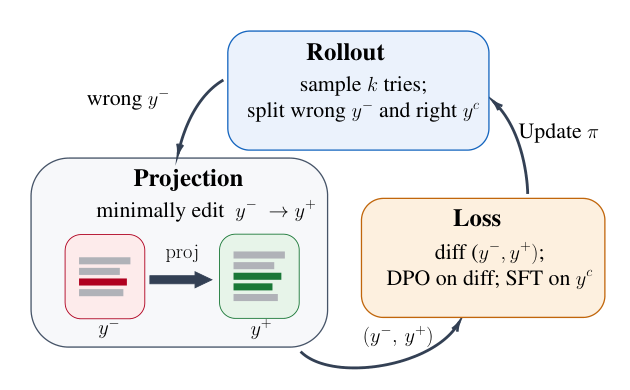

# Projected Distillation: On Learning to Solve Hard Problems from Close, Correct Targets

<!-- source-sha256: e0e17bff17993f5240eb1b7b00f9636f00c5d3ece167cbc3e31699c4d074925e -->

[简体中文](README.md)

> **L1 edit alignment, validation interface and loss; diagnostic only.** No language editor or online training loop.

## Paper information

| Field | Details |
| --- | --- |
| Paper | [Projected Distillation: On Learning to Solve Hard Problems from Close, Correct Targets](https://arxiv.org/abs/2610.27467v1) |
| Affiliations | First author Shripad V. Deshmukh: University of Massachusetts; work during AWS AI Labs internship, with AWS AI Labs collaborators. |
| First public release | 2026-10-20 01:38:01 UTC |
| Author code | No author source found in reviewed text/abstract as of 2026-10-21. Referenced TRL is not this method. |
| Local key | `projected-distillation`; no adapter |
| Local code | `src/auto_research/post_training/oct21_followup_distillation.py` |
| Local evidence | [Local mechanism metrics](metrics/component-cuda-seeds42-44.json); [A100 validation receipt](../../gpu-validations/projected-distillation-a100-20261021-followup.json) |

## What the paper changes

All student samples on a hard task may be wrong, leaving RL without a success reward; fitting a wholly external answer can be too off-policy. Project a wrong response to a minimally changed verified correction and apply DPO only to edited spans. Successful student answers separately receive SFT; the paper resamples each round. Minimal editing approximates, rather than exactly solves, finding the most likely correct student answer.

### Original paper figure



Original figure from the reviewed paper, reused without redrawing.

### Core equations

$$
\Delta=\sum_{t\in E^+}\log\frac{\pi_\theta(y_t^+\mid x,y_{<t}^+)}{\pi_{ref}(y_t^+\mid x,y_{<t}^+)}
-\sum_{t\in E^-}\log\frac{\pi_\theta(y_t^-\mid x,y_{<t}^-)}{\pi_{ref}(y_t^-\mid x,y_{<t}^-)}.
$$

$$
L=-\mathbb E\log\sigma(\beta\Delta)
-\mathbb E_{y^c\sim\pi_\theta,\,R(y^c)=1}\sum_t\log\pi_\theta(y_t^c\mid x,y_{<t}^c).
$$

Use complete respective causal prefixes for each edited token, frozen initialization as reference and summed unnormalized span scores. Insertion/deletion may leave one side empty, but at least one edit is required. SFT is on student-correct $y^c$, not corrected $y^+$. Unchanged direct gathered gradients are zero, not all shared-parameter or prefix effects.

### Results reported by the authors

Authors compare specialization/retention for Qwen3-8B and OLMo-2-7B and report most cells better than GRPO/OPD. Evaluation sampling seeds of one checkpoint are not independent training seeds. No production A/B or local capability reproduction.

## Local reproduction and limits

`minimal_edit_masks` uses unit-cost Levenshtein, capped at one million DP cells; `verified_edit_masks` rejects already-correct originals and unverified repairs. `projected_distillation_loss` supports optional self-correct SFT and detached reference. Independent scalar/gradient, incorrect full-sequence DPO, masks, no edit, non-finite inputs and SFT target tests. Synthetic inputs and fixture verifier are not a language projector or benchmark. No real sampling, mining, refresh, ability comparison, gold-aware evaluator or Evolve. Maximum three seeds, no CUDA fallback/output overwrite.

```bash
PYTHONPATH=src python scripts/run_oct21_followup_post_components.py \
  --device cuda --seeds 42,43,44 --output runs/a2d-projected-components.json
```

### Full experiment: not reproduced

Appendices C.1/C.4 use eight A100 40GB, seven FSDP2 student plus one rollout device, 7B/8B students, 2,048 generation tokens and up to two paid Claude Opus corrections per wrong answer, across domains and seeds. No checkpoint, paid call, long trial or retry.

### Additional references

[Full paper](https://arxiv.org/html/2610.27467v1) · [Paper PDF, p. 4](https://arxiv.org/pdf/2610.27467v1#page=4) · [`run_oct21_followup_post_components.py`](https://github.com/daiwk/auto-research/blob/main/scripts/run_oct21_followup_post_components.py) · [`oct21_followup_distillation.py`](https://github.com/daiwk/auto-research/blob/main/src/auto_research/post_training/oct21_followup_distillation.py)
