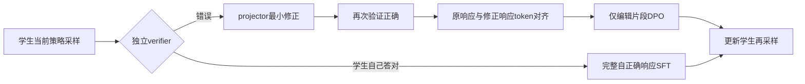
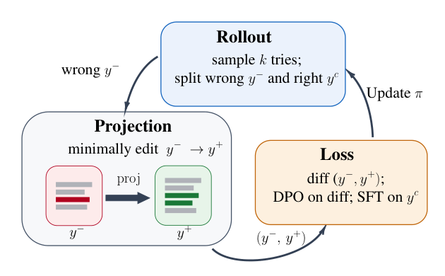

# Projected Distillation：仅在最小修正片段学习偏好

> **L1 编辑对齐、验证接口和损失公式诊断，不是语言纠错或在线闭环复现。** 不可晋级、未接入 Evolve。完整实验成本过高，不复现（审查 DONE）。本页属于同一 10 月 21 日公告的补审。

## 论文信息

| 字段 | 内容 |
|---|---|
| 论文链接 | [arXiv 2610.27467v1](https://arxiv.org/abs/2610.27467v1)；[固定正文](https://arxiv.org/html/2610.27467v1) |
| 公司 / 机构 | 一作 Shripad V. Deshmukh：University of Massachusetts；工作于 AWS AI Labs 实习期间完成，其他作者来自 AWS AI Labs |
| 首次公开日期 | 2026-10-20T01:38:01Z（arXiv v1，UTC） |
| 原作者代码 | 截至 2026-10-21，固定正文及摘要页未找到原作者源码；不能把参考文献中的 TRL 等仓库算作本文开源 |
| 本地 adapter / 方法键 | `projected-distillation`；`adapter: null`，独立公式组件 |
| 本地代码位置 | [`src/auto_research/post_training/oct21_followup_distillation.py`](https://github.com/daiwk/auto-research/blob/main/src/auto_research/post_training/oct21_followup_distillation.py) |
| 运行入口 | [`scripts/run_oct21_followup_post_components.py`](https://github.com/daiwk/auto-research/blob/main/scripts/run_oct21_followup_post_components.py) |

## 原始论文总结

### 背景与主要改动

困难问题的学生 rollout 可能全错，RL 得不到成功奖励；直接拟合外部完整答案又过于 off-policy。论文用 projector 最小改写学生的错误响应，经 verifier 接受后，只在变化片段做 DPO；学生自己答对的响应单独做 SFT，每轮重新采样和纠错。最小编辑只是“学生最可能生成的正确响应”的可计算近似，不保证是该优化问题的精确解。



<!-- paper-figure:start -->
### 原论文关键图

[](https://arxiv.org/pdf/2610.27467v1#page=4)

> Figure 2 保留完整的采样、修正、差分损失和下一轮更新环。图片来自[原论文](https://arxiv.org/abs/2610.27467v1)，版权归原作者所有；固定 PDF 第 4 页原图裁剪，已视觉核对。
<!-- paper-figure:end -->

### 核心公式

对错误响应 $y^-$ 与已验证修正 $y^+$，精确 token 编辑对齐给出 $E^-$、$E^+$；各自概率均取各自的完整因果前缀。固定初始化策略为 reference：

$$
\Delta=\sum_{t\in E^+}\log\frac{\pi_\theta(y_t^+\mid x,y_{<t}^+)}{\pi_{ref}(y_t^+\mid x,y_{<t}^+)}
-\sum_{t\in E^-}\log\frac{\pi_\theta(y_t^-\mid x,y_{<t}^-)}{\pi_{ref}(y_t^-\mid x,y_{<t}^-)}.
$$

$$
L=-\mathbb E\log\sigma(\beta\Delta)
-\mathbb E_{y^c\sim\pi_\theta,\,R(y^c)=1}\sum_t\log\pi_\theta(y_t^c\mid x,y_{<t}^c).
$$

使用未按长度归一化的片段 log-prob 求和；SFT 对象是**学生自己答对的 $y^c$**，不是 projector 的 $y^+$。插入、删除可令一侧编辑 mask 为空，但每个 pair 至少有一次编辑；未改 token 的直接 gathered-log-prob 梯度为零，不表示共享模型参数或保留前缀对编辑位置完全无影响。

### 论文离线与线上效果

论文比较 Qwen3-8B、OLMo-2-7B 的专化与能力保留前沿，报告多数测试单元优于 GRPO/OPD。附录明确区分训练 seed 与单个 checkpoint 的评测采样 seed；后者不能证明跨训练稳定性。未报告生产线上 A/B。本地不声称复现这些能力或统计结论。

## 本地复现

### 数据协议与运行

```bash
PYTHONPATH=src python scripts/run_oct21_followup_post_components.py \
  --device cuda --seeds 42,43,44 --output runs/a2d-projected-components.json
```

无下载和预训练模型调用。输入为合成 token pair 与随机 logits；测试用的显式 verifier 只验证已给定夹具，不扮演语言 projector。单次对齐最多一百万动态规划格，避免该诊断入口无界占内存；真实长文本流水线不在本轮范围。输出不可覆盖、最多三个 seed，CUDA 不回退。

### 结果、代码映射与边界

`minimal_edit_masks` 实现单位代价 Levenshtein 对齐，覆盖多处替换及单边插入/删除；`verified_edit_masks` 拒绝已正确的原响应和未经验证的修正；`projected_distillation_loss` 实现局部 DPO 和可选 self-correct SFT，冻结 reference。独立标量 loss/解析梯度参考与错误的全序列 DPO 对照核验，保留 mask、无编辑、非有限值和 SFT 目标测试。

**没有实现** 学生自然语言生成、最小修正模型、hard-set mining、每轮在线刷新或专化/保留评测。未把已知答案送给被评测模型；本轮没有能力评测模型。CPU/CUDA 的公式执行结论仅以独立 metrics 和本轮提交的[GPU 回执](../../gpu-validations/projected-distillation-a100-20261021-followup.json)为准。

**完整实验成本过高，不复现（审查 DONE）：** 正文 C.1/C.4 使用 8×A100 40GB：7 卡 FSDP2 学生、1 卡 rollout；学生 7B/8B，统一 2048-token 生成预算，外部 Claude Opus projector 每次错误最多请求两次修正，另有多领域与训练 seed 对照。现有单 A100/A30 不匹配该资源与时间预算，不下载 checkpoint、不调用收费 projector、不启动缩小但仍长时间的试跑。
