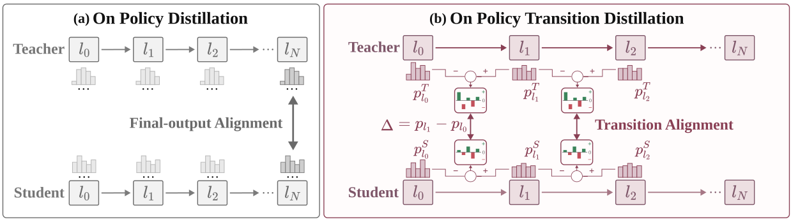

# OPTD: Distilling prediction corrections between layers

<!-- source-sha256: af7c0a8f611a38acb533e156b012f5cfb98e98f97565a72d0d684e593232c3ca -->

[简体中文](README.md)

> **L1 final-plus-transition loss; diagnostic only.** No full reasoning/code benchmark or Evolve.

## Paper information

| Field | Details |
| --- | --- |
| Paper | [On-Policy Transition Distillation](https://arxiv.org/abs/2610.28048v1) |
| Affiliations | First author Runyang You: The Hong Kong Polytechnic University; Huawei Technologies collaboration. |
| First public release | 2026-10-20 11:37:31 UTC |
| Author code | [ModalityDance/optd](https://github.com/ModalityDance/optd), MIT at `eb8a29a5f6eeb64b48714bd31d880aeae1ea5ff7`, with verl implementation/config/tests and separate third-party notices. |
| Local key | `optd`; no adapter |
| Local code | `src/auto_research/post_training/oct21_distillation.py` |
| Local evidence | [Local mechanism metrics](metrics/component-cuda-seeds42-44.json); [A100 validation receipt](../../gpu-validations/optd-a100-20261021.json) |

## What the paper changes

Matching the final teacher distribution need not match how predictions change with depth. Keep final OPD, add supervision on log-probability increments across selected shallow-to-deep readouts, and fix candidate identities using final student top-k after full-vocabulary log-softmax. No per-layer top-k or hidden-state MSE.

### Original paper figure



Original figure from the reviewed paper, reused without redrawing.

### Core equations

$$
w_{i,t}(v)=\operatorname{sg}\left[\frac{p^S_{\ell_i,t}(v)}{\sum_{u\in\mathcal K_t}p^S_{\ell_i,t}(u)}\right],\quad
c_{i,t}(v)=\operatorname{sg}\left[w_{i,t}(v)(\Delta^S_{i,t}(v)-\Delta^T_{i,t}(v))\right].
$$

$$
L_i=\operatorname{mean}_{t:m_t=1}\sum_{v\in\mathcal K_t}c_{i,t}(v)\Delta^S_{i,t}(v),\quad
L=L_{final-OPD}+\sum_{i=1}^{M}L_i.
$$

Use detached destination-layer probability renormalized within the fixed candidates and detach the coefficient based on student–teacher increment difference. Gradients reach both ends of the student increment. Appendix C.3 sums the three transitions, three times their mean; the implementation scales the mean by transition count. Only last 2,000 valid response positions receive transition supervision. Practical update is not the exact reverse transition KL with softmax/centering from Appendix B.4.

### Results reported by the authors

The author 1.5B three-domain aggregate teacher-gap recovery is about 90% versus 75% for OPD; it is not a guarantee on every task. No production A/B or local benchmark.

## Local reproduction and limits

`transition_distillation_loss` validates [batch,depth,token,vocab], fixed candidates, tail mask and padding. A tiny 12-token causal GRU with three residual-depth blocks shares final LayerNorm/unembedding across four readouts. Samples student rollouts, freezes teacher replay and runs three SGD steps. Diagnostic top-k 5 versus normal 16. Scalar and full log-softmax Jacobian checks, wrong increment-softmax negative control. No CUDA fallback or overwrite; receipts are mechanism evidence only.

```bash
PYTHONPATH=src python scripts/run_oct21_post_components.py \
  --methods optd --device cuda --seeds 42,43,44 \
  --output runs/optd-component.json
```

### Full experiment: not reproduced

1.5B/4B/7B students and math/code/instruction teachers, 50–150 updates, up to 128×2 rollouts and 10,240–16,384 training tokens; math/code evaluation uses 16/8 samples and up to 32,768 tokens plus sandbox. No full matrix, downloads, trial or retry.

### Additional references

[Full paper](https://arxiv.org/html/2610.28048v1) · [Paper PDF, p. 1](https://arxiv.org/pdf/2610.28048v1#page=1) · [`run_oct21_post_components.py`](https://github.com/daiwk/auto-research/blob/main/scripts/run_oct21_post_components.py) · [`oct21_distillation.py`](https://github.com/daiwk/auto-research/blob/main/src/auto_research/post_training/oct21_distillation.py)
