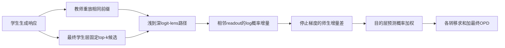
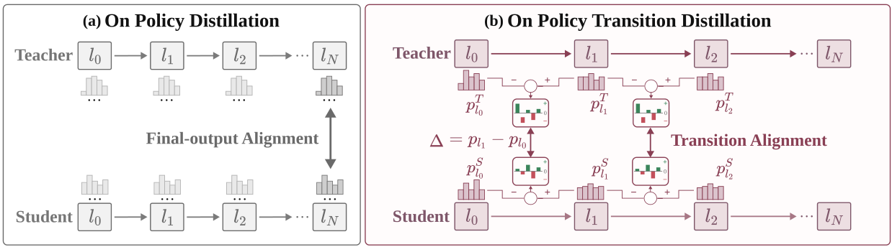

# OPTD：蒸馏层间预测修正，而不只蒸馏最终输出

> **L1 定义性损失组件，不是推理或代码能力复现。** 完整实验成本过高，不复现（审查 DONE）；不可晋级，未接入 Evolve。

## 论文信息

| 字段 | 内容 |
|---|---|
| 论文链接 | [arXiv 2610.28048](https://arxiv.org/abs/2610.28048v1)；[固定 v1 正文](https://arxiv.org/html/2610.28048v1) |
| 公司 / 机构 | 一作 Runyang You：The Hong Kong Polytechnic University；Huawei Technologies 为合作机构，不按全部作者归属拆多份 |
| 首次公开日期 | 2026-10-20T11:37:31Z（arXiv v1，UTC；PDF 封面自署 10-19，不替代 arXiv 首次公开时间） |
| 原作者代码 | [ModalityDance/optd](https://github.com/ModalityDance/optd)，PDF 首页项目链接；核对有 verl 实现、配置、测试；上游 commit `eb8a29a5f6eeb64b48714bd31d880aeae1ea5ff7` |
| 代码许可 | MIT；第三方依赖另见上游 `THIRD_PARTY_NOTICES.md` |
| 本地 adapter / 方法键 | `optd`；`adapter: null`，独立损失组件 |
| 本地代码位置 | [`src/auto_research/post_training/oct21_distillation.py`](https://github.com/daiwk/auto-research/blob/main/src/auto_research/post_training/oct21_distillation.py) |
| 运行入口 | [`scripts/run_oct21_post_components.py`](https://github.com/daiwk/auto-research/blob/main/scripts/run_oct21_post_components.py) |

## 原始论文总结

### 背景与主要改动

最终层分布接近教师，不一定代表模型沿深度修正预测的方式接近教师。OPTD 保留最终层 OPD，再对选定浅到深 readout 的 log 概率增量施加监督。候选 token 在最终学生层选定后，全路径保持同一身份；不是每层独立 top-k，也不是隐状态 MSE。



<!-- paper-figure:start -->
### 原论文关键图

[](https://arxiv.org/pdf/2610.28048v1#page=1)

> Figure 1：对比仅对齐最终输出和额外对齐层间预测转移。图片来自[原论文](https://arxiv.org/abs/2610.28048v1)，版权归原作者所有；由固定PDF第1页裁剪，已视觉检查。
<!-- paper-figure:end -->

### 核心公式

在完整词表 log-softmax 后，从最终学生分布选固定候选集 $\mathcal K_t$。相邻层转移为 $\Delta^S_{i,t}(v)=\log p^S_{\ell_i,t}(v)-\log p^S_{\ell_{i-1},t}(v)$，教师同理。实际更新使用目的层预测权重：

$$
w_{i,t}(v)=\operatorname{sg}\left[\frac{p^S_{\ell_i,t}(v)}{\sum_{u\in\mathcal K_t}p^S_{\ell_i,t}(u)}\right],\quad
c_{i,t}(v)=\operatorname{sg}\left[w_{i,t}(v)(\Delta^S_{i,t}(v)-\Delta^T_{i,t}(v))\right].
$$

$$
L_i=\operatorname{mean}_{t:m_t=1}\sum_{v\in\mathcal K_t}c_{i,t}(v)\Delta^S_{i,t}(v),\quad
L=L_{final-OPD}+\sum_{i=1}^{M}L_i.
$$

**附录 C.3 的实际缩放**是 3 条转移之和，即正文均值的 3 倍；实现默认使用转移数乘均值。梯度流过学生增量两端，教师、候选权重和修正系数停止梯度。论文附录 B.4 明确区分该 practical update 与带增量 softmax/中心化修正的精确 reverse transition KL，不能偷换目标。转移仅监督最后 2,000 个有效响应位置。

### 论文离线与线上效果

作者三域 1.5B 实验总体 teacher-gap recovery 约 90%，普通 OPD 约 75%；这是数学、代码和指令遵循的指定聚合，不代表每个测试项都改善。未报告生产线上 A/B。

## 本地复现

### 数据协议与运行

```bash
PYTHONPATH=src python scripts/run_oct21_post_components.py \
  --methods optd --device cuda --seeds 42,43,44 \
  --output runs/optd-component.json
```

无下载。随机 12-token 因果 GRU 加三个 residual-depth block，以同一个最终 LayerNorm/unembedding 构成四层 readout；实际学生采样、冻结教师同前缀重放，默认三次 SGD。诊断 top-k 缩为 5，通用算子默认论文 16；不声称该微型网络是论文 Transformer。CUDA 不可用不回退，输出不可覆盖。

### 结果、代码映射与边界

`transition_distillation_loss` 接收 `[batch,depth,token,vocab]`，校验 shape/dtype/device，固定最终候选、保留双端梯度并处理 padding/尾段。独立 Python 标量 loss 和完整 logit-softmax Jacobian 参考；用错误的增量 softmax 权重作负对照，防止把相近的 KL 目标当作论文目标。CPU 三 seed 已运行，CUDA 以[GPU 回执](../../gpu-validations/optd-a100-20261021.json)为准。

**完整实验成本过高，不复现（审查 DONE）：** 1.5B/4B/7B 学生配数学/代码/指令教师，50–150 次更新，最多 128 prompts×2 rollout，10,240–16,384-token 训练响应；数学和代码另有 16/8 样本、最长 32,768-token 评测与本地代码沙箱。单卡 A100/A30 完整矩阵预计长时运行，不下载/试跑探成本。组件梯度正确不意味着跨域保持、教师质量或 benchmark 提升已验证。
