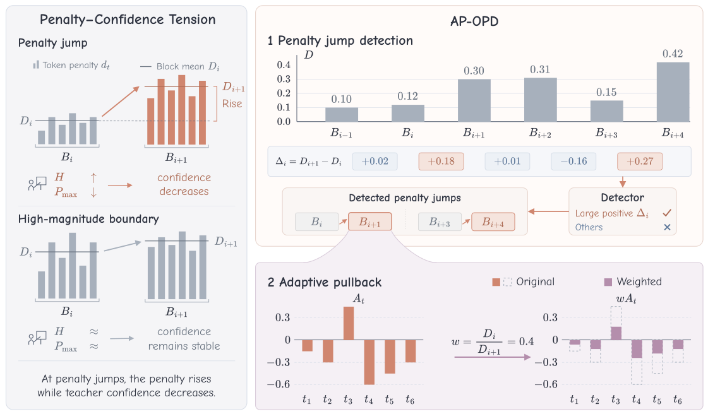

# AP-OPD: Pulling back supervision after abrupt penalty increases

<!-- source-sha256: c7c9bd11d4fd1e4ebf2ae7e058682d64378cd5fd5bfe61651a4ed20cb3b5699e -->

[简体中文](README.md)

> **L1 loss component; diagnostic only.** No full math/code capability reproduction.

## Paper information

| Field | Details |
| --- | --- |
| Paper | [Adaptive Pullback: Reweighting Supervision at Penalty Jumps in On-Policy Distillation](https://arxiv.org/abs/2610.28194v1) |
| Affiliations | First author Guangyu Liu: Nanjing University; collaborator Shanghai AI Laboratory. |
| First public release | 2026-10-20 13:34:43 UTC |
| Author code | No author source link verified in reviewed HTML/PDF; referenced code is not this method. |
| Local key | `ap-opd`; no adapter |
| Local code | `src/auto_research/post_training/oct21_distillation.py` |
| Local evidence | [Local mechanism metrics](metrics/component-cuda-seeds42-44.json); [A100 validation receipt](../../gpu-validations/ap-opd-a100-20261021.json) |

## What the paper changes

Separate a sustained high OPD penalty from an abrupt increase. Measure adjacent blocks of positive log-ratios from the same student prefixes, then downscale the entire following block without another teacher forward or sign changes. Read raw unweighted previous and next statistics, not recursively downweighted ones.

### Original paper figure



Original figure from the reviewed paper, reused without redrawing.

### Core equations

$$
D_{i+1}-D_i>z\sqrt{s_i^2/n_i+s_{i+1}^2/n_{i+1}}
$$

$$
L=\frac{1}{N_{tok}}\sum_t w_t\operatorname{sg}(r_t)\log p_S(y_t).
$$

Let $r_t=\log p_S-\log p_T$ and $d_t=[r_t]_+$. Block means include zeros; use sample variance, default block length 64 and z=2 with at least two tokens per block. The gate is not a calibrated significance test for dependent tokens. Optional top-alpha selects up to ceiling(alpha × boundaries), default 0.05, by positive raw jump. At selected boundaries use previous/new mean, elsewhere one. Apply even to negative ratios, allow zero weight for zero reference, no floor or renormalization; preserve stop-gradient coefficients and full token mean.

### Results reported by the authors

Table 1 six math suites, two runs using Avg@k: vanilla 31.82%, z-gate 32.39%, top-alpha 32.62%. No production A/B or local capability values.

## Local reproduction and limits

`adaptive_pullback_weights` and `adaptive_pullback_loss`; random width-eight causal GRU, vocabulary 12, real student sampling and frozen same-prefix teacher, three SGD steps per seed. Response length ten and diagnostic block two; general default 64. Scalar/gradient reference plus no-pullback and recursive-reference controls; tests negative coefficient, zero reference, partial block, padding, invalid inputs and frozen teacher. CUDA does not fall back and outputs cannot be overwritten. CPU/receipt evidence is L1, not teacher quality or Evolve.

```bash
PYTHONPATH=src python scripts/run_oct21_post_components.py \
  --methods ap-opd --device cuda --seeds 42,43,44 \
  --output runs/ap-opd-component.json
```

### Full experiment: not reproduced

1.7B student/8B math teacher, 17,398 training problems, batch 128, 200 updates, up to 8,192 tokens. Teacher GSPO 200 steps, 512 problems ×16 rolls, plus code and 7,388 math evaluation responses/model. No downloads, long trial or retry.

### Additional references

[Full paper](https://arxiv.org/html/2610.28194v1) · [Paper PDF, p. 2](https://arxiv.org/pdf/2610.28194v1#page=2) · [`run_oct21_post_components.py`](https://github.com/daiwk/auto-research/blob/main/scripts/run_oct21_post_components.py) · [`oct21_distillation.py`](https://github.com/daiwk/auto-research/blob/main/src/auto_research/post_training/oct21_distillation.py)
