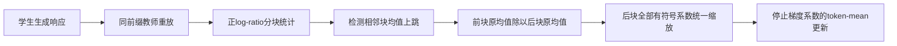
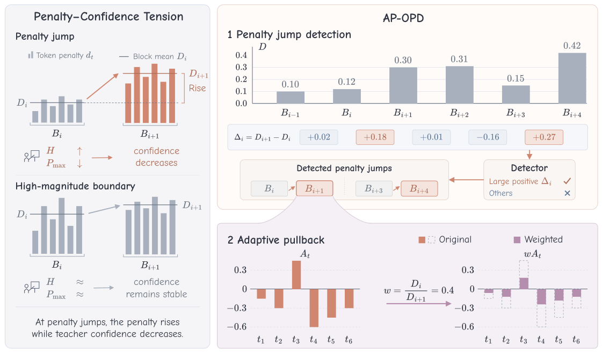

# AP-OPD：惩罚突增位置的局部监督回拉

> **L1 定义性损失组件，不是数学或代码能力复现。** 完整实验成本过高，不复现（审查 DONE）；不可晋级，未接入 Evolve。

## 论文信息

| 字段 | 内容 |
|---|---|
| 论文链接 | [arXiv 2610.28194](https://arxiv.org/abs/2610.28194v1)；[固定 v1 正文](https://arxiv.org/html/2610.28194v1) |
| 公司 / 机构 | 一作 Guangyu Liu：Nanjing University（按 PDF 首页上标 1 核验）；合作机构 Shanghai AI Laboratory |
| 首次公开日期 | 2026-10-20T13:34:43Z（arXiv v1，UTC） |
| 原作者代码 | 截至本轮核查，原文 HTML/PDF 未找到原作者公开源码链接；不把参考文献代码当本文实现 |
| 本地 adapter / 方法键 | `ap-opd`；`adapter: null`，独立损失组件 |
| 本地代码位置 | [`src/auto_research/post_training/oct21_distillation.py`](https://github.com/daiwk/auto-research/blob/main/src/auto_research/post_training/oct21_distillation.py) |
| 运行入口 | [`scripts/run_oct21_post_components.py`](https://github.com/daiwk/auto-research/blob/main/scripts/run_oct21_post_components.py) |

## 原始论文总结

### 背景与主要改动

同样高的 OPD 惩罚可能是持续稳定的，也可能刚刚突增。AP-OPD 用相邻 token 块定位后一种情况，再把突增后整块监督按一个比率回拉；不增加教师 forward，不改变 token 系数的正负。均值和检测器始终读取**原始、未加权**统计，不能递归使用已回拉的前块。



<!-- paper-figure:start -->
### 原论文关键图

[](https://arxiv.org/pdf/2610.28194v1#page=2)

> Figure 1：左侧区别持续高惩罚与惩罚突增，右侧展示上跳检测和有符号监督的统一缩放。图片来自[原论文](https://arxiv.org/abs/2610.28194v1)，版权归原作者所有；由固定PDF第2页裁剪，已视觉核对。
<!-- paper-figure:end -->

### 核心公式

令 $r_t=\log p_S(y_t)-\log p_T(y_t)$，$d_t=[r_t]_+$。块内均值 $D_i$ 包含非正 token 的零惩罚，方差采用样本方差。默认 $B=64,z=2$，当两块至少各有 2 个 token 且

$$
D_{i+1}-D_i>z\sqrt{s_i^2/n_i+s_{i+1}^2/n_{i+1}}
$$

时，令后一块 $w_t=D_i/D_{i+1}$，其余为 1。该 $z$ 门槛不是相关 token 下校准的显著性检验。可选 top-$\alpha$ 按正向均值差选取至多 $\lceil\alpha C\rceil$ 个边界，默认 $\alpha=0.05$。

$$
L=\frac{1}{N_{tok}}\sum_t w_t\operatorname{sg}(r_t)\log p_S(y_t).
$$

权重不重新归一化、不设下界、不修改系数符号。即使后块的某个 $r_t<0$，它也与同块其他 token 一起缩放；不能只处理正惩罚。若前块均值为零，允许后块权重为零。

### 论文离线与线上效果

作者表 1 数学六套件宏平均：vanilla OPD 31.82%，AP-OPD z-gate 32.39%，top-$\alpha$ 32.62%；是两个训练 run 的共享 Avg@$k$ 协议，不是本地结果。未报告生产线上 A/B。

## 本地复现

### 数据协议与运行

```bash
PYTHONPATH=src python scripts/run_oct21_post_components.py \
  --methods ap-opd --device cuda --seeds 42,43,44 \
  --output runs/ap-opd-component.json
```

无下载。随机初始化 12-token、8 维因果 GRU 策略实际采样响应，独立冻结教师在相同前缀重放，默认每 seed 3 次 SGD。诊断响应长 10，块长缩为 2 以覆盖多个边界；通用算子默认仍是论文 $B=64$。合成 token 不代表自然语言数学能力，输出不可覆盖，CUDA 不可用不回退。

### 结果、代码映射与边界

`adaptive_pullback_weights` 实现两种检测器；`adaptive_pullback_loss` 保留停止梯度的权重和 log-ratio。独立 Python 标量/解析梯度参考，实际无回拉损失负对照，另用阶梯夹具区分原始参考与错误递归参考。测试覆盖负系数、零参考、末块、padding、非有限值和教师冻结。

CPU 三 seed 已执行；CUDA 结果与环境以本轮提交的[GPU 回执](../../gpu-validations/ap-opd-a100-20261021.json)为准。仅支持组件机制结论，不声明教师质量、通用能力或论文提升已复现。

**完整实验成本过高，不复现（审查 DONE）：** 原文 1.7B 学生 / 8B 数学教师，17,398 训练题、128 prompts/batch、200 更新、最长 8,192-token 响应；另有教师 200 步 GSPO（512题×16 rollout）、代码实验及每模型 7,388 条数学评测响应。完整矩阵预计单 A100/A30 需长时间生成和多教师训练，属基于配置的成本估计，不下载/试跑探成本。
