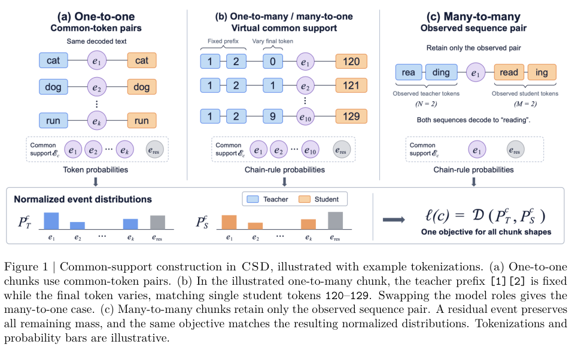

# CSD: Distillation across tokenizers using shared text events

<!-- source-sha256: 591df9af1614f7db05309f2e266245b850966b7be9c906c76936f6bd0fba1746 -->

[简体中文](README.md)

> **L1 alignment and loss component; diagnostic only.** No full LLM capability or Evolve reproduction.

## Paper information

| Field | Details |
| --- | --- |
| Paper | [CSD: Common-Support Distillation for Cross-Tokenizer Knowledge Transfer](https://arxiv.org/abs/2610.28895v1) |
| Affiliations | First author Mingyu Yang: NVIDIA |
| First public release | 2026-10-20 20:18:46 UTC |
| Author code | [NVIDIA-NeMo/RL PR #4680](https://github.com/NVIDIA-NeMo/RL/pull/4680), Apache-2.0, [pinned head](https://github.com/NVIDIA-NeMo/RL/tree/c560131e789f07c8f1b8063cad19eb4ccc87d87c). Loss/subtoken utilities visible in the open PR, not a merged release or completed upstream GPU qualification. |
| Local key | `csd`; no adapter |
| Local code | `src/auto_research/post_training/csd.py` |
| Local evidence | [Local mechanism metrics](metrics/component-cuda-seeds42-44.json); [A100 validation receipt](../../gpu-validations/csd-a100-20261022.json) |

## What the paper changes

Align chunks by minimal common character boundaries and decoded text, not token IDs. For 1:1 use shared token events; for 1:N or M:1 hold observed prefixes fixed and enumerate equivalent final completions; M:N defaults to the observed sequence only. The REST event preserves unmatched mass.

### Original paper figure



Original figure from the reviewed paper, reused without redrawing.

### Core equations

$$
q_S(k)=\left[\prod_{r=1}^{M-1}p_S(s_r\mid h_S,s_{<r})\right]
p_S(u_k\mid h_S,s_{<M}),
\qquad
P_S=(q_S(1),\ldots,q_S(K),1-\sum_kq_S(k)).
$$

$$
L_{KD}=\frac{\sum_{c\in C_{1:1}}D(P_T^c,P_S^c)+\beta\sum_{c\in C_{\ne}}D(P_T^c,P_S^c)}{|C_{1:1}|+|C_{\ne}|},
\quad
L=L_{CE}+\operatorname{sg}(L_{CE}/L_{KD})L_{KD}.
$$

Chain probabilities use full vocabulary and no length normalization or re-softmax, even with teacher top-k. Teacher detached; students differentiate through all chain factors, final token and REST. Default JSD and non-1:1 weight five; divide by unweighted accepted-chunk count. Detach the entire CE/KD scale, reverting to CE for zero KD or no shared events.

### Results reported by the authors

The paper compares Qwen/Phi teachers and Llama/Gemma students with different tokenizers, reporting aggregate and per-task scores and top-k efficiency trade-offs. No universal gains or production A/B; MMLU/GSM8K were not run locally.

## Local reproduction and limits

`align_offsets` checks boundaries and full decode; source-verified whitespace gaps may be accepted, gaps without source are skipped, invalid/non-whitespace mismatches rejected. `paired_completions` maps decoded alternatives; `event_distribution` and `common_support_loss` implement the shared event rules. Synthetic Embedding+Linear models use four chunk shapes, frozen teacher and three SGD updates. CPU seeds report ~1.8e-15 loss and 1.1e-13 gradient differences from dense reference; dropping chain or REST differs. Caller owns causal alignment, same textual history and zero-width specials. No semantic-role matching, huge offline tables, distributed TP/CP, teacher transport or full training.

```bash
PYTHONPATH=src python -c 'from auto_research.post_training.csd import diagnostic; print(diagnostic(42, device="cpu"))'
python -m pytest -q tests/test_csd.py
```

### Full experiment: not reproduced

Appendix E.3 uses 32 nodes/256 H100s for timings; 1B student 30,000 steps, global batch 768, context 4,096, plus 8B students and up to 14B teachers. No weights, full trial or retry.

### Additional references

[Full paper](https://arxiv.org/html/2610.28895v1) · [Paper PDF, p. 3](https://arxiv.org/pdf/2610.28895v1#page=3) · [`csd.py`](https://github.com/daiwk/auto-research/blob/main/src/auto_research/post_training/csd.py) · [`test_csd.py`](https://github.com/daiwk/auto-research/blob/main/tests/test_csd.py)
