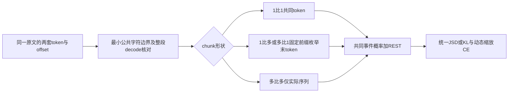
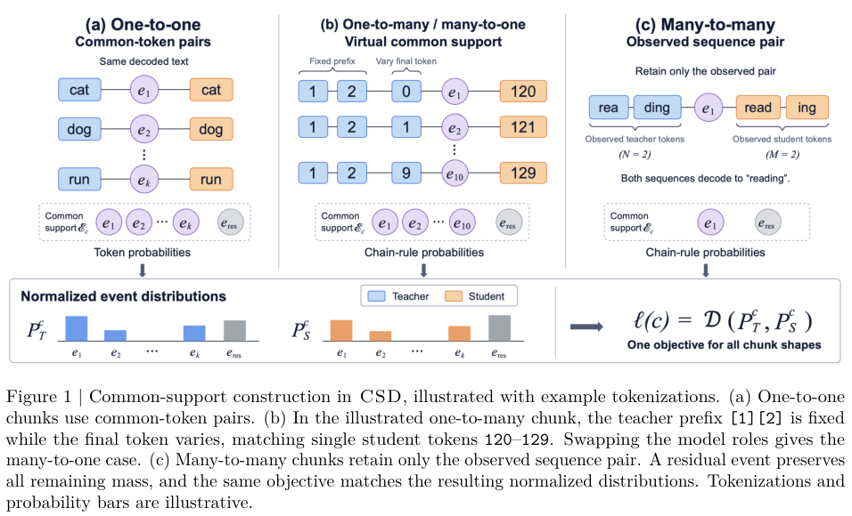

# CSD：让不同 Tokenizer 在共同文本事件上蒸馏

> **L1 跨 Tokenizer 对齐与损失组件，不是大模型能力复现。** 不可晋级、未接入 Evolve。完整实验成本过高，不复现（审查 DONE）。v1 提交在 10 月 20 日截止时间之后，本轮归 **2026-10-22 首次公告**，不改写其真实提交日期。

## 论文信息

| 字段 | 内容 |
|---|---|
| 论文链接 | [arXiv 2610.28895v1](https://arxiv.org/abs/2610.28895v1)；[固定正文](https://arxiv.org/html/2610.28895v1) |
| 公司 / 机构 | 一作 Mingyu Yang：NVIDIA（NVIDIA 技术报告，已核对固定 PDF 首页） |
| 首次公开日期 | 2026-10-20T20:18:46Z（arXiv v1，UTC）；首次公告 2026-10-22；封面报告日期不能替代 arXiv v1 时间 |
| 原作者代码 | 正文脚注公开 [NVIDIA-NeMo/RL PR #4680](https://github.com/NVIDIA-NeMo/RL/pull/4680)，[固定 head](https://github.com/NVIDIA-NeMo/RL/tree/c560131e789f07c8f1b8063cad19eb4ccc87d87c)，Apache-2.0 |
| 代码发布边界 | 核对时 PR 仍 open，loss 与 sub-token 工具可读取；不写成已合并 release 或已完成上游所有 GPU qualification |
| 本地 adapter / 方法键 | `csd`；`adapter: null`，独立数学组件 |
| 本地代码位置 | [`src/auto_research/post_training/csd.py`](https://github.com/daiwk/auto-research/blob/main/src/auto_research/post_training/csd.py) |
| 定向测试 | [`tests/test_csd.py`](https://github.com/daiwk/auto-research/blob/main/tests/test_csd.py) |

## 原始论文总结

### 背景与主要改动

师生词表大小、token ID 与分词边界不一致，不能直接逐坐标 KL。CSD 先按原文字符区间对齐 chunk，再通过 **解码文本等价** 构造共同事件。1:1 采用共同 token；1:N 或 M:1 固定观察到的 chunk 前缀，只枚举末 token 的等价续写；M:N 默认只保留实际观察序列。未显式匹配的质量进入 REST，而不是被丢弃或重新归一化。



<!-- paper-figure:start -->
### 原论文关键图

[](https://arxiv.org/pdf/2610.28895v1#page=3)

> 原论文 Figure 1，固定 v1 第 3 页原图裁剪，已视觉核对。版权归 NVIDIA / 原作者所有；没有将示意概率条当作实验结果。
<!-- paper-figure:end -->

### 核心公式

令 $u_k,v_k$ 是解码到相同文本的两个末 token。对于长度 $M:N$ 的 chunk：

$$
q_S(k)=\left[\prod_{r=1}^{M-1}p_S(s_r\mid h_S,s_{<r})\right]
p_S(u_k\mid h_S,s_{<M}),
\qquad
P_S=(q_S(1),\ldots,q_S(K),1-\sum_kq_S(k)).
$$

教师同理计算并冻结。这里是完整链式概率，**不做长度归一化，也不对保留候选重新 softmax**。teacher top-k 只缩小显式事件集合，概率仍取原始完整词表 softmax。

$$
L_{KD}=\frac{\sum_{c\in C_{1:1}}D(P_T^c,P_S^c)+\beta\sum_{c\in C_{\ne}}D(P_T^c,P_S^c)}{|C_{1:1}|+|C_{\ne}|},
\quad
L=L_{CE}+\operatorname{sg}(L_{CE}/L_{KD})L_{KD}.
$$

默认 $D=JSD$、$\beta=5$；本地也提供正向/反向 KL。分母是被接受 chunk 的 **未加权数量**，不能改成权重和；零 KD 或没有显式共同事件时回退 CE。学生梯度经过所有 chain factors、末 token 与 REST；动态比例整体 stop-gradient。

### 论文离线与线上效果

论文比较不同 tokenizer 的 Qwen/Phi 教师与 Llama/Gemma 学生，表格包含平均能力分、任务细分和 top-k 效率折中；不保证每一任务都提升。未报告生产线上 A/B。本地没有执行 MMLU、GSM8K 或任何论文大模型能力 benchmark。

## 本地复现

### 数据协议与运行

```bash
PYTHONPATH=src python -c 'from auto_research.post_training.csd import diagnostic; print(diagnostic(42, device="cpu"))'
python -m pytest -q tests/test_csd.py
```

`align_offsets` 对原文字符 span 做最小公共边界对齐并核对整体 decode；`paired_completions` 在固定前缀下按文本建映射，不按相同 ID、概率排名或给定相似分配对；`event_distribution` 计算可微 chain probability 与 REST；`common_support_loss` 实现所有形状共享的 JSD/KL、chunk 加权和动态 CE/KD。

Tokenizer 的 `trim_offsets` 可能略去空白：调用方提供 `source_text` 时，只允许原文确认的空白 gap，并核对两侧整段解码与原文相同或仅空白不同；缺少原文时保守跳过有 gap 的 chunk。非空白内容丢失、越界或解码不符都拒绝，不把未对齐内容默认为同一事件。

微型诊断使用两套不同大小的词表与不同分词，覆盖四种 chunk 形状。极小的 Embedding+Linear 条件模型以各自上一个 token 为输入：教师冻结，学生真实做三次 SGD 更新。该模型只用于公式核验，不声称具备语言能力或复现预训练分布。

### 结果、代码映射与边界

CPU seeds 42/43/44 均通过独立 dense-softmax 概率乘积参考：loss 最大差约 $1.8\times10^{-15}$、logit 梯度最大差约 $1.1\times10^{-13}$。移除 chain factors 或丢掉 REST 后重归一化的错误实现均与正确 KD 明显不同。数值一致只验证算子；不代表蒸馏提升。CUDA 记录分别见本轮 `metrics/component-cuda-seeds42-44.json` 与 [GPU 回执](../../gpu-validations/csd-a100-20261022.json)，以实际回执为准。

调用方须保证每个 logit row 对应自己模型的正确因果 predictor 位置，以及两侧 chunk 历史代表相同原文前缀；本接口不静默猜测 shift。特殊 token 的语义 role 匹配、超大 tokenizer 离线表构建、分布式 TP/CP、在线 teacher transport 和完整大模型训练未实现。零宽特殊 token 必须先由调用方处理；歧义 decode 拼写会被保守排除，避免重复事件概率。本地词表枚举仅用于可负担组件，不宣称其适合完整数十万词表生产训练。

**完整实验成本过高，不复现（审查 DONE）：** 原文 Appendix E.3 的计时环境为 32 节点共 256×H100；1B 学生训练 30,000 steps、global batch 768、context 4096，另有 8B 学生与最高 14B 教师。现有单卡 A100/A30 不匹配这套联合训练、数据与多方法比较预算，不下载大权重、不试跑完整配方；已审查关闭的成本项不会阻塞扫描水位。
