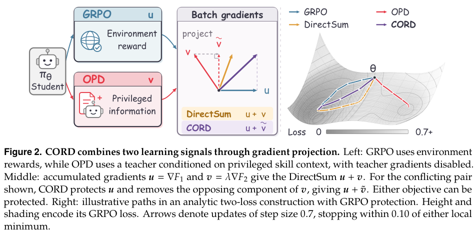

# CORD: Protecting one gradient when combining RL and distillation

<!-- source-sha256: 36735db8c5f16290550281a76e69e68461ece48ace445a744dbc09f2102541e1 -->

[简体中文](README.md)

> **L1 gradient-combination component; diagnostic only.** No full agent trainer, capability or Evolve integration.

## Paper information

| Field | Details |
| --- | --- |
| Paper | [CORD: Conflict-Aware Optimization for Joint RL and Distillation in Agents](https://arxiv.org/abs/2610.29965v1) |
| Affiliations | First author Wenhao Yu: The Chinese University of Hong Kong; collaborators Tencent and Peking University. |
| First public release | 2026-10-21 16:19:22 UTC |
| Author code | [CORD-release](https://github.com/LvAoAo/CORD-release), Apache-2.0 at [ba09683](https://github.com/LvAoAo/CORD-release/tree/ba09683e4440c67ab607c6c7ce7276350174fc55). |
| Local key | `cord`; no adapter |
| Local code | `src/auto_research/post_training/cord.py` |
| Local evidence | [Local mechanism metrics](metrics/component-cuda-seeds42-44.json); [A100 validation receipt](../../gpu-validations/cord-a100-20261022.json) |

## What the paper changes

The two objectives can cancel. Scale the second by lambda, choose which direction to protect and minimally project only the other. Conflict-only projects negative inner products, whereas always removes parallel components even for aligned gradients. These gates and the two protected-objective choices are distinct configurations.

### Original paper figure



Original figure from the reviewed paper, reused without redrawing.

### Core equations

$$
g=a+\widetilde b,\qquad
\widetilde b=
\begin{cases}
b-\frac{\langle a,b\rangle}{\|a\|^2}a,&\langle a,b\rangle<0,\ \|a\|>0,\\
b,&\text{otherwise}.
\end{cases}
$$

$$
\langle a,g\rangle=\|a\|^2+\max(\langle a,b\rangle,0).
$$

For nonzero protected direction the conflict projection is the nearest vector with nonnegative alignment. A zero protected vector is not projected; lambda zero returns the first gradient directly. The identity is pre-optimizer, first-order and for fixed sampled loss, not an AdamW or finite-step descent guarantee. Aggregate each objective across the optimizer minibatch using fixed weights before one projection, not per microbatch.

### Results reported by the authors

Table 1 reports improvement on ALFWorld for all three hosts, not all WebShop settings. The main comparison uses one training seed with four evaluation draws, not four trainings. No production A/B or local environment success rate.

## Local reproduction and limits

`combine_gradients`, `accumulate_gradients` and `objective_gradients` operate on real vectors/scalar gradients on one device, not FSDP cross-shard reduction. A tiny two-CE MLP takes three SGD steps. CPU seeds 42/43/44 verify autograd and scalar references with about $2.3\times10^{-16}$ maximum error; projecting before aggregation produces 0.5 difference. Aligned-gradient control distinguishes gates. The pinned source's first-objective protection/conflict gate/sharded stats do not implement every paper branch; swapped protection and always follow Algorithm 1. No real rollouts, skill bank or benchmark.

```bash
PYTHONPATH=src python -c 'from auto_research.post_training.cord import diagnostic; print(diagnostic(42, device="cpu"))'
python -m pytest -q tests/test_cord.py
```

### Full experiment: not reproduced

Eight A100 40GB, Qwen2.5-3B-Instruct, 150 rounds, eight rollouts/question, up to 50 ALFWorld or 15 WebShop actions, plus 7B and other baselines. Full matrix not reproduced; no expensive trial or retry.

### Additional references

[Paper PDF](https://arxiv.org/pdf/2610.29965v1) · [Paper PDF, p. 4](https://arxiv.org/pdf/2610.29965v1#page=4) · [`cord.py`](https://github.com/daiwk/auto-research/blob/main/src/auto_research/post_training/cord.py) · [`test_cord.py`](https://github.com/daiwk/auto-research/blob/main/tests/test_cord.py)
