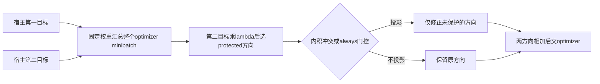
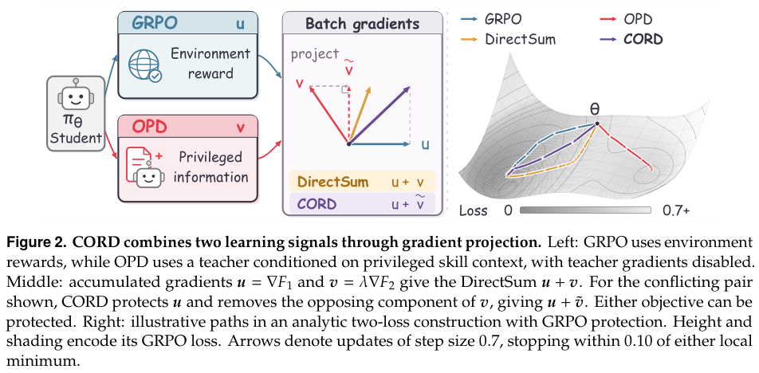

# CORD：在联合 RL 与蒸馏时选择保护哪一个梯度

> **L1 梯度组合组件，不是 Agent 能力复现。** 不可晋级、未接入 Evolve。完整实验成本过高，不复现（审查 DONE）。本篇属于 **2026-10-22 新公告**，不是将旧候选重记为新论文。

## 论文信息

| 字段 | 内容 |
|---|---|
| 论文链接 | [arXiv 2610.29965v1](https://arxiv.org/abs/2610.29965v1)；[固定 PDF](https://arxiv.org/pdf/2610.29965v1) |
| 公司 / 机构 | 一作 Wenhao Yu：The Chinese University of Hong Kong；合作机构 Tencent、Peking University |
| 首次公开日期 | 2026-10-21T16:19:22Z（arXiv v1，UTC）；首次公告 2026-10-22 |
| 原作者代码 | [CORD-release](https://github.com/LvAoAo/CORD-release)，Apache-2.0；[固定 revision](https://github.com/LvAoAo/CORD-release/tree/ba09683e4440c67ab607c6c7ce7276350174fc55) |
| 本地 adapter / 方法键 | `cord`；`adapter: null`，独立数学组件 |
| 本地代码位置 | [`src/auto_research/post_training/cord.py`](https://github.com/daiwk/auto-research/blob/main/src/auto_research/post_training/cord.py) |
| 定向测试 | [`tests/test_cord.py`](https://github.com/daiwk/auto-research/blob/main/tests/test_cord.py) |

## 原始论文总结

### 背景与主要改动

任务奖励和教师指导提供不同信号，直接相加会让相反的梯度互相抵消。CORD 不替换 GRPO 或 OPD 的目标，而是明确选择一个 **protected objective**，最小修改另一个梯度。是否修改由独立的投影 gate 决定：只在冲突时投影，或始终去掉平行分量。两种保护方向、两种 gate 不能混为同一个算法配置。



<!-- paper-figure:start -->
### 原论文关键图

[](https://arxiv.org/pdf/2610.29965v1#page=4)

> 图片来自[原论文](https://arxiv.org/pdf/2610.29965v1#page=4) Figure 2，固定 v1 第 4 页裁剪，已视觉核对。版权归原作者所有；图中的完整 Agent 宿主不是本地已实现能力。
<!-- paper-figure:end -->

### 核心公式

定义 $u=\nabla F_1$、$v=\lambda\nabla F_2$，再选 $(a,b)=(u,v)$ 或 $(v,u)$。冲突模式：

$$
g=a+\widetilde b,\qquad
\widetilde b=
\begin{cases}
b-\frac{\langle a,b\rangle}{\|a\|^2}a,&\langle a,b\rangle<0,\ \|a\|>0,\\
b,&\text{其他情况}.
\end{cases}
$$

这等价于在 $\langle a,z\rangle\ge0$ 下寻找离 $b$ 最近的向量。`always` 模式对同向梯度也投影；零 protected 梯度不投影；$\lambda=0$ 按 Algorithm 1 直接返回 $G_1$。

$$
\langle a,g\rangle=\|a\|^2+\max(\langle a,b\rangle,0).
$$

以上是 **optimizer 转换前、固定 sampled loss 的一阶方向性质**，不保证 AdamW 更新后或有限步长下某个目标必然下降。先按固定 $\alpha_m$ 累加 $G_j=\sum_m\alpha_mg_j^{(m)}$，再投影一次；逐 microbatch 投影后相加通常不等价。

### 论文离线与线上效果

正文 Table 1 的三个宿主方法在 ALFWorld 均改善；WebShop 并非全部改善。论文明确主体对照只有一个训练 seed、四次评测采样，不能把四次 decode 当成四个训练 seed。未报告生产线上 A/B；本地没有重现环境成功率。

## 本地复现

### 数据协议与运行

```bash
PYTHONPATH=src python -c 'from auto_research.post_training.cord import diagnostic; print(diagnostic(42, device="cpu"))'
python -m pytest -q tests/test_cord.py
```

`combine_gradients` 对已汇总向量执行公式；`accumulate_gradients` 先应用调用方固定的损失聚合权重，再执行一次投影；`objective_gradients` 从真实 scalar loss 提取参数梯度。该入口是单设备向量算子，没有假装实现 FSDP 跨 shard 归约。

诊断用两个冲突的交叉熵目标对一个极小 MLP 做三次真实 SGD 更新，验证一般双目标组合公式。它们 **不是环境 rollout、GRPO 回报、教师技能或 Agent benchmark**；预训练模型、公共能力评测和外部 API 调用均为零。

### 结果、代码映射与边界

CPU seeds 42/43/44 均通过独立总 loss 的 autograd 梯度与逐标量点积参考；最大梯度差及 protected 一阶恒等式误差均约 $2.3\times10^{-16}$。只改变投影位置的错误 microbatch 实现产生 0.5 的最大坐标差；同向梯度下 `always` 与 `conflict-only` 也明确不同。这些是数值/机制检验，不是任务效果指标。CUDA 执行记录分别保存在本轮 `metrics/component-cuda-seeds42-44.json` 与 [GPU 回执](../../gpu-validations/cord-a100-20261022.json)，以实际回执为准。

固定作者代码 `verl/trainer/ppo/cord_utils.py` 实现第一目标保护、冲突门控及分片统计归约；本地的交换保护方向和 `always` 分支依据论文 Algorithm 1，不冒称该源码快照已有所有实验分支。没有实现完整 host trainer、skill bank、LLM rollout、环境状态或长期能力比较；不作为可执行 Evolve operator。

**完整实验成本过高，不复现（审查 DONE）：** 正文使用 8×A100 40GB、Qwen2.5-3B-Instruct、150 训练轮、每题八条 rollout，ALFWorld/WebShop 最多 50/15 次行动，另有 7B 实验。现有单卡 A100/A30 不匹配整套训练及多方法评测预算；成本判断来自论文配置，不启动长 rollout 或试跑来证明其昂贵。低成本算子核验不等于完成这套实验。
