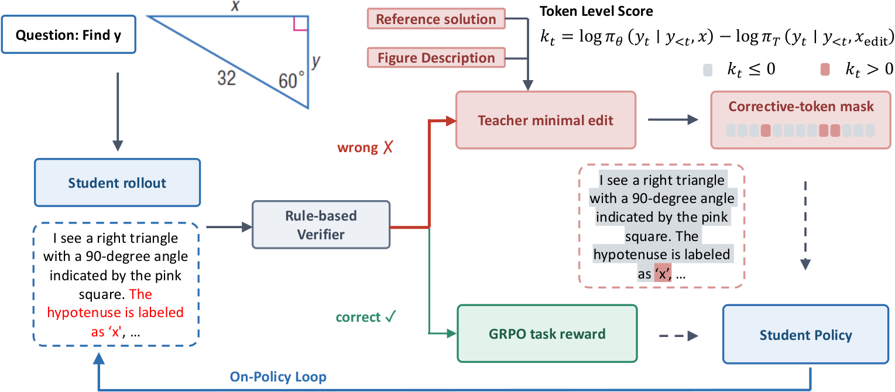

# Minimal-Edit OPD: Correct unsupported tokens while retaining task rewards for successful rollouts

<!-- source-sha256: f561d41e240e5bf8d7432d1c5ac5ffd5613d32ca01d52437e7216102c856cfbc -->

[简体中文](README.md)

> **L1 routing and correction loss; diagnostic only.** Full multimodal training not reproduced due to cost.

## Paper information

| Field | Details |
| --- | --- |
| Paper | [Edit, Don't Imitate: Minimal-Edit On-Policy Distillation for Multimodal Reasoning](https://arxiv.org/abs/2610.30231v1) |
| Affiliations | First author Wen Ye: Meta Superintelligence Labs (first affiliation) and USC; other affiliations include UC Berkeley, Cornell and UCLA. |
| First public release | 2026-10-21 17:59:28 UTC (announced 2026-10-23) |
| Author code | No verifiable author source in v1 or exact-ID GitHub search as of 2026-10-25. This is not proof no release exists elsewhere. Independent implementation; paper and figure CC BY 4.0. |
| Local key | `minimal-edit-opd`; no adapter |
| Local code | `src/auto_research/post_training/minimal_edit_opd.py` |
| Local evidence | [Local mechanism metrics](metrics/component-cuda-seeds42-44.json); [Raw CPU run](../../research-audits/oct25-priority-components/raw-cpu.json); [A100 validation receipt](../../gpu-validations/minimal-edit-opd-a100-20261025.json) |

## What the paper changes

For visual reasoning, keep useful parts of a student's answer and correct only tokens the privileged teacher supports less than the frozen behavior policy. The teacher sees a training-only diagram description, verified solution and the entire original response, then teacher-forces that response a second time instead of generating a new answer. Correct responses receive task GRPO only; none of the teacher, references or verifier enters deployment.

### Original paper figure



Original figure from the reviewed paper, reused without redrawing. See [figure provenance](assets/provenance.json).

### Core equations

$$
m_{it}=\operatorname{sg}\!\left(\mathbf 1\left[\ell^{S,old}_{it}-\ell^T_{it}>0\right]\right),
\qquad Z=\sum_{i\in\mathcal I,t}m_{it}.
$$

$$
L_{corr}=\begin{cases}
\displaystyle\frac1Z\sum_{i\in\mathcal I,t}m_{it}\left[\log\pi_\theta(y_{it}|x_i,y_{i,<t})-\ell^T_{it}\right],&Z>0,\\
0,&Z=0,
\end{cases}
\qquad L=L_{task}(\theta;\theta_{old},\mathcal C)+\lambda L_{corr}.
$$

$$
A_i=\frac{r_i-\operatorname{mean}_{j\in G_i}r_j}{\operatorname{std}_{j\in G_i}(r_j;\mathrm{correction})+\epsilon},\quad
\rho_{it}=\exp(\log\pi_\theta-\ell^{S,old}_{it}),
$$

$$
L^{local}_{PG}=-\operatorname{mean}_{i\in\mathcal C}\operatorname{mean}_{t\in response_i}
\min\{\rho_{it}A_i,\operatorname{clip}(\rho_{it},.8,1.2)A_i\}.
$$

Compute task advantages over all $K$ rewards before routing, not over correct-only rewards. Select strict positive old-minus-teacher log-probability on wrong rows and freeze the mask across updates. The linear sampled-token log ratio uses one minibatch-wide selected-token denominator; it is not full-vocabulary KL, REINFORCE or teacher-answer CE. Empty branches contribute differentiable zero. The exact interface accepts caller-computed full-group advantages and correct-only task loss. Paper specifies asymmetric sign branches with clip .2 but not std correction, epsilon, token/sequence reduction or exact verl setup; population SD, $10^{-6}$ and response means in diagnostics are local choices. Teacher, old policy, rewards and advantages are detached.

### Results reported by the authors

Table 1 Geometry3K pass@1/pass@8, MathVerse ALL and Geoperception pass@1: Base .321/.540/37.8/.179; plain GRPO .447/.625/42.1/.279; privileged OPD (8B teacher) .487/.707/40.0/.320; minimal-edit (8B) .554/.794/45.8/.455; minimal-edit (2B self-teacher) .498/.756/46.9/.438. Geometry uses 32 rolls per item; MathVerse uses greedy judging. In Table 2 with 8B student, Geometry3K .699 is below privileged OPD .708. No production A/B or local capability result.

## Local reproduction and limits

`freeze_rollouts` validates/copies supplied verifier labels, advantages and scores; `minimal_edit_loss` routes aligned sampled logits plus external task loss that must exclude wrong rows. `full_group_advantages` and `correct_rollout_grpo` are explicit local helpers. Padded and unused correct-row teacher values cannot contaminate gradients; half promotes to FP32. Independent probability/gradient checks and real synthetic SGD cover sign, old/current separation, routing, reduction, clipping, detach, zeros and invalid/overflow inputs. CPU/A100 three-seed evidence is mechanism-only. No prompt/tokenization pipeline, teacher, verifier, gold reading or Evolve.

```bash
OMP_NUM_THREADS=1 MKL_NUM_THREADS=1 PYTHONPATH=src python -m pytest tests/post_training/test_minimal_edit_opd.py -q
PYTHONPATH=src python -c 'from auto_research.post_training.minimal_edit_opd import diagnostic; print(diagnostic(42, device="cpu"))'
```

### Full experiment: not reproduced

The matrix covers Qwen3-VL-2B→8B, 8B→32B, Qwen2.5-VL-7B→32B and self-teachers. Up to 32 reference attempts filter ~2.1K prompts to 1.8K. K=8, max 2,048 tokens, 96-problem minibatch, up to 30 epochs, LR $10^{-6}$ and correction .01. 1,572,864 tokens is a batch cap, not measurement. Teacher processes $P_t+2R$; estimated FLOP ratios to naive OPD are .929 for 8B/32B and 1.133 for 2B/8B, not always cheaper. No full matrix, weights, expensive probe or retry.

### Additional references

[Paper Figure 1](https://arxiv.org/html/2610.30231v1#S1.F1)
