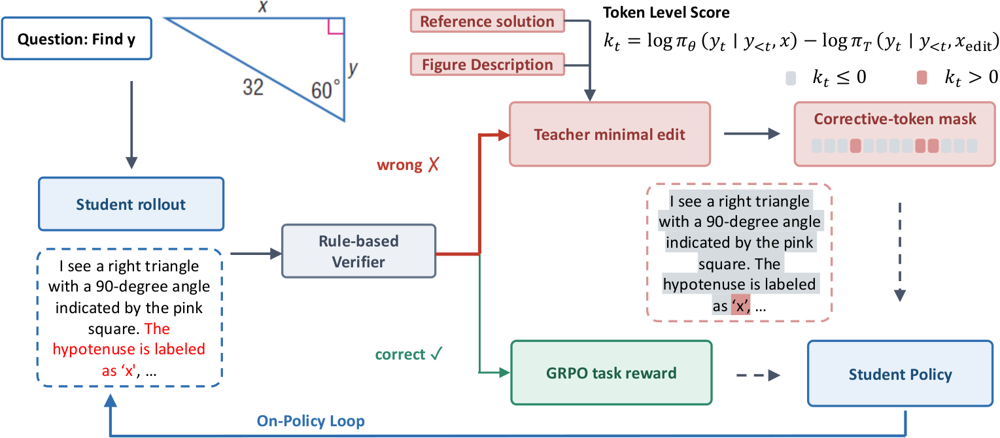
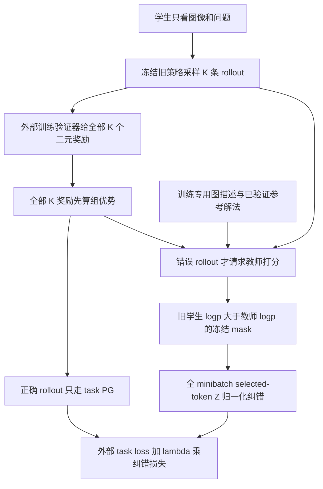

# Minimal-Edit OPD：只纠正错误 token，保留成功轨迹的任务奖励

> 本地状态：**L1 精确路由 / 纠错目标组件，diagnostic only**，不是 VLM 能力复现。完整多模态训练：**成本过高，不复现（审查 DONE）**，不自动重试。GRPO 的未公开实现细节不冒充论文原配置。

## 论文信息

| 字段 | 内容 |
|---|---|
| 论文 | [Edit, Don't Imitate: Minimal-Edit On-Policy Distillation for Multimodal Reasoning](https://arxiv.org/abs/2610.30231v1) |
| 公司 / 作者机构 | 一作 **Wen Ye 的第一机构为 Meta Superintelligence Labs**，同时列 University of Southern California；其他作者还列 UC Berkeley、Cornell University、UCLA。本页按一作第一机构归于 Meta |
| 原始发布日期 | **2026-10-21 17:59:28 UTC**，arXiv v1；2026-10-23 公告。本次为 Oct25 重叠补漏，不是 Oct25 新首发 |
| 原作者代码 | **未找到**：截至 2026-10-25，官方摘要页 / HTML 未提供作者代码链接，GitHub 精确 arXiv 编号检索没有命中作者仓库。不是断言所有渠道都未公开 |
| 原作者代码许可 | 无已核验作者仓库，源码许可 / 固定 SHA 不适用；本地依据论文独立重写。论文及原图许可为 **CC BY 4.0** |
| 本地 Adapter / key | `minimal-edit-opd`；独立算法组件，非能力 adapter；`evolve_integrated=false` |
| 本地代码 | `src/auto_research/post_training/minimal_edit_opd.py` |
| 本地入口 | `freeze_rollouts`、`minimal_edit_loss`；另有显式本地约定的 `full_group_advantages`、`correct_rollout_grpo`，以及 `diagnostic(seed, device='cpu')` |
| 指标产物 | [A100 三种子机制指标](metrics/component-cuda-seeds42-44.json)；[CPU 原始结果](../../research-audits/oct25-priority-components/raw-cpu.json)；GPU receipt 为 `docs/gpu-validations/minimal-edit-opd-a100-20261025.json`，已绑定实际冻结源码。均不是 VLM 能力评测 |

## 原始论文总结

### 背景与主要改动

ME-OPD 用训练专属描述与参考解法，让教师为错误的学生回答打分，只纠正教师不支持的 token；正确回答只走任务奖励，避免整段模仿。它针对小型视觉语言模型误读斜边、标签或几何关系的问题，保留原回答中无需修改的推导与措辞。

ME-OPD 让教师在训练时看到图形描述、已验证参考解法和学生的**完整原回答**，要求“用最少编辑修正”。教师不生成新答案，而是 teacher-force 同一学生回答的第二次出现，为原 token 打分。最终答案验证正确的 rollout 只走任务 GRPO；错误 rollout 才走教师分支，而且只保留教师比冻结旧学生更不支持的 token。描述、参考答案、教师和验证器均不进入部署侧学生输入。

<!-- paper-figure:start -->
### 原论文关键图



原始 PNG 直接来自[原论文 Figure 1](https://arxiv.org/html/2610.30231v1#S1.F1)，未重绘、未裁剪，已与原 PDF 第 2 页逐项目视核对输入、验证器、两条分支、mask 符号和循环连线。图中的 VLM、验证器与教师提示系统不代表本地已实现。来源、许可与 SHA-256 见 `assets/provenance.json`。

图片来自[原论文](https://arxiv.org/abs/2610.30231v1)，版权归原作者所有。
<!-- paper-figure:end -->



### 核心公式

依据 Sec. 3.2 与 Appendix A Algorithm 1，先对同一问题的全部 $K$ 个 verifier rewards 计算任务优势，**再**拆为正确集合 $\mathcal C$ 和错误集合 $\mathcal I$。不能先只留下正确 rollout 再算组统计，否则全是奖励 1，没有相对优势。

旧策略是本次 rollout 的冻结行为策略。对错误轨迹：

$$
m_{it}=\operatorname{sg}\!\left(\mathbf 1\left[\ell^{S,old}_{it}-\ell^T_{it}>0\right]\right),
\qquad Z=\sum_{i\in\mathcal I,t}m_{it}.
$$

严格大于才选择；相等和教师更支持的 token 不选。该 mask 在 subsequent policy update 中固定，不因当前学生概率改变而重新选择。

$$
L_{corr}=\begin{cases}
\displaystyle\frac1Z\sum_{i\in\mathcal I,t}m_{it}\left[\log\pi_\theta(y_{it}|x_i,y_{i,<t})-\ell^T_{it}\right],&Z>0,\\
0,&Z=0,
\end{cases}
\qquad L=L_{task}(\theta;\theta_{old},\mathcal C)+\lambda L_{corr}.
$$

$Z$ 是整个 minibatch 的**纠错选中 token 数**，不是所有 response token、不是每条轨迹分别归一化。实现打印目标中的线性 sampled-token log 比值，不擅自换成 full-vocabulary KL、KL 值加权的 REINFORCE 或教师生成答案的交叉熵。$Z=0$ 和没有正确轨迹时保留可反传零；不补造学习信号。

原文只指定 group-relative advantages、双向 clipped PG 和 clip $.2$，未给 std correction、优势 epsilon、token / sequence reduction 或完整 verl 配置。本地精确接口**由调用方传入全 K 已计算优势及 correct-only task loss**；辅助函数明确选择：

$$
A_i=\frac{r_i-\operatorname{mean}_{j\in G_i}r_j}{\operatorname{std}_{j\in G_i}(r_j;\mathrm{correction})+\epsilon},\quad
\rho_{it}=\exp(\log\pi_\theta-\ell^{S,old}_{it}),
$$

$$
L^{local}_{PG}=-\operatorname{mean}_{i\in\mathcal C}\operatorname{mean}_{t\in response_i}
\min\{\rho_{it}A_i,\operatorname{clip}(\rho_{it},.8,1.2)A_i\}.
$$

这里的 std 选择与 sequence-mean 是**本地约定**，不是从论文确认的作者默认值。诊断显式使用 population std、$\epsilon=10^{-6}$。正式集成外部训练器时须核对其真实 TaskAdvantages / PG 定义。旧策略分数仅用于固定 mask 和重要性比率分母，教师、旧策略、奖励与优势均冻结。

### 论文离线与线上效果

原文 Table 1，Qwen3-VL-2B 学生；推理时只给图像和问题：

| 方法 | Geometry3K pass@1 | Geometry3K pass@8 | MathVerse ALL | Geoperception pass@1 |
|---|---:|---:|---:|---:|
| Base | .321 | .540 | 37.8 | .179 |
| GRPO plain prompt | .447 | .625 | 42.1 | .279 |
| Privileged OPD，8B 教师 | .487 | .707 | 40.0 | .320 |
| Minimal-edit，8B 教师 | .554 | .794 | 45.8 | .455 |
| Minimal-edit，2B self-teacher | .498 | .756 | 46.9 | .438 |

Geometry3K 用每题 32 个 rollout 估计 pass@k；MathVerse 为 greedy 单响应和其标准 judge，不能把不同指标拼为统一成功率。Table 2 的 8B 学生上，minimal-edit 的 Geometry3K pass@1=.699，privileged OPD=.708：并非所有列都最佳。原文未报告互联网生产线上 A/B，不作为工业线上提升证据。本地张量诊断不复现这些分数。

## 本地复现

### 代码映射与真实性边界

- `freeze_rollouts` 接收外部 verifier 的二元奖励和外部全组优势，复制并冻结旧学生 / 教师概率、mask 与路由。它不判断自然语言答案正确性，不生成图形描述，不校验参考解法是否真的通过验证器。
- `minimal_edit_loss` 接收当前可训练 logits、采样动作、冻结 batch，以及**外部 correct-only scalar task loss**；准确执行纠错目标及组合。调用方必须保证该 scalar 不包含错误轨迹的 task 梯度。提供的 `correct_rollout_grpo` 只对正确行求 PG，分母是旧策略概率。
- `full_group_advantages` 使用全部 rollout 的奖励统计；调用方必须提供完整同 prompt 的 K 条，而非筛选后子集。它要求显式 std / epsilon，避免把未知配置写成论文事实。
- `sampled_log_probabilities` 在 softmax / gather 前清理 padding；半精度概率计算提升到 float32。正确行教师分数和 padding 可以缺失，不污染梯度。失败行未选 token 只有零梯度。
- 原文教师 prompt 中包含完整学生回答一次，随后再 teacher-force 同一回答一次；这需要真实的输入和 tokenizer 对齐。**本地没有用字符串拼接和伪验证器冒充该系统**，只接收已对齐数值打分。不存在部署侧模型或评测 Agent，也不访问 gold 计算能力指标。

`diagnostic` 使用合成二元标量与随机 logits，真实执行一次 backward / SGD，检查公式与 logits 梯度的独立概率参考、冻结、路由及 padding；不报告任务 accuracy，不下载模型或数据。`promotion_eligible=false`、`evolve_integrated=false`。多个 seed 仍是 L1 机制诊断，不构成能力比较。

```bash
OMP_NUM_THREADS=1 MKL_NUM_THREADS=1 PYTHONPATH=src python -m pytest tests/post_training/test_minimal_edit_opd.py -q
PYTHONPATH=src python -c 'from auto_research.post_training.minimal_edit_opd import diagnostic; print(diagnostic(42, device="cpu"))'
```

### 检查与负控

测试覆盖严格正号、old/current 分歧、正确 / 错误互斥、全 K 组统计、不同轨迹选中数的全局 $Z$、正确轨迹 clipping、教师未使用行 NaN、padding、空 task / 空 mask 的可微零、旧策略 / 教师 / 奖励冻结、低精度 promotion、错误参数和溢出拒绝。CPU/CUDA seeds 42/43/44 的实际产物由本批 runner 生成并绑定 receipt，未执行的结果不预填为成功。

### 高成本完整实验

Sec. 4 使用 Qwen3-VL-2B→8B、8B→32B、Qwen2.5-VL-7B→32B，另有 2B/8B self-teacher，多基线、多下游评测。每训练题先由 privileged teacher 最多采样 **32 条**解法，保留通过规则检查的参考；约 2.1K 的训练问题被过滤到 1.8K。训练每题 **K=8**、响应上限 **2048**、optimization minibatch **96 problems**、最多 **30 epochs**、学习率 $10^{-6}$、$\lambda=.01$。仅一个 batch 的生成配置上限为 $96\times8\times2048=1,572,864$ token，**不是实测 token 数或耗时**。

Appendix B 明确教师会处理 $P_t+2R$ token，因为学生回答在条件中出现一次，又作为打分后缀出现一次。其 FLOP 模型给出的 minimal-edit / naive OPD 比率为 8B/32B **.929**，但 2B/8B 是 **1.133**：不能把只给错误轨迹打分等同于始终便宜。原文没有给可用于承诺单卡时长的硬件 wall-clock，不推造 GPU 数和耗时。

在现有单张 A100/A30 或 Mac 的预算下，不执行完整 VLM 训练、离线教师解法生产和多基准矩阵。结论：**成本过高，不复现（审查 DONE）**；不下载权重、不试跑证明昂贵、不自动重试。这一终态不阻塞审查水位，但也不等于完整算法系统通过能力验收。
