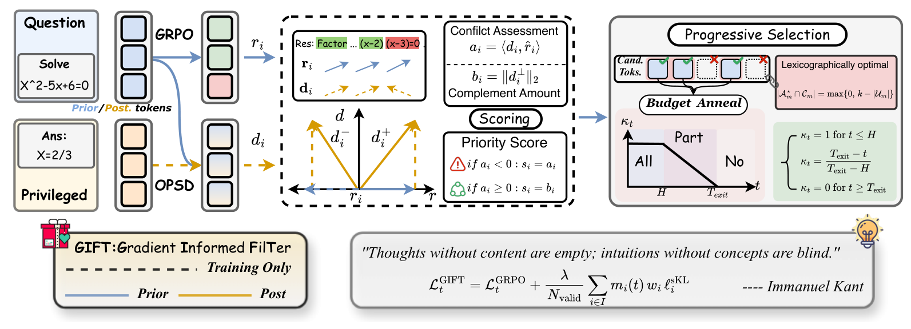

# GIFT: Gradient Informed Filtering for Distillation Augmented Reasoning RL

<!-- source-sha256: e3bc0a3669467498e8d57896ec59617247e371621fda77e7b03276e1b7bee8a3 -->

[简体中文](README.md)

> **L1 gradient-geometry and sparse loss component; diagnostic only.** Full training not reproduced due to cost.

## Paper information

| Field | Details |
| --- | --- |
| Paper | [GIFT: Gradient Informed Filtering for Distillation Augmented Reasoning RL](https://arxiv.org/abs/2610.30796v1) |
| Affiliations | First author Shijie Li: Shanghai Jiao Tong University and Tencent. |
| First public release | 2026-10-22 06:22:45 UTC (announced 2026-10-23) |
| Author code | [lilifree/GIFT](https://github.com/lilifree/GIFT) at `5e9a9dfdb371b7368949abbdc3a846d23a546557`. No first-party license found; vendored licenses do not cover author source. Independent implementation. |
| Local key | `gift`; no adapter |
| Local code | `src/auto_research/post_training/gift.py` |
| Local evidence | [Local mechanism metrics](metrics/component-cuda-seeds42-44.json); [A100 validation receipt](../../gpu-validations/gift-a100-20261023.json) |

## What the paper changes

RL and teacher gradients can conflict. Decompose teacher gradients in the original vocabulary-logit space, prefer nonconflicting tokens with a large orthogonal contribution, and gradually reduce the number distilled rather than diluting their coefficients.

### Original paper figure



Original figure from the reviewed paper, reused without redrawing. See [figure provenance](assets/provenance.json).

### Core equations

$$
r_i=A_i\rho_i h_i(p_i-e_{u_i}),\quad
d_i=\nabla_{z_i}\ell_i^{sKL},\quad
a_i=\langle d_i,\widehat r_i\rangle,\quad
b_i=\|d_i-a_i\widehat r_i\|_2.
$$

$$
k_{t,m}=\min\{\lfloor\kappa_t|I_m|\rfloor,|E_m|\},\qquad
\mathcal L=\mathcal L_{GRPO}+\frac1{N_{valid}}\sum_i m_i\ell_i^{sKL}.
$$

For nonzero RL gradient use signed alignment $a_i$ when negative and orthogonal norm $b_i$ otherwise; absent RL gradient scores zero and zero teacher-gradient tokens are ineligible. Coverage is one through step 10, $(78-t)/68$ thereafter and zero from 78. Normalize retained unprojected KL by **all valid tokens**, coefficient one. Exact quota admits the weakest conflicts when safer candidates are insufficient. Local first-order logit geometry is not a finite-step or shared-parameter safety guarantee.

### Results reported by the authors

Table 1 math mean@12 (AMC23/AIME24/AIME25), base/GRPO/GIFT: Qwen3-1.7B 51.65/52.18/54.25, 4B 74.67/75.65/77.20, 8B 76.67/76.64/78.96. OPSD leads 8B AIME24. No production A/B or local reasoning score.

## Local reproduction and limits

`gift_loss` implements one sub-batch with unit rollout IS, clipped GRPO and top-k-plus-tail KL. Tail gradient is expanded using student conditional tail probabilities in original vocabulary, not computed in bucket space. Geometry/mask and teacher/old/advantage are detached; top-k covering vocabulary gives full KL. Stable ties, FP32 half promotion and padded NaN sanitization are explicit. CPU/A100 three-seed checks compare full/top-1/top-2 gradients to autograd, PPO saturation, neutral/ineligible tokens, weak-conflict fill, valid denominator, schedule and SGD. Teacher exit gives GRPO loss, not proof of skipped upstream model execution. No distributed trainer, rollout, real reward or Evolve.

```bash
OMP_NUM_THREADS=1 MKL_NUM_THREADS=1 PYTHONPATH=src python -m pytest tests/post_training/test_oct23_post_components.py -q
PYTHONPATH=src python -c 'from auto_research.post_training.gift import diagnostic; print(diagnostic(42))'
```

### Full experiment: not reproduced

Author configuration uses 32 GPUs, multi-node Ray/verl, vLLM/FlashAttention, Qwen3-1.7B/4B/8B and OLMo-3-7B-Think, DeepMath-103K and Knights-and-Knaves, 96 steps and eight responses per prompt. No model/data download, expensive probe or retry.

### Additional references

[Paper Figure 1](https://arxiv.org/html/2610.30796v1#S3.F1)
