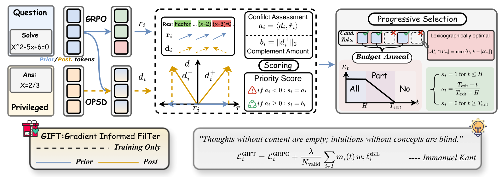
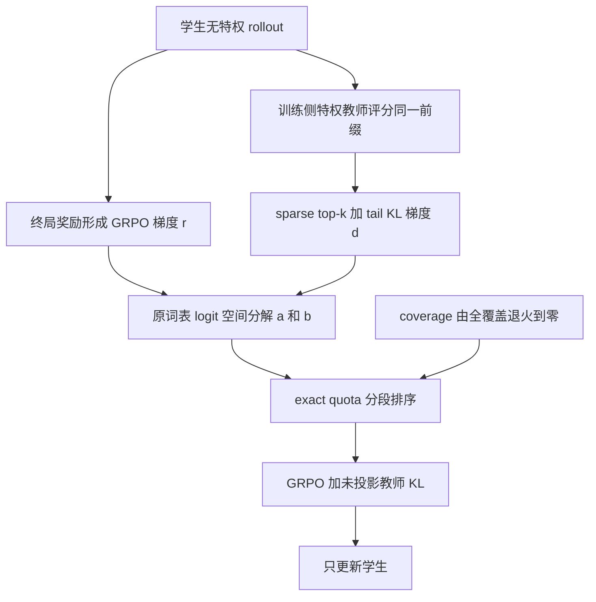

# GIFT：梯度几何驱动的蒸馏 token 选择

> 本地状态：**L1 精确损失组件，diagnostic only**。保留 token 级梯度几何、exact-quota 排序、coverage annealing 与 sparse top-k+tail KL；不是完整推理能力复现。完整实验：**成本过高，不复现（审查 DONE）**。

## 论文信息

| 字段 | 内容 |
|---|---|
| 论文 | [GIFT: Gradient Informed Filtering for Distillation Augmented Reasoning RL](https://arxiv.org/abs/2610.30796v1) |
| 公司 / 作者机构 | 一作 Shijie Li 的第一机构为 Shanghai Jiao Tong University，第二机构 Tencent；作者合作为上海交通大学 / 腾讯，不归为 Google / Meta |
| 原始发布日期 | **2026-10-22 06:22:45 UTC**，arXiv v1；2026-10-23 公告 |
| 原作者代码 | [lilifree/GIFT](https://github.com/lilifree/GIFT)，论文首页直接链接；固定检查 `5e9a9dfdb371b7368949abbdc3a846d23a546557` |
| 原作者代码许可 | 固定版本未找到第一方 LICENSE / COPYING，GitHub repository license 返回 null；vendored 依赖的许可不能代替第一方许可。**未确认开放许可，不复制作者源码**；本地据论文独立实现 |
| 本地 Adapter / key | `gift`；独立组件，无能力 adapter，`evolve_integrated=false` |
| 本地代码 | `src/auto_research/post_training/gift.py` |
| 本地入口 | `coverage_ratio`、`gradient_geometry`、`exact_quota_mask`、`gift_loss`、`diagnostic(seed, device)` |
| 指标产物 | `metrics/component-cpu-seeds42-44.json`；CUDA 证据须由实际运行后独立登记 |

## 原始论文总结

### 背景与主要改动

终局正确性驱动的 RL 梯度与教师模仿梯度可能相冲突。GIFT 在原始词表 logits 空间分解两者：先最少纳入冲突 token，再优先保留提供正交新方向的教师监督；训练逐步缩减被蒸馏的 token 数量，保留项的强度不稀释。

<!-- paper-figure:start -->
### 原论文关键图



来自[原论文 Figure 1](https://arxiv.org/html/2610.30796v1#S3.F1)，采用作者固定仓库提供的 1593×576 同图原文件，未经改写；已与 PDF 第 4 页目视核对梯度分解、分段分数与预算退火。论文许可 CC BY 4.0，来源与 SHA-256 见 `assets/provenance.json`；作者代码许可另行判断。

图片来自[原论文](https://arxiv.org/abs/2610.30796v1)，版权归原作者所有。
<!-- paper-figure:end -->



### 核心公式

对有非零 RL 梯度的 token，按 Eq. 1 / 2：

$$
r_i=A_i\rho_i h_i(p_i-e_{u_i}),\quad
d_i=\nabla_{z_i}\ell_i^{sKL},\quad
a_i=\langle d_i,\widehat r_i\rangle,\quad
b_i=\|d_i-a_i\widehat r_i\|_2.
$$

分数为 $s_i=a_i$（$a_i<0$），否则为 $b_i$；无可用 RL 梯度的 token 分数为 0。零教师梯度 token 不参与排序。一个 training sub-batch 的配额为：

$$
k_{t,m}=\min\{\lfloor\kappa_t|I_m|\rfloor,|E_m|\},\qquad
\mathcal L=\mathcal L_{GRPO}+\frac1{N_{valid}}\sum_i m_i\ell_i^{sKL}.
$$

默认 $\kappa_t=1$ 至第 10 步，随后 $(78-t)/68$，第 78 步起为 0。系数固定 1、分母是**全部有效 token 数**，不能改成 selected token 数，也不能将教师梯度投影后当作 GIFT。

exact quota **不等于永久 conflict-free**：当配额大于非冲突与未分类 token 容量时，最弱冲突会补足配额。论文只给出局部 logit 空间的一阶性质，不保证有限步、共享参数更新或全程安全。

### 论文离线与线上效果

原文 Table 1，数学 AMC23 / AIME24 / AIME25 的 mean@12 等权均值 (%)：

| 模型 | BASE | GRPO | GIFT |
|---|---:|---:|---:|
| Qwen3-1.7B | 51.65 | 52.18 | 54.25 |
| Qwen3-4B | 74.67 | 75.65 | 77.20 |
| Qwen3-8B | 76.67 | 76.64 | 78.96 |

不是每个单独 benchmark 最优，例如 Qwen3-8B 的 AIME24 最优为 OPSD。未报告互联网生产线上 A/B。以上均为原文结果，本地损失组件没有复测这些能力。

## 本地复现

### 保留机制与缩小边界

`gift_loss` 实现一个 actor training sub-batch、单位 rollout IS 权重下的 clipped GRPO 与 GIFT。教师 top-k token 外的质量聚成一个 tail bucket，但 **$d_i$ 仍是原始词表 logit 梯度**：tail 内每个词的有效目标按学生 tail 条件分布分配，不能在压缩 bucket 空间直接算几何。top-k 大于等于词表时退化为精确 full-vocabulary 对照。

`gradient_geometry` 与选择 mask 完全 detach，实际保留的 KL 未投影。`exact_quota_mask` 的 budget 取全部有效 token，按 eligible 数封顶；平分用输入顺序，论文允许任意 tie-break。half 输入先提升 float32，padding 可含 NaN，不进入损失或梯度。teacher-exit 时该损失退化为 GRPO；本接口不是模型执行器，不能宣称已跳过上游模型 forward。

未实现作者的分布式 verl / Ray 调度、rollout engine、真实 self-teacher 构造、奖励函数、多个大模型训练或能力比较。它们没有被启发式替代为“完整复现”。

### 数据、结果与隔离协议

没有下载 checkpoint 或数据。`diagnostic` 对随机可训练 logits 的冻结分布真实抽样，进行一次真实 backward / SGD，记录梯度、参数变化、token 数与冻结检查；不生成数学答案、不读取 gold，不报告任务准确率。它是数值诊断，不是可晋级 Agent，也无 validation 选模 / test 能力评估。

CPU seeds 42、43、44 的实际标量见 `metrics/`；CUDA 复用 `diagnostic(seed, device="cuda")`，需真实硬件结果与收据才能声称通过。多 seed 不改变 diagnostic only 等级。

```bash
OMP_NUM_THREADS=1 MKL_NUM_THREADS=1 PYTHONPATH=src python -m pytest tests/post_training/test_oct23_post_components.py -q
PYTHONPATH=src python -c 'from auto_research.post_training.gift import diagnostic; print(diagnostic(42))'
```

### 检查与负控

- 对 full vocabulary、top-1、top-2 等 sparse tail 配置，逐项比较解析 $r_i,d_i$ 与独立 autograd。
- 检查 PPO 饱和分支、零 RL 中性分数、零教师梯度 eligibility，以及 exact quota 超出安全容量时必须保留弱冲突。
- 检查 full-valid 归一化、覆盖率端点、教师与旧策略/优势 detach、padding 零梯度；不把随机 token 选择或 hard conflict-free 筛选伪装成相同方法。

### 高成本完整实验

作者固定 README 明确纸面配置需要 **32 GPU**，多节点 Ray / verl、vLLM / FlashAttention；使用 Qwen3-1.7B / 4B / 8B 与 OLMo-3-7B-Think、DeepMath-103K 及 Knights-and-Knaves，96 actor steps、每 prompt 8 条响应并比较多种基线。完整训练与整套多模型对照不适合当前单张 A100/A30 或 Mac 的低成本预算；未测量单卡运行时，不给伪精确小时估计。结论：**成本过高，不复现（审查 DONE）**；不下载模型或大数据、不发起昂贵探测、不自动重试。低成本精确组件不能支撑原论文能力结论。
