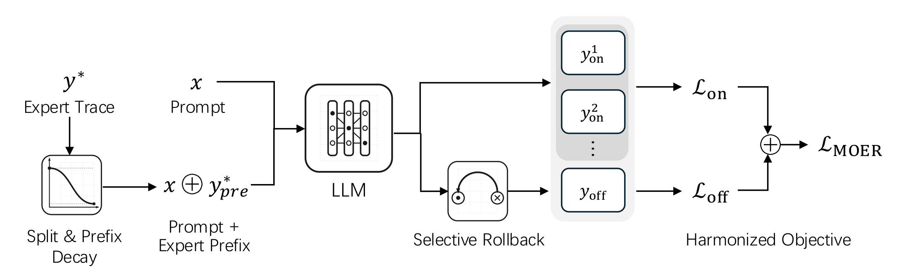

# MOER: Annealed expert prefixes, selective rollback and a mixed-policy objective

<!-- source-sha256: 5e4be9edbab7fba3c7945f73f49a875ef24835d9ae6b7044e44f60fa60a80914 -->

[简体中文](README.md)

> **L1 numerical component and single-candidate rollback; diagnostic only.** No full LLM trainer, verifier or capability reproduction.

## Paper information

| Field | Details |
| --- | --- |
| Paper | [MOER: Mix-Policy Optimization under Expert Prefix Guidance with Selective Rollback](https://arxiv.org/abs/2610.30873v1) |
| Affiliations | First author Xuyang Zhong: City University of Hong Kong; collaborators include LIGHTSPEED and an independent researcher. |
| First public release | 2026-10-22 07:54:45 UTC (announced 2026-10-23) |
| Author code | [CityU-MLO/MOER](https://github.com/CityU-MLO/MOER) at `7dafbe33118e61597a4f0186d538c1630430c0be`. No root license verified; nested luffy/verl licenses do not cover all new code. Independent formula implementation. |
| Local key | `moer`; no adapter |
| Local code | `src/auto_research/post_training/moer.py` |
| Local evidence | [Local mechanism metrics](metrics/component-cuda-seeds42-44.json); [A100 validation receipt](../../gpu-validations/moer-a100-20261024.json) |

## What the paper changes

Anneal the expert chain-of-thought prefix to preserve exploration. Keep prefix plus continuation when verified, otherwise replace the whole row with an already verified expert trajectory. The whole guided trajectory, including student-generated suffix, is off-policy. Rollback avoids an additional generation, not the original generation/verifier cost.

### Original paper figure



Original figure from the reviewed paper, reused without redrawing. See [figure provenance](assets/provenance.json).

### Core equations

$$
A_k=R_k-\operatorname{mean}_{i\in G_{on}\cup G_{off}}R_i.
$$

$$
r(s)=r_{min}+(r_{max}-r_{min})\left[\tfrac12+\tfrac12\cos\left(\pi\frac{s-s_{warm}}{S-s_{warm}}\right)\right].
$$

$$
L_{off}=\sum_{j\in Y_{off},t}\frac{p_{jt}}{\max(\operatorname{sg}(p_{jt}),\gamma)}A_j,
$$

$$
L_{on}=\sum_{i\in Y_{on},t}\min\left(\rho_{it}A_i,\operatorname{clip}(\rho_{it},1-\epsilon_{low},1+\epsilon_{high})A_i\right),
\qquad L_{MOER}=\frac{L_{on}+\alpha L_{off}}{Z}.
$$

Center rewards within the joint on/off prompt group without SD or LOO. Use $r_{max}$ before warm-up, then cosine anneal to $r_{min}$ and hold it after the horizon; take the floor of prefix length from CoT only, not final answers. Minimize negative Eq.6 with total valid response tokens as $Z$, not per-row means or an alpha-weighted denominator. Defaults $\gamma=.1,\alpha=.2,\epsilon_{low}=.2,\epsilon_{high}=.24$. The detached denominator gives nonzero gradient even when the forward off-policy ratio is one; do not cancel it.

### Results reported by the authors

Table 1 Qwen2.5-Math-7B: ReLIFT versus MOER 48.6 versus 49.1 across six math tasks, 57.3 versus 59.0 across three general reasoning tasks. Math mixes avg@32 with pass@1; general ARC-c/GPQA-diamond/MMLU-Pro use pass@1. Checkpoint selection uses validation. No production A/B or local capability scores.

## Local reproduction and limits

`prefix_ratio`, `expert_cot_prefix`, `selective_rollback`, `mixed_group_advantages` and `moer_loss` require one verified off-policy and at least one on-policy row per prompt. Include guided prefix and suffix; ignore prompt/padding. Only current logits update; old probabilities apply only to unguided rows. Half promotes to FP32. Paper rollback is per failed candidate; upstream multi-candidate extension rolls back the first only if all fail. Upstream launcher uses fixed response length instead of Eq.6's valid count, and entropy .001 versus paper .01. The local scope adds neither variant, entropy, KL nor dual clip. Frozen CPU/CUDA seeds check independent values and gradients below/above gamma, group isolation, asymmetric clip, ignored NaNs, zero all-success signal, anneal, floor and rollback. Synthetic rewards are not verifier measurements; no gold-aware evaluator or Evolve.

```bash
OMP_NUM_THREADS=1 MKL_NUM_THREADS=1 PYTHONPATH=src python -m pytest tests/post_training/test_moer.py -q
PYTHONPATH=src python -c 'from auto_research.post_training.moer import diagnostic; print(diagnostic(42))'
```

### Full experiment: not reproduced

Pinned launcher: one node/eight GPUs, Qwen2.5-Math-7B, OpenR1-Math-46k-8192 with DeepSeek-R1 solutions, rollout batch 128, group eight, up to 8,192 generated tokens, update batch 64 and 30 epochs. Horizon 500 is not a step cap. One batch caps at $8.39\times10^6$ tokens, not a measured count/time. Additional 1.5B/7B/14B, multi-domain avg@32 and code evaluation exceed the available budget. No download, trial or retry.

### Additional references

[Paper Figure 1](https://arxiv.org/html/2610.30873v1#S1.F1) · [Pinned upstream source](https://github.com/CityU-MLO/MOER/tree/7dafbe33118e61597a4f0186d538c1630430c0be)
