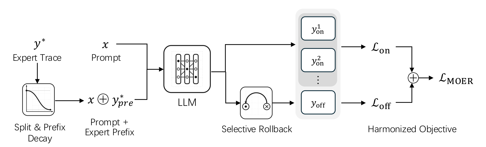
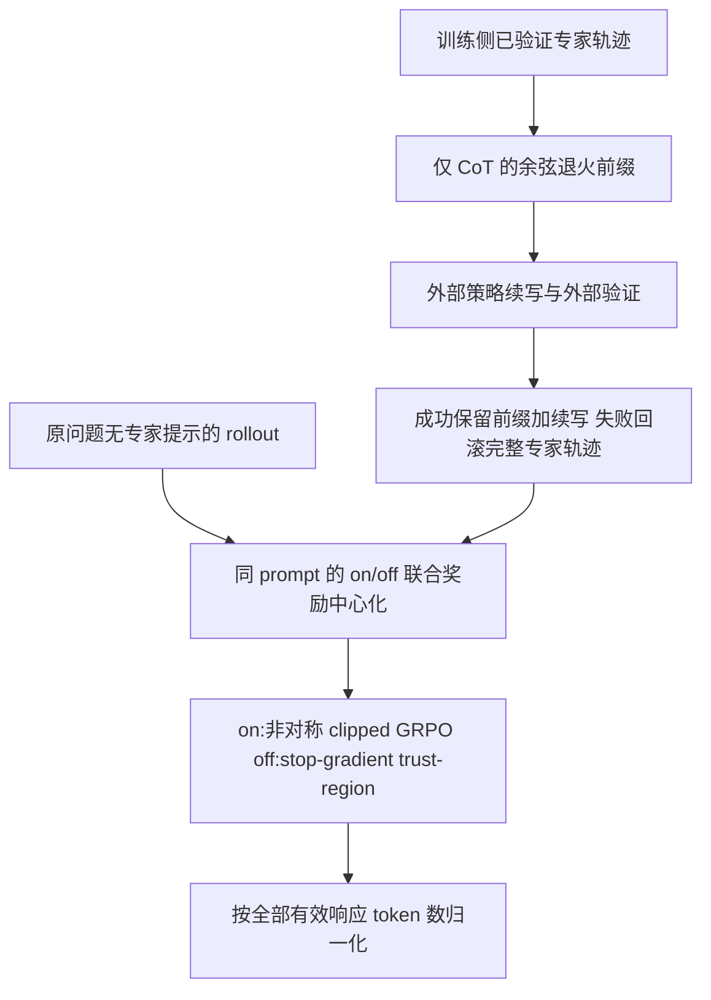

# MOER：前缀引导、选择性回滚与混合策略目标

> 本地状态：**L1 精确数值组件，diagnostic only**。保留 Eq. 1、3–6 与单候选回滚，不是 LLM 训练器、验证器或能力复现。完整实验：**成本过高，不复现（审查 DONE）**，不自动重试。

## 论文信息

| 字段 | 内容 |
|---|---|
| 论文 | [MOER: Mix-Policy Optimization under Expert Prefix Guidance with Selective Rollback](https://arxiv.org/abs/2610.30873v1) |
| 公司 / 作者机构 | 一作 Xuyang Zhong 的第一机构为 City University of Hong Kong；其他作者来自 LIGHTSPEED、Independent Researcher、City University of Hong Kong；无 Google / Meta 作者机构 |
| 原始发布日期 | **2026-10-22 07:54:45 UTC**，arXiv v1；2026-10-23 公告。本次为 Oct24 补审之前未收录条目，不是 Oct24 新首发 |
| 原作者代码 | 论文直接链接 [CityU-MLO/MOER](https://github.com/CityU-MLO/MOER)，固定检查 [`7dafbe33118e61597a4f0186d538c1630430c0be`](https://github.com/CityU-MLO/MOER/tree/7dafbe33118e61597a4f0186d538c1630430c0be) |
| 原作者代码许可 | **自有代码许可未确认**：固定树没有根 LICENSE，只有 `luffy/LICENSE`、`luffy/verl/LICENSE` 等嵌套上游许可，不能据此推定全部新增代码已获许可。本地根据公开论文独立重写，不复制或导入作者源码 |
| 本地 Adapter / key | `moer`；独立组件，无能力 adapter；`evolve_integrated=false` |
| 本地代码 | `src/auto_research/post_training/moer.py` |
| 本地入口 | `prefix_ratio`、`expert_cot_prefix`、`selective_rollback`、`mixed_group_advantages`、`moer_loss`、`diagnostic(seed, device='cpu')` |
| 指标产物 | 本批统一 runner 生成 `metrics/component-cpu-seeds42-44.json` 与 CUDA 对应产物；真实 GPU receipt 为 `docs/gpu-validations/moer-a100-20261024.json`，生成前不得宣称 GPU 通过 |

## 原始论文总结

### 背景与主要改动

既有混合策略训练直接加入完整专家解法，可能削弱探索；专家前缀引导虽允许学生续写，却可能把错误续写继续作为监督。MOER 逐步缩短专家 CoT 前缀：成功则保留前缀加续写，失败则回滚到已有的完整、已验证专家轨迹。它把整个引导轨迹都视为 off-policy，包括学生续写部分，并为两类轨迹采用不同目标。

<!-- paper-figure:start -->
### 原论文关键图



来自[原论文 Figure 1](https://arxiv.org/html/2610.30873v1#S1.F1)，原始 SVG 未修改，仅栅格化为 PNG 供文档兼容展示；已与原 PDF 第 2 页目视核对，并检查生成的 PNG 所有节点、标签与连线。论文许可 CC BY 4.0，SVG / PNG 来源与各自 SHA-256 见 `assets/provenance.json`。图中 LLM/生成/验证器不是本地已实现路径。

图片来自[原论文](https://arxiv.org/abs/2610.30873v1)，版权归原作者所有。
<!-- paper-figure:end -->



### 核心公式

Eq. 1 的 baseline 是同 prompt 的 on/off **联合组**均值，不除奖励标准差，不使用 LOO：

$$
A_k=R_k-\operatorname{mean}_{i\in G_{on}\cup G_{off}}R_i.
$$

Eq. 3：warm-up 前使用 $r_{max}$，之后

$$
r(s)=r_{min}+(r_{max}-r_{min})\left[\tfrac12+\tfrac12\cos\left(\pi\frac{s-s_{warm}}{S-s_{warm}}\right)\right].
$$

仅从专家 CoT 取前 $\lfloor r|y^*_{cot}|\rfloor$ 个 token，不能把最终答案段混入前缀。本地 `anneal_steps` 只表示前缀退火 horizon；依固定作者源码，超过该步数后保持 $r_{min}$，不会再次升高，也不会停止训练。完整专家轨迹可用于训练监督；评测 Agent 不得看到它。

令 $p_{it}=\pi_\theta(y_{it}|x,y_{i,<t})$，$\rho_{it}=p_{it}/\pi_{old}(y_{it}|x,y_{i,<t})$。Eq. 4–6：

$$
L_{off}=\sum_{j\in Y_{off},t}\frac{p_{jt}}{\max(\operatorname{sg}(p_{jt}),\gamma)}A_j,
$$

$$
L_{on}=\sum_{i\in Y_{on},t}\min\left(\rho_{it}A_i,\operatorname{clip}(\rho_{it},1-\epsilon_{low},1+\epsilon_{high})A_i\right),
\qquad L_{MOER}=\frac{L_{on}+\alpha L_{off}}{Z}.
$$

本地最小化 $-L_{MOER}$。$Z$ 是全部有效响应 token 数，既不是逐轨迹均值，也不以 $\alpha$ 改写分母。默认 $\gamma=.1,\alpha=.2,\epsilon_{low}=.2,\epsilon_{high}=.24$。当 $p\ge\gamma$ 时 off-policy 比值前向等于 1，**梯度仍然非零**，不能将分子分母相消；其对 $\log p$ 的梯度权重为 $p/\max(p,\gamma)$。

### 论文离线与线上效果

原文 Table 1，Qwen2.5-Math-7B：

| 方法 | 六项数学平均分 | 三项泛领域推理平均分 |
|---|---:|---:|
| ReLIFT | 48.6 | 57.3 |
| MOER | 49.1 | 59.0 |

数学均分混合 AIME2024/2025、AMC 的 avg@32 和其他数学任务的 pass@1；泛领域采用 ARC-c、GPQA-diamond、MMLU-Pro 的 pass@1。使用 validation 最佳 checkpoint 后报告 test。未报告互联网生产线上 A/B，不能冒充工业搜广推。论文数据和本地数值诊断不可直接比较。

## 本地复现

### 保留机制与代码映射

`moer.py` 独立实现论文公式与单候选回滚。每个 prompt 限定一个已验证 off-policy 行、至少一个 on-policy 行，对应作者主配置 `n_prefix=1`；调用方提供完整响应 token mask。guided 行的前缀与续写必须都有效，prompt/padding 不参与损失。旧策略概率只用于 unguided 行，奖励和旧概率冻结，只有 current logits 更新。半精度 logits 的概率计算提升至 float32。

`selective_rollback` 只执行给定 verifier 结果下的离散替换，不推断正确性、不调用 LLM；“保证正确”依赖真实外部验证器和正确专家轨迹这个前提。原文所谓 cost-free 仅指不为回滚再次生成，不能抹去已完成的生成/验证成本。

### 论文与固定作者代码的差异

- 原文 Algorithm 1 对每个失败 guided candidate 回滚；作者固定代码多候选扩展是“所有 prefix candidate 都失败时，只回滚第一个”。本地不实现这个扩展，限定单候选，避免把两种语义混为一谈。
- 本地实现 Eq. 6 的总有效 token 数 $Z$。固定 `exp_scripts/train.sh` 开启 `loss_remove_token_mean=True`，其 `mix_core_alg.py` 路径使用张量固定 response length 作分母；不静默沿用该缩放差异。
- 论文 Sec. 5.1 entropy coefficient 为 .01，固定 launcher 为 .001。本地仅实现 Eq. 1、3–6，不加入 entropy bonus、KL、dual clipping 或其他上游实验选项，不宣称训练链路等价。

### 数据、结果与隔离协议

未下载模型、训练数据或 checkpoint。`diagnostic` 使用随机可训练 logits 和显式合成终局标量，真实执行一次 backward/SGD；这些标量只检验数值机制，不代表外部 verifier 实测结果。不存在评测 Agent，不报告任务准确率，不做选模、test 能力比较或 evolve 晋级。`promotion_eligible=false`、`evolve_integrated=false`。

CPU/CUDA seeds 42、43、44 的实际 scalar 与 checks 由统一 runner 冻结，源码/原始结果/receipt 绑定由本批 evidence gate 校验；不得用三 seed 将诊断升级为能力复现。GPU 通过状态只由实际 A100/A30 receipt 确认。

```bash
OMP_NUM_THREADS=1 MKL_NUM_THREADS=1 PYTHONPATH=src python -m pytest tests/post_training/test_moer.py -q
PYTHONPATH=src python -c 'from auto_research.post_training.moer import diagnostic; print(diagnostic(42))'
```

### 检查与负控

- 对 Eq. 4–6 的数值及 logits 梯度做独立 literal-probability 参考；显式覆盖低于/高于 $\gamma$ 的非零 trust-region 梯度。
- union baseline 不跨 prompt、不除 std；非对称 PPO 两个 clipped 分支均检查零梯度。
- off-policy 行旧概率可以是 NaN 而不影响结果；padding logits、动作和概率无效值不会污染损失或梯度。全组成功时优势及梯度为零，不添加兜底学习信号。
- 验证前缀余弦端点、CoT floor 截断、成功保留/失败回滚和未验证专家拒绝。测试只检查提供的标签如何影响控制流，不能作为真实 verifier 准确率证据。

### 高成本完整实验

固定作者 launcher 使用 **1 节点 8 GPU**、Qwen2.5-Math-7B、OpenR1-Math-46k-8192（DeepSeek-R1 专家解法）、rollout batch128、group8、生成上限8192、update batch64、30 epochs；余弦前缀 horizon500 不是全程训练 step 上限。论文还报告 1.5B/7B/14B、多方法、多数据域、avg@32 与代码执行评测。仅按一个 128×8×8192 rollout batch 的生成配置上限已约 $8.39\times10^6$ token，**不是实测生成量或耗时**。已有资源为单张 A100/A30 或本地 Mac，完整计划明显超出低成本范围。结论：**成本过高，不复现（审查 DONE）**；不下载权重、不试跑证明昂贵、不自动重试。精确数值组件不能替代完整实验。
