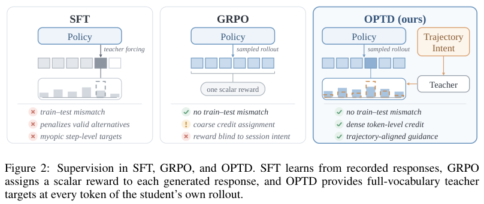

# UserArena / OPTD: Distilling with abstract trajectory intent

<!-- source-sha256: 3c7bdaaad5160991a8500ff0bac0e68fa7c380a71db9ed49fac49cf6f6f0f00d -->

[简体中文](README.md)

> **L1 loss component; diagnostic only.** Not a user simulator, environment or benchmark integration.

## Paper information

| Field | Details |
| --- | --- |
| Paper | [UserArena: Benchmarking Interactive User Simulation for Long-Horizon Shopping Agents](https://arxiv.org/abs/2610.30932v1) |
| Affiliations | First author Jujia Zhao: Leiden University; Renmin University of China, Alibaba Group and ICT Chinese Academy of Sciences collaborate. |
| First public release | 2026-10-22 08:54:16 UTC (announced 2026-10-23) |
| Author code | [RecGPT-Team/UserArena](https://github.com/RecGPT-Team/UserArena), environment/evaluation/OPTD at `d37e3c062d30950f2a3744c66a18fda9aa72c1f7`; [non-commercial research/data agreement](https://github.com/RecGPT-Team/UserArena/blob/d37e3c062d30950f2a3744c66a18fda9aa72c1f7/LICENSE), no unauthorized redistribution. Independent formula implementation; no source, user records or images copied. |
| Local key | `userarena-optd`; no adapter |
| Local code | `src/auto_research/post_training/userarena_optd.py` |
| Local evidence | [Local mechanism metrics](metrics/component-cuda-seeds42-44.json); [Overlap batch audit](../../research-audits/oct24-overlap-components/README.md); [A100 validation receipt](../../gpu-validations/userarena-optd-a100-20261024.json) |

## What the paper changes

The 13-action shopping environment measures five fidelity levels in Replay and Rollout: executability, local behavior, trajectory dynamics, individual/group variation and outcomes. OPTD abstracts preferences, concerns and comparison criteria from training trajectories and gives them only to a frozen teacher. Score actual student prefixes with and without intent, constrain the extra information in a token-wise trust region, and add teacher-forced grounding on real responses. Exclude specific actions, item IDs, prices, outcomes, future pages and evidence indices from intent. KL alone cannot prove absence of leakage.

### Original paper figure



Original figure from the reviewed paper, reused without redrawing. See [figure provenance](assets/provenance.json).

### Core equations

$$
q^\lambda=\operatorname{softmax}((1-\lambda)\log q^0+\lambda\log q^I),\quad
\lambda^*=\max\{\lambda\in[0,\lambda_{\max}]:D_{KL}(q^\lambda\|q^0)\le\epsilon\}.
$$

$$
m=\beta q^{\lambda^*}+(1-\beta)p_\theta,\qquad
JSD_\beta=\beta D_{KL}(q^{\lambda^*}\|m)+(1-\beta)D_{KL}(p_\theta\|m).
$$

$$
\mathcal L=\mathbb E_{x,y\sim\pi_\theta}\left[\frac{1}{|y|}\sum_kJSD_\beta\right]
+\gamma\,\mathbb E_{x,y^*}\left[-\frac{1}{|y^*|}\sum_k\log\pi_\theta(y^*_k\mid x,y^*_{<k})\right].
$$

Use forward budget $D_{KL}(q^\lambda\|q^0)$ per token, default 0.02 and maximum coefficient one. Eight bisections return a feasible lower endpoint within 1/256 and preserve the full endpoint when feasible. Follow PDF pp.5–6 where HTML drops superscripts. JSD uses $\beta=0.5$ and grounding $\gamma=0.1$; average tokens per state, then states equally. Grounding needs separate true-prefix logits, not gold tokens inserted into student-prefix logits. Coefficients and both teacher branches are detached.

### Results reported by the authors

For the same Qwen3.5-2B base, Table 2 reports single-session local-action accuracy 0.3204, DM-JSD 0.0156, length error 1.72 and PF 0.8692; cross-session accuracy 0.2969. STA is better on cross-session macro-F1 and CTR error. Appendix C.1 tests consistency for the same two recommendation policies in simulation and a real A/B, not an online deployment gain from OPTD. Simulated effect is 0.713× real (28.7% underestimation), with 10,000 simulated users, 5,000 per arm. Count CTR and production PV-CTR are different.

## Local reproduction and limits

`trust_region_teacher` and `optd_loss` implement full-vocabulary geometric mixing, token bisection, generalized JSD and separate grounding, with detached teacher/targets, validated budgets/lengths and sanitized padded NaN. Half inputs promote to FP32. Independent probability and gradient checks cover next-grid infeasibility, zero/full endpoints, padding, freezing and genuine updates to both student branches. The interface cannot attest rollout or intent provenance. No extraction, rationale, warmup, online sampling, page environment, ROLL/verl or Evolve. Three frozen seeds verify only L1.

```bash
OMP_NUM_THREADS=1 MKL_NUM_THREADS=1 PYTHONPATH=src python -m pytest tests/post_training/test_userarena_optd.py -q
PYTHONPATH=src python -c 'from auto_research.post_training.userarena_optd import diagnostic; print(diagnostic(42))'
```

### Full experiment: not reproduced

The paper uses 11,010 users, 64,729 sessions and 577,670 actions, a Qwen3.5-397B rationale/intent generator, 2B VLM student/frozen teacher, 32k context and distributed SFT/OPTD. No transferable GPU-hour total. No model/data/image download, paid API trial or retry.

### Additional references

[Paper PDF, p. 4](https://arxiv.org/pdf/2610.30932v1#page=4)
