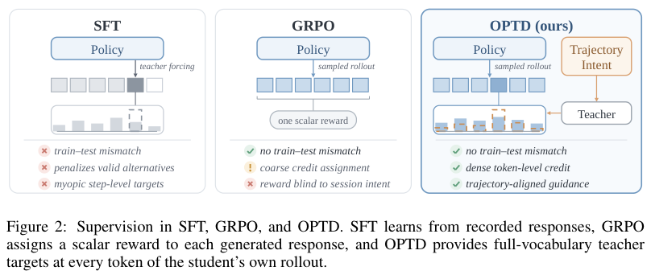
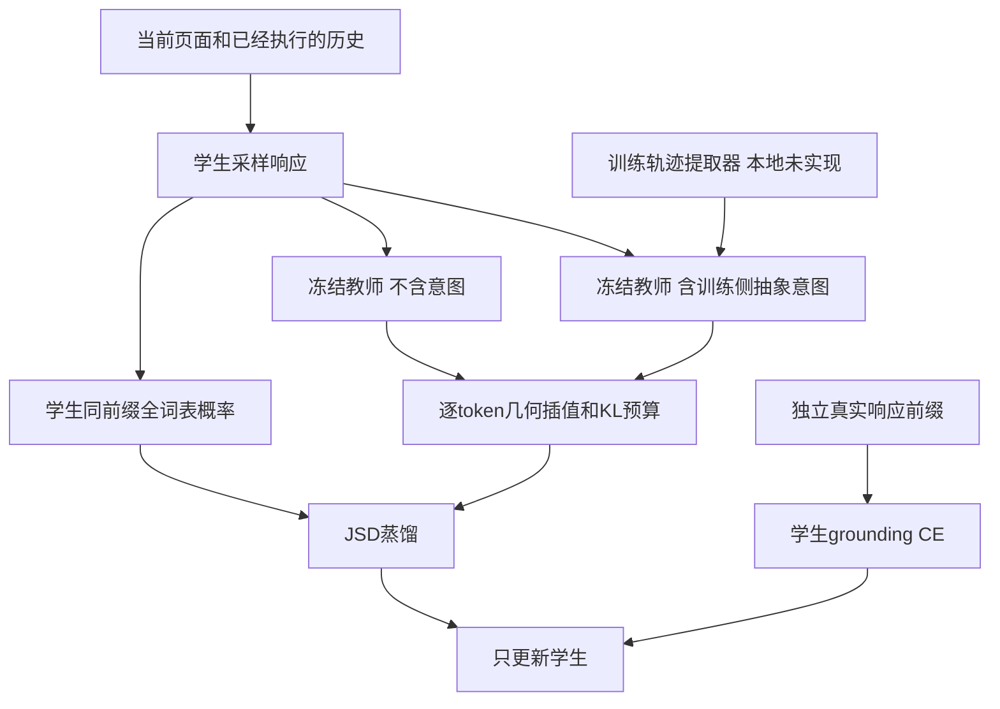

# UserArena / OPTD：轨迹意图引导的用户模拟蒸馏

> 本地状态：**L1 精确损失组件，diagnostic only**；不是用户模拟器、购物环境或官方 benchmark 接入。完整实验：**成本过高，不复现（审查 DONE）**，不自动重试。

## 论文信息

| 字段 | 内容 |
| --- | --- |
| 论文 | [UserArena: Benchmarking Interactive User Simulation for Long-Horizon Shopping Agents](https://arxiv.org/abs/2610.30932v1) |
| 公司 / 作者机构 | 一作 Jujia Zhao：**Leiden University**；合作 Renmin University of China、Alibaba Group、ICT Chinese Academy of Sciences。不是 Google / Meta 论文 |
| 原始发布日期 | **2026-10-22 08:54:16 UTC**，arXiv v1；10-23 公告。本轮为上一公告补漏，不是10-24新首发 |
| 原作者代码 | [RecGPT-Team/UserArena](https://github.com/RecGPT-Team/UserArena)，环境、评测和OPTD已发布；固定 `d37e3c062d30950f2a3744c66a18fda9aa72c1f7` |
| 原作者代码许可 | [非商业研究与数据使用协议](https://github.com/RecGPT-Team/UserArena/blob/d37e3c062d30950f2a3744c66a18fda9aa72c1f7/LICENSE)，禁止未经授权再分发；本地仅据论文公式独立实现，不复制上游代码、用户记录或商品图 |
| 本地 Adapter / key | `userarena-optd`；独立组件，无能力adapter，`evolve_integrated=false` |
| 本地代码 | `src/auto_research/post_training/userarena_optd.py` |
| 本地入口 | `trust_region_teacher`、`optd_loss`、`diagnostic(seed, device)` |
| 指标产物 | `metrics/component-cuda-seeds42-44.json`；真实GPU回执与CPU/CUDA原始记录见[本批审计](../../research-audits/oct24-overlap-components/README.md) |

## 原始论文总结

### 背景与主要改动

逐步动作命中率不能说明用户模拟器能否保持跨会话偏好，更不能说明模拟出来的推荐政策差异是否接近真实生产A/B。UserArena把细粒度页面、动作和跨会话记录统一成13种动作环境，分Replay与Rollout评估五层保真度：可执行性、局部行为、轨迹动态、个体群体差异和最终结果。

OPTD的区别不是“直接给学生看未来轨迹”。完整训练轨迹先被提炼成抽象偏好、顾虑和比较准则，**只提供给冻结教师**；教师在学生自己生成的前缀上给完整词表分布。另一次不含意图的同教师评分作为参照，用逐token信任域限制额外意图的影响，再加真实响应的teacher-forced grounding。训练意图必须排除具体动作、商品ID、价格、结果、未来页面及证据步号；单靠KL约束不能证明提取器没有泄漏。

<!-- paper-figure:start -->
### 原论文关键图



原始PDF第4页的Figure 2与图注，已目视核对，未经重绘。图片来自[原论文](https://arxiv.org/pdf/2610.30932v1#page=4)，版权归原作者所有；截图来源与哈希见 `assets/provenance.json`。图中机制并不意味着本地已实现教师模型或用户模拟环境。
<!-- paper-figure:end -->



### 核心公式

记不含意图的教师分布为 $q^0$、含意图为 $q^I$，两者都评分同一学生生成前缀。Eq.5–6：

$$
q^\lambda=\operatorname{softmax}((1-\lambda)\log q^0+\lambda\log q^I),\quad
\lambda^*=\max\{\lambda\in[0,\lambda_{\max}]:D_{KL}(q^\lambda\|q^0)\le\epsilon\}.
$$

默认 $\epsilon=0.02,\lambda_{\max}=1$；用8次二分的**可行下端点**近似，系数误差至多 $1/256$，完整端点可行则保留。它是逐token约束，不是整批平均KL，更不是 $D_{KL}(q^0\|q^\lambda)$。原文HTML丢失部分上标，本地依据PDF第5–6页核对。

$$
m=\beta q^{\lambda^*}+(1-\beta)p_\theta,\qquad
JSD_\beta=\beta D_{KL}(q^{\lambda^*}\|m)+(1-\beta)D_{KL}(p_\theta\|m).
$$

Eq.7–10先对每个状态的响应token取均值，再对状态等权平均：

$$
\mathcal L=\mathbb E_{x,y\sim\pi_\theta}\left[\frac{1}{|y|}\sum_kJSD_\beta\right]
+\gamma\,\mathbb E_{x,y^*}\left[-\frac{1}{|y^*|}\sum_k\log\pi_\theta(y^*_k\mid x,y^*_{<k})\right].
$$

默认 $\beta=0.5,\gamma=0.1$。GT grounding使用**另一组真实前缀logits**，不能在学生rollout前缀上直接塞入gold token冒充teacher forcing；长度不等时不能用全批token平均替代状态平均。目标、系数与两路教师全部停止梯度。

### 论文离线与线上效果

共享Qwen3.5-2B基座的单会话实验（Table 2），OPTD局部动作准确率0.3204、DM-JSD 0.0156、轨迹长度误差1.72、PF 0.8692；跨会话准确率0.2969。跨会话并非每项最佳，STA的macro-F1和CTR误差更好。本地不复算这些能力结果。

生产部分是**同一对推荐政策在模拟与真实A/B中的效果一致性校验**，不是把OPTD部署线上后的业务提升。Appendix C.1中OPTD的模拟效果/真实效果为0.713倍，仍低估28.7%；10,000用户按两臂各5,000做模拟。不能把0.713写成CTR或71.3%的线上增益。五层指标里的count CTR与生产PV-CTR也不是同一定义。

## 本地复现

### 保留机制与接口

实现Eq.5–10完整词表几何目标、逐token二分、广义JSD、独立GT grounding、两级均值和教师detach。接受两组不同长度的学生logits；padding可含NaN但不贡献损失/梯度，有效位置必须有限、词表和配对状态必须对齐。FP16/BF16提升到FP32计算，非法空响应、越界gold与不合法预算直接拒绝。

不实现意图提取器、rationale生成、SFT warmup、在线采样、页面环境、真实数据评测或官方ROLL/verl适配。接口无法证明调用者的前缀确实来自当前学生，也无法验证自然语言意图是否泄漏；这些是完整集成必须另验的边界。不会读取gold来生成评测动作，也不把接口注册成evolve能力算子。

```bash
OMP_NUM_THREADS=1 MKL_NUM_THREADS=1 PYTHONPATH=src python -m pytest tests/post_training/test_userarena_optd.py -q
PYTHONPATH=src python -c 'from auto_research.post_training.userarena_optd import diagnostic; print(diagnostic(42))'
```

### 检查与负控

独立概率域参考核对损失和梯度；对比几何插值、逐tokenKL预算与更高一个二分网格点的不可行性；覆盖零预算、完整端点可行、padding NaN、教师冻结及两条学生分支真实更新。随机logits上一次SGD下降只是数值合同检查，**不是购物任务准确率改善**。三种子只支持L1可重复性，不构成正式模型比较；真实A100结果与冻结源码绑定后才验收CUDA路径。

### 高成本完整实验

原文含11,010用户、64,729会话、577,670动作；Qwen3.5-397B生成rationale与轨迹意图，2B视觉语言学生/冻结教师、32k上下文、SFT与分布式OPTD，再做多基线长会话评测。原文未给完整GPU小时数，不能编造耗时。相对于单张A100/A30或本地Mac，这明显超出本轮低成本边界：**成本过高，不复现（审查 DONE）**。不下载模型、用户数据或图像，不调用付费API，不通过小样本探针冒充完整实验，不自动重试。
