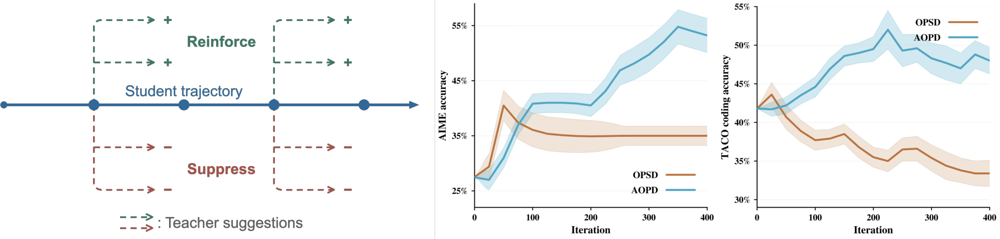

# AOPD: Weighting teacher supervision by student advantage

<!-- source-sha256: 6b5d84f591144e8efb60992868845adaaaffa09365cfe7a95fef83887c3a0aee -->

[简体中文](README.md)

> **L1 advantage-weighted loss; diagnostic only.** No full LLM trainer or capability reproduction.

## Paper information

| Field | Details |
| --- | --- |
| Paper | [When to Follow the Teacher: Advantage-Based On-Policy Distillation](https://arxiv.org/abs/2610.31563v1) |
| Affiliations | First author Mahdi Sabbaghi: University of Pennsylvania; collaboration with University of Southern California. |
| First public release | 2026-10-22 17:05:21 UTC (announced 2026-10-23) |
| Author code | [Helloworld10011/AOPD](https://github.com/Helloworld10011/AOPD) at `3f205368f225bfc4ed4ad007ccbae7879d1b38f2`; [Apache-2.0](https://github.com/Helloworld10011/AOPD/blob/3f205368f225bfc4ed4ad007ccbae7879d1b38f2/LICENSE). Independent implementation, not the upstream training environment. |
| Local key | `aopd`; no adapter |
| Local code | `src/auto_research/post_training/aopd.py` |
| Local evidence | [Local mechanism metrics](metrics/component-cuda-seeds42-44.json); [A100 validation receipt](../../gpu-validations/aopd-a100-20261023.json) |

## What the paper changes

A teacher-preferred action is not necessarily good for the current student's continuation. Estimate its advantage from existing student rollouts, terminal rewards and teacher importance ratios, without counterfactual continuations. Keep the frozen rollout policy separate from the updated student.

### Original paper figure



Original figure from the reviewed paper, reused without redrawing. See [figure provenance](assets/provenance.json).

### Core equations

$$
b_i=\frac{1}{G-1}\sum_{j\ne i}R_j,\qquad \widetilde R_i=R_i-b_i.
$$

$$
\widetilde T(a\mid h)=\min\{T(a\mid h),cS(a\mid h)\},\quad
\widetilde w_t=\frac{\widetilde T(a_t\mid h_t)}{S(a_t\mid h_t)},
$$

$$
\widetilde J_i=\frac{\widetilde R_i}{H_i}\sum_t
\left[\widetilde w_t\log S_\theta(a_t\mid h_t)
-\sum_a\widetilde T(a\mid h_t)\log S_\theta(a\mid h_t)\right].
$$

Use within-prompt leave-one-out over $G>1$ rollouts and per-response token means. Eq.3.8 uses the same clipped, **unnormalized** teacher measure in sampled and full-vocabulary terms, default $c=4$; minimize negative mean objective with gradients only to current student. `clip=None` gives Eq.3.6. Clipping only the sampled term, renormalizing teacher mass or using updated student ratios changes the estimator. Upstream sigmoid residual and optional all-wrong-group KL ($\mu$) are additional variants, not silently included; equal group rewards give zero signal. Callers must ensure true sampling probabilities and support without top-p/top-k truncation.

### Results reported by the authors

Table 1 for Qwen3-1.7B with external teacher: AIME24/AMC/HumanEval scores are 32.1/61.8/71.3 for OPD-FKL, 32.6/61.0/68.3 for OPD-RKL and 35.0/65.1/74.4 for AOPD. GRPO leads HumanEval pass@10 and OPD-FKL leads MultiPL-E. No production A/B or local accuracy.

## Local reproduction and limits

`leave_one_out_advantages` and `aopd_loss` validate current/rollout/teacher logits, support, actions and rewards; allow sanitized padded NaN and promote half arithmetic. Independent exhaustive two-step MDP rollout-pair tests verify expected objective and gradient in both variants; oracle is test-only. Diagnostics sample frozen synthetic logits, perform real backward/SGD and check group isolation, detached branches, zero padding gradients and clipped mass below one. Seeds 42/43/44 are component evidence, not an evaluator or capability gain. Only a real receipt supports CUDA; no checkpoints, training data, judge or Evolve.

```bash
OMP_NUM_THREADS=1 MKL_NUM_THREADS=1 PYTHONPATH=src python -m pytest tests/post_training/test_oct23_post_components.py -q
PYTHONPATH=src python -c 'from auto_research.post_training.aopd import diagnostic; print(diagnostic(42))'
```

### Full experiment: not reproduced

Upstream defaults to eight GPUs, BF16 and LoRA rank 64. External math uses Qwen3-1.7B/4B student/teacher, 450 steps, batch 32, group four and up to 8,192 generated tokens. This caps generation at about $4.72\times10^8$ tokens, not a measured count/time. Further 7B/8B settings, code execution and comparisons make the matrix too expensive; no download, trial or retry.

### Additional references

[Paper Figure 1](https://arxiv.org/html/2610.31563v1#S1.F1)
