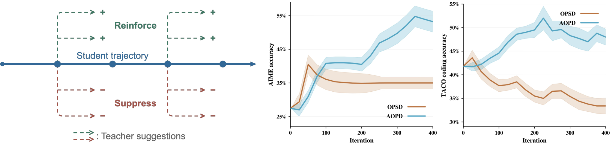
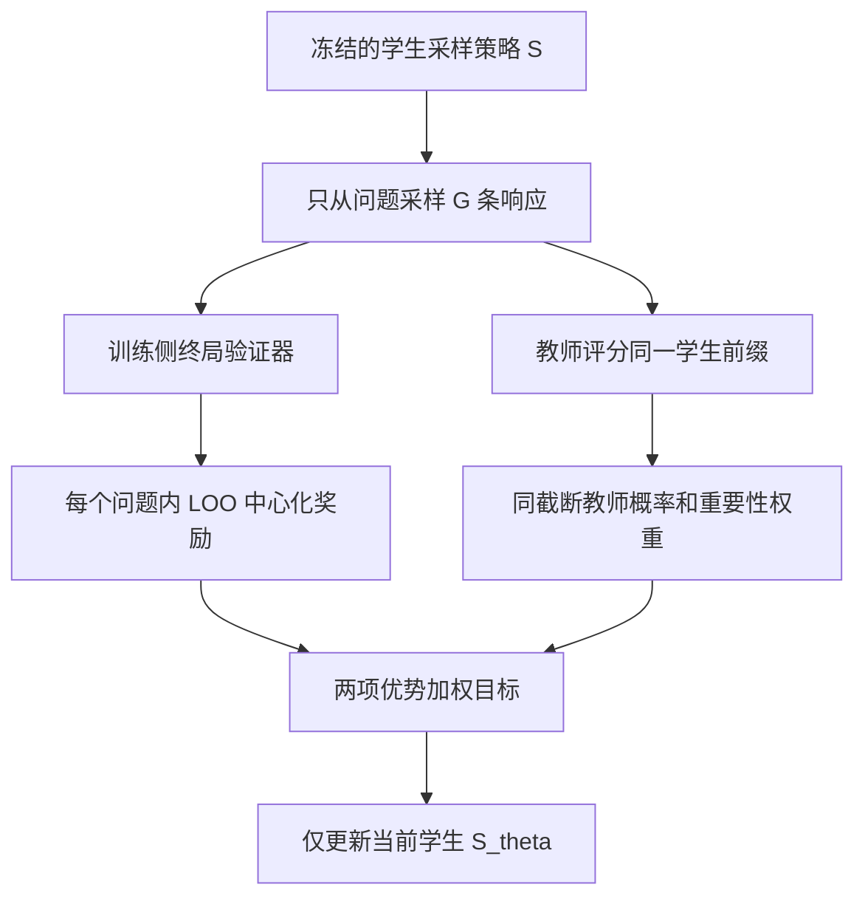

# AOPD：按学生优势选择教师监督

> 本地状态：**L1 精确损失组件，diagnostic only**。实现论文 Eq. 3.6 / 3.8 与 Algorithm 1 的 leave-one-out baseline，不是完整 LLM 训练器或能力复现。完整实验：**成本过高，不复现（审查 DONE）**，不进入自动重试队列。

## 论文信息

| 字段 | 内容 |
|---|---|
| 论文 | [When to Follow the Teacher: Advantage-Based On-Policy Distillation](https://arxiv.org/abs/2610.31563v1) |
| 公司 / 作者机构 | 一作 Mahdi Sabbaghi：University of Pennsylvania；合作机构 University of Southern California；不是 Google / Meta 论文 |
| 原始发布日期 | **2026-10-22 17:05:21 UTC**，arXiv v1；2026-10-23 公告，不能将公告日写成首发日 |
| 原作者代码 | [Helloworld10011/AOPD](https://github.com/Helloworld10011/AOPD)，论文首页直接链接；固定检查 `3f205368f225bfc4ed4ad007ccbae7879d1b38f2` |
| 原作者代码许可 | [Apache-2.0](https://github.com/Helloworld10011/AOPD/blob/3f205368f225bfc4ed4ad007ccbae7879d1b38f2/LICENSE)；本地根据论文独立实现，不导入上游训练环境 |
| 本地 Adapter / key | `aopd`；独立组件，无能力 adapter，`evolve_integrated=false` |
| 本地代码 | `src/auto_research/post_training/aopd.py` |
| 本地入口 | `leave_one_out_advantages`、`aopd_loss`、`diagnostic(seed, device)` |
| 指标产物 | `metrics/component-cpu-seeds42-44.json`；CUDA 证据由实际运行后单独登记，CPU 不能替代 GPU 验证 |

## 原始论文总结

### 背景与主要改动

普通 OPD 在学生实际访问的状态上模仿教师，但教师偏好的动作不一定能被当前学生继续完成。AOPD 用该动作对学生最终奖励的优势加权教师监督，通过学生原有 rollout、终局奖励及教师重要性比率估计，不额外生成反事实续写。

<!-- paper-figure:start -->
### 原论文关键图



来自[原论文 Figure 1](https://arxiv.org/html/2610.31563v1#S1.F1)，未经改写；已与 PDF 第 2 页目视核对。图中结果属于原论文，不是本地结果。论文许可 CC BY 4.0，来源与 SHA-256 见 `assets/provenance.json`。

图片来自[原论文](https://arxiv.org/abs/2610.31563v1)，版权归原作者所有。
<!-- paper-figure:end -->



### 核心公式

冻结 rollout 策略为 $S$，被更新学生为 $S_\theta$，教师为 $T$。每个 prompt 采样 $G>1$ 条响应，使用与当前响应独立的 leave-one-out baseline：

$$
b_i=\frac{1}{G-1}\sum_{j\ne i}R_j,\qquad \widetilde R_i=R_i-b_i.
$$

Eq. 3.8 对两项使用同一个**不重新归一化**的教师测度，默认 $c=4$：

$$
\widetilde T(a\mid h)=\min\{T(a\mid h),cS(a\mid h)\},\quad
\widetilde w_t=\frac{\widetilde T(a_t\mid h_t)}{S(a_t\mid h_t)},
$$

$$
\widetilde J_i=\frac{\widetilde R_i}{H_i}\sum_t
\left[\widetilde w_t\log S_\theta(a_t\mid h_t)
-\sum_a\widetilde T(a\mid h_t)\log S_\theta(a\mid h_t)\right].
$$

最小化 $-\operatorname{mean}_i\widetilde J_i$；只有 $S_\theta$ 接受梯度。`clip=None` 是 Eq. 3.6 的未截断估计。它不是“给 KL 乘奖励”的简单替代，也不能只截断 sampled term、重新归一化 $\widetilde T$，或用更新后的学生概率替代 rollout $S$。

### 论文离线与线上效果

原文 Table 1，外部教师、Qwen3-1.7B 学生：

| 方法 | AIME24 pass@1 (%) | AMC pass@1 (%) | HumanEval (%) |
|---|---:|---:|---:|
| OPD-FKL | 32.1 | 61.8 | 71.3 |
| OPD-RKL | 32.6 | 61.0 | 68.3 |
| AOPD | 35.0 | 65.1 | 74.4 |

AOPD 并非每个指标最优：Table 1 的 HumanEval pass@10 以 GRPO 最优，MultiPL-E 以 OPD-FKL 最优。未报告互联网生产线上 A/B；本地诊断不能验证上述能力数值。

## 本地复现

### 保留机制与代码映射

`leave_one_out_advantages` 按 prompt group 独立计算 baseline；`aopd_loss` 使用分离的 current / rollout / teacher logits，保留完整词表 teacher expectation、双项同截断与逐响应 token 均值。padding 可以含 NaN，但有效 logits、动作、奖励和支持必须合法；half 输入先提升至 float32。

上游固定版本还实现了 sigmoid residual 修正，以及部分配置的 all-wrong-group KL (`mu`)。这些是**作者代码的附加项，不是本文 Eq. 3.8**；本地不静默加入。全组奖励相同时，本文损失分量为零，不伪造学习信号。外部调用者必须确保采样概率确为 $S$，并按论文关闭 top-p / top-k 截断以满足重要性采样支持；纯损失接口不能验证实际 rollout 来历。

### 数据、结果与隔离协议

没有下载 checkpoint 或训练数据。`diagnostic` 从可训练随机 logits 的冻结分布真实抽样，做一次真实 backward / SGD；合成终局奖励只作为已观测标量输入，不存在读取 gold 的评测 Agent。它不实现语言模型、验证器或数据划分，不报告准确率，也不参与 validation 选模、test 比较、能力榜或 evolve 晋级。

CPU seeds 42、43、44 的实际损失、梯度范数、参数变化和冻结检查见独立 `metrics/` 文件。该结果仅支持数值组件，不代表后训练能力。统一 CUDA 接口为 `diagnostic(42, device="cuda")`，必须有真实硬件收据后才能宣称 GPU 通过。

```bash
OMP_NUM_THREADS=1 MKL_NUM_THREADS=1 PYTHONPATH=src python -m pytest tests/post_training/test_oct23_post_components.py -q
PYTHONPATH=src python -c 'from auto_research.post_training.aopd import diagnostic; print(diagnostic(42))'
```

### 检查与负控

- 穷举两步 MDP 上独立采样的 rollout pairs，验证估计器的期望及梯度等于已知优势目标；覆盖未截断与截断情形。oracle 仅存在测试代码，不进入损失或诊断策略。
- 检查 LOO 不跨 prompt、教师与 rollout 分支不反传、padding 不产生梯度、截断质量可小于 1 且不重归一化。
- 全错组的零信号与当前/冻结学生分离；不以损失下降冒充任务奖励改善。

### 高成本完整实验

作者固定 README：默认 **8 GPU**、BF16、LoRA rank 64；外部数学为 Qwen3-1.7B 学生加 Qwen3-4B 教师，450 steps、batch 32、group 4、训练生成上限 8192 tokens；其他设置还涉及 7B/8B、代码执行与多任务对照。仅该数学配置的生成 token 上限为 $450\times32\times4\times8192\approx4.72\times10^8$，这是配置上限，**不是实测耗时或实际生成量**。现有资源为单张 A100/A30 或本地 Mac，完整多模型、多任务、多方法训练明显超出低成本范围。结论：**成本过高，不复现（审查 DONE）**；不下载模型、不试跑证明成本、不自动重试。精确损失组件不能替代完整实验。
