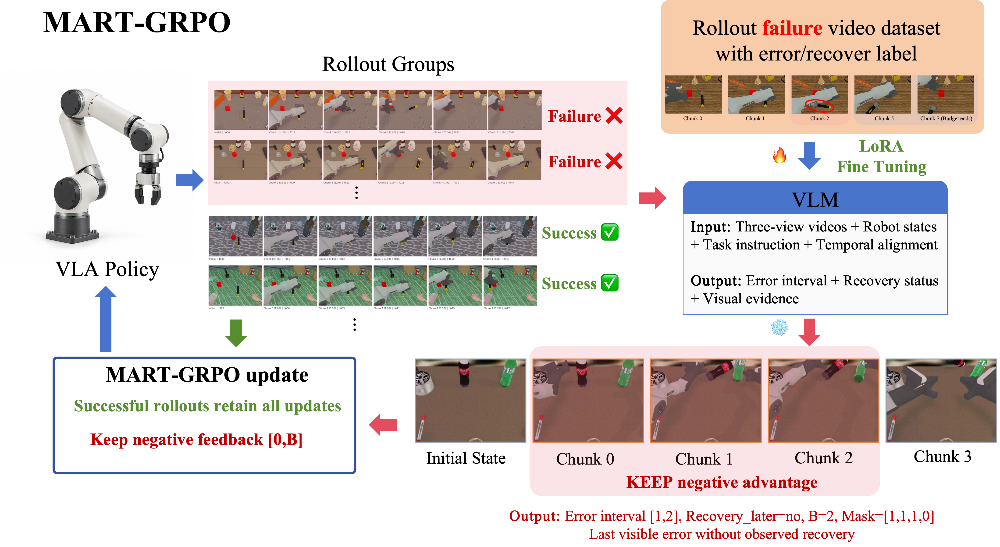

# MART-GRPO: Keep the failed trajectory prefix through the unrecovered error

<!-- source-sha256: 6816fb69719fa029520d426c2b2a0783a4f74840df959bb203cb0b2d830408c4 -->

[简体中文](README.md)

> **L1 event-boundary and clipped-loss component; diagnostic only.** Full robot and VLM training not reproduced due to cost.

## Paper information

| Field | Details |
| --- | --- |
| Paper | [When to Stop Penalizing Actions? Martingale GRPO for VLA Reinforcement Learning](https://arxiv.org/abs/2610.32431v1); [reviewed full text](https://arxiv.org/html/2610.32431v1) |
| Affiliations | First author Zongyao Zhao: The University of Hong Kong; collaborators include Tsinghua University. |
| First public release | 2026-10-23 09:56:27 UTC (announced 2026-10-26) |
| Author code | No method repository in the reviewed v1 as of 2026-10-26. Referenced SimpleVLA-RL is not author source. No source license/revision verified; the paper's arXiv license is not a software license. |
| Local key | `mart-grpo`; no adapter |
| Local code | `src/auto_research/post_training/mart_grpo.py` |
| Local evidence | [Local mechanism metrics](metrics/component-cuda-seeds42-44.json); [A100 validation receipt](../../gpu-validations/mart-grpo-a100-20261026.json) |

## What the paper changes

Terminal failure does not make every action harmful. After complete rollout, a frozen VLM inspects synchronized three-camera video, robot state and task/frame-to-action alignment to identify the final visible unrecovered error interval. Drop loss only after its upper endpoint, leaving the successful trajectories, original group advantages and original valid-token denominator unchanged. This is not early environment termination, reward editing or regrouping.

### Original paper figure



Original figure from the reviewed paper, reused without redrawing. See [figure provenance](assets/provenance.json).

### Core equations

$$
w_{ik}=\begin{cases}1&R_i=1,\\ \mathbf1[k\le B_i]&R_i=0,\end{cases}\qquad
\widetilde A_{ik}=w_{ik}A_i.
$$

$$
L=-\frac1M\sum_i\frac1{N_i}\sum_{t\in V_i}
\min\{\rho_{it}\widetilde A_{i,k(t)},\operatorname{clip}(\rho_{it},.8,1.28)\widetilde A_{i,k(t)}\}.
$$

The external group advantage uses sample SD plus $10^{-6}$. A well-formed failure, explicit error, in-bounds interval and no recovery permit $B=u$; success/uncertain, absent localization or observed/uncertain recovery retain full feedback. Malformed schema, identity mismatch, invalid interval and inference failure are errors, not semantic fallbacks. Chunk indices are zero-based; [1,2] yields mask (1,1,1,0) over chunks 0–3. Eq.15 keeps the original valid-token denominator and asymmetric clip 0.8/1.28. Old policy, event and advantages are detached; half arithmetic promotes to FP32 and padding is sanitized. A retrospective VLM sees future frames and is not automatically an ideal stopping time. The paper analyzes conditional projection residuals; no arbitrary-mask unbiasedness or variance guarantee.

### Results reported by the authors

The paper reports improved OpenVLA-OFT success over full GRPO across seven RoboTwin 2.0 bimanual tasks. Appendix E.3 reports 72.1% task-macro interval IoU on 220 localizable, unrecovered test failures using a validation-selected event checkpoint. IoU is not actor success. The authors state that test diagnostics influenced training duration, which limits isolation. No production A/B or local task score.

## Local reproduction and limits

`boundary_from_event`, `feedback_mask` and `mart_grpo_loss` only consume external training rollout events. They cannot verify the event model's video provenance; never derive boundaries from gold plans or expose them to the evaluated actor. Frozen-source CPU and A100 seeds 42/43/44 check the independent probability-space objective and gradients, original denominator, zero failed-suffix gradient, successful terms, strict event/schema checks, endpoints, empty-prefix boundary, clip, padded NaN and detachment. No robot, VLM or actor load, theoretical proof or Evolve integration.

```bash
PYTHONPATH=src python -c 'from auto_research.post_training.mart_grpo import diagnostic; print(diagnostic(42))'
OMP_NUM_THREADS=1 MKL_NUM_THREADS=1 PYTHONPATH=src python -m pytest tests/post_training/test_oct26_post_agent_components.py -q
```

### Full experiment: not reproduced

Appendix D Table 3 lists eight H100s, 512 trajectories/update, 40 updates, seven tasks and 128 seen/held-out episodes each every five updates. Each chunk is 25 control steps × 14 dimensions. The frozen Qwen3.8-27B event model requires LoRA on 1,024 failed videos plus successes and three-camera inference. No weights, expensive trial or retries on one A100/A30 or Mac.

### Additional references

[Paper Figure 3](https://arxiv.org/html/2610.32431v1#S3.F3)
