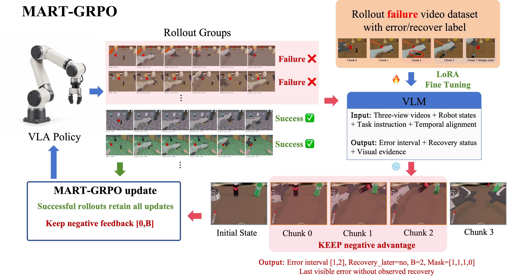
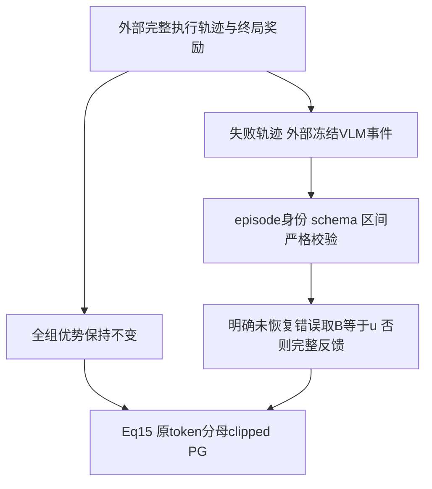

# MART-GRPO：保留错误事件前缀，屏蔽失败后的无关惩罚

MART-GRPO 让冻结 VLM 在完整失败轨迹中定位最后一次未恢复错误，保留错误区间上端点以前的 GRPO 反馈，屏蔽后续动作的失败惩罚，同时保持成功轨迹与原 token 分母。本地实现外部事件到边界的严格映射及 Eq.15 张量目标，不实现视频定位器或机器人训练。

## 论文信息

| 字段 | 内容 |
|---|---|
| 论文 | [When to Stop Penalizing Actions? Martingale GRPO for VLA Reinforcement Learning](https://arxiv.org/abs/2610.32431v1) |
| 公司 / 作者机构 | 一作 **Zongyao Zhao，The University of Hong Kong**；固定 v1 首页其上标为 1，1=HKU；合作机构包括 Tsinghua University |
| 原始发布日期 | **2026-10-23 09:56:27 UTC**，arXiv v1；2026-10-26 公告 |
| 原作者代码 | **未找到**：截至 2026-10-26，固定 v1 摘要/HTML 未提供作者代码链接；不将引用的 SimpleVLA-RL 作为本论文代码 |
| 固定 SHA / 源码许可 | 无可核验作者仓库，SHA/源码许可不适用；本地依据原文独立实现。论文许可为 arXiv perpetual non-exclusive license，不是开源代码许可证 |
| 本地 Adapter / key | `mart-grpo`；独立 L1 外部事件映射/损失组件 |
| 本地代码 | `src/auto_research/post_training/mart_grpo.py` |
| 本地入口 | `boundary_from_event`、`feedback_mask`、`mart_grpo_loss`、`diagnostic(seed, device='cpu')` |
| 完整实验 | **成本过高，不复现（审查 DONE）**，不自动重试 |

## 原始论文总结

### 背景与主要改动

一次机器人最终失败，不等于每个动作都导致失败；全轨迹负优势还会惩罚有价值的重抓和恢复尝试。MART-GRPO 用冻结事件 VLM 回看完整失败轨迹，定位最后一次未恢复错误，只保留截止该边界的失败反馈；成功轨迹、原组优势和原始 token 分母不变。

论文先分析理想 stopping-time 条件下，何时删除零条件期望的后续梯度可以保持估计器期望；实际回溯 VLM 不自动满足这些理论条件。VLM 用三路同步摄像头、机器人状态、任务与帧/动作 chunk 对齐信息，报告最后一次可见且未恢复的错误起始区间 $[\ell,u]$；完整执行 rollout 后才将 $u$ 后面的 loss 置零，**不是提前停止环境、改奖励、改组优势或改分母**。

<!-- paper-figure:start -->
### 原论文关键图



图片来自[原论文](https://arxiv.org/html/2610.32431v1#S3.F3)，版权归原作者所有。原始 PNG 未重绘、未裁剪，来源与 SHA-256 见 `assets/provenance.json`。图中的 27B VLM、机器人 rollout 和 LoRA 训练未由本地组件实现。

<!-- paper-figure:end -->



### 核心公式

全组二元终局奖励先产生参考优势 $A_i=(R_i-\bar R_g)/(s_g+10^{-6})$，Appendix D.2 指明 $s_g$ 为样本标准差；本地损失接收**外部全组优势**，不在反馈过滤后重算。

$$
w_{ik}=\begin{cases}1&R_i=1,\\ \mathbf1[k\le B_i]&R_i=0,\end{cases}\qquad
\widetilde A_{ik}=w_{ik}A_i.
$$

事件必须是合法 failure、具体错误类型、合法 $[\ell,u]$、明确 no recovery 才取 $B=u$；预测成功/不确定、无明确错误/区间或恢复为 observed/uncertain 均保留完整反馈。**格式错误、episode identity 不匹配、越界区间或推理失败应报错，不当作语义 fallback**。本地无法核验外部 VLM 是否真的基于视频，只保证输入 schema 与数值协议。

$$
L=-\frac1M\sum_i\frac1{N_i}\sum_{t\in V_i}
\min\{\rho_{it}\widetilde A_{i,k(t)},\operatorname{clip}(\rho_{it},.8,1.28)\widetilde A_{i,k(t)}\}.
$$

$N_i$ 是**原始有效 action token 数**，不是 mask 后剩余数。本地接口统一使用0起始chunk编号；区间 $[1,2]$ 对编号0--3的失败轨迹产生 $(1,1,1,0)$，包括上端点。调用方必须将外部事件模型的索引映射到同一约定，不能混用帧号或1起始编号。旧策略、事件 mask 和优势在 PPO 更新中 detached；半精度算术提升 float32，padding 在非线性运算前清理。

VLM 看过未来帧，所以边界是 retrospective，不自动满足理论理想条件。论文对这类边界引入条件投影残差；本地**不宣称任意事件 mask 无偏或必然降低方差**。

### 论文离线与线上效果

原文在 RoboTwin 2.0 的七种双臂操作任务比较 OpenVLA-OFT 的 full GRPO 与事件前缀反馈，报告成功率提升；事件模型另评估区间 IoU。Appendix E.3 的 validation-selected event checkpoint 在七任务 220 个可定位未恢复 test failure 上 task-macro IoU 为 72.1%。这是定位标签一致性，不是 actor success rate。原文也写 test diagnostics 曾影响训练时长，不能忽略此选择边界。未报告生产线上 A/B；本地没有复现这些分数。

## 本地复现

本轮已在CPU及真实NVIDIA A100上执行同一冻结版本、42/43/44三个种子：[独立机制指标](metrics/component-cuda-seeds42-44.json)、[脱敏GPU凭证](../../gpu-validations/mart-grpo-a100-20261026.json)。仅验收下述L1组件，不宣称完整模型能力。

```bash
PYTHONPATH=src python -c 'from auto_research.post_training.mart_grpo import diagnostic; print(diagnostic(42))'
OMP_NUM_THREADS=1 MKL_NUM_THREADS=1 PYTHONPATH=src python -m pytest tests/post_training/test_oct26_post_agent_components.py -q
```

调用方只可给真实训练 rollout 的事件记录，不能从 gold 计划反推边界，也不能把这些训练事件喂给被评估 policy。本地不加载 actor、VLM 或环境。诊断真实反传合成 logits，用独立概率空间 Eq.15 参考检查值与梯度、原分母、失败后缀零梯度和成功项保留；不产生机器人 accuracy/success。`diagnostic_only=true`、`promotion_eligible=false`、`evolve_integrated=false`。

测试还覆盖 semantic fallback 与格式错误的区别、identity mismatch、上下端点、空失败前缀的分析边界、非对称 clip、padding NaN 和 teacher/old/advantage 不反传。本轮CPU与真实A100三种子机制检查已通过，见本节凭证；不将其解释为VLA成功率或理论无偏性验证。

### 高成本完整实验

Appendix D Table 3 明确 **8 张 NVIDIA H100** 服务容量；使用 OpenVLA-OFT、RoboTwin 2.0，512 条轨迹/更新，40 次更新，七任务、seen/held-out 每次各 128 episode、每 5 更新评估。每 chunk 含 25 control steps×14 action dimensions。另需在 1,024 条失败视频及成功参考上训练冻结 **Qwen3.8-27B** 事件 VLM 的 LoRA，再做三路视频推理。

这超过单张 A100/A30 或 Mac 的合理迭代预算，完整 actor/VLM 训练和机器人多任务评测为 **成本过高，不复现（审查 DONE）**；不下载权重、不试跑完整配置、不自动重试。事件映射+目标函数组件不能代替定义性 VLM 或理论条件。
