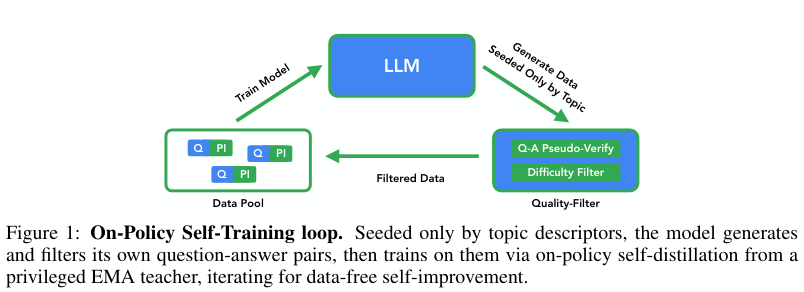

# OPST: Verification, per-response reduction and EMA for self-generated curricula

<!-- source-sha256: 988595b5328fb93aa62b9858706d01adeafa2f362b2f7e421c367ef0bc4df5b4 -->

[简体中文](README.md)

> **L1 verification/reduction/EMA component; diagnostic only.** No canonical JSD, full model or capability reproduction.

## Paper information

| Field | Details |
| --- | --- |
| Paper | [On-Policy Self-Training: Data-Free Self-Improvement in Large Language Models](https://arxiv.org/abs/2610.32770v1); [reviewed full text](https://arxiv.org/html/2610.32770v1) |
| Affiliations | First author Leon Sick: Google (first affiliation) and Ulm University. |
| First public release | 2026-10-23 15:12:03 UTC (announced 2026-10-26) |
| Author code | No author repository was found in the reviewed v1 abstract/HTML as of 2026-10-26. OPSD and evaluation-harness links are not author source. The paper is CC BY 4.0. |
| Local key | `opst`; no adapter |
| Local code | `src/auto_research/post_training/opst.py` |
| Local evidence | [Local mechanism metrics](metrics/component-cuda-seeds42-44.json); [A100 validation receipt](../../gpu-validations/opst-a100-20261026.json) |

## What the paper changes

OPST generates questions and privileged solution hints from topics, filters them, then uses an EMA teacher that sees those hints to supervise actual student prefixes. The generator must independently solve both the original and a meaning-preserving paraphrase in fresh context without the hint. Discard a too-easy item only if all $G$ student rollouts match the proposed answer; agreement on some other answer is not sufficient. Cross-round semantic deduplication is external.

### Original paper figure



Original figure from the reviewed paper, reused without redrawing. See [figure provenance](assets/provenance.json).

### Core equations

$$
v=\mathbf1[\hat a(x)=a]\mathbf1[\hat a(x')=a],\qquad
\operatorname{keep}=v\land\neg\bigwedge_{g=1}^{G}[\hat a_g=a].
$$

$$
L=\frac1B\sum_i\frac{\sum_t M_{it}D_{it}}{\sum_t M_{it}},\qquad
\phi_k=(1-\beta)\phi_{k-1}+\beta\theta_k.
$$

Equation 6 averages valid token divergences per response, then averages responses. In EMA, $\beta=0.05$ by default is the new student weight, not old-teacher momentum; update after each student step and evaluate the EMA teacher. Empty responses fail, padding is sanitized before arithmetic, and the update returns detached tensors without mutating inputs. Non-floating buffers are out of scope.

**Unresolved Equation 5 ambiguity.** Both v1 PDF page 5 and HTML give mixture $(1-\alpha)q+\alpha p$ but outer KL weights $\alpha$ for $q$ and $1-\alpha$ for $p$. The claimed entropy bound and directional endpoints require the matched mixture $\alpha q+(1-\alpha)p$. For $p=(1,0),q=(0,1),\alpha=0.8$, the printed form gives 1.332179 versus matched entropy 0.500402. The implementation does not choose a correction; it accepts caller-defined nonnegative token divergences.

### Results reported by the authors

Table 1 reports Gemma 4 E2B without thinking rising from 37.5 to 47.7 on MMLU, and thinking E4B moving from 71.3 to 76.0 across four tasks. Out-of-domain regressions such as MATH-500 prevent a claim of no forgetting. No production A/B or local capability replication.

## Local reproduction and limits

`verification_gate` consumes observed Boolean results and external duplicate flags, not gold or a generated verifier. `masked_divergence_mean` backpropagates through external divergence; `ema_update` handles weights only. Frozen-source CPU and A100 runs use 42/43/44, testing answer-specific consensus, paraphrase rejection, deduplication, per-response versus global reduction, padding NaN/zero gradients, EMA direction and the equation counterexample. No model loading, curriculum, full loss, teacher/student forward or Evolve integration.

```bash
OMP_NUM_THREADS=1 MKL_NUM_THREADS=1 PYTHONPATH=src python -m pytest tests/post_training/test_oct26_post_agent_components.py -q
PYTHONPATH=src python -c 'from auto_research.post_training.opst import diagnostic; print(diagnostic(42))'
```

### Full experiment: not reproduced

The complete matrix includes Gemma 4 E2B/E4B (family labels, not exact total parameter counts), multiple domains and thinking modes, SFT/GRPO/OPSD and a visual extension. Default seven rounds of 285 examples require generation, paraphrase/re-solving, student sampling and dual-model scoring. Cost review is complete; no model download, expensive probe, retry or purported single-device timing.

### Additional references

[Paper PDF](https://arxiv.org/pdf/2610.32770v1)
