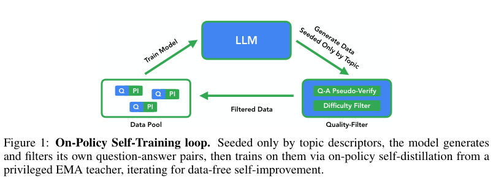
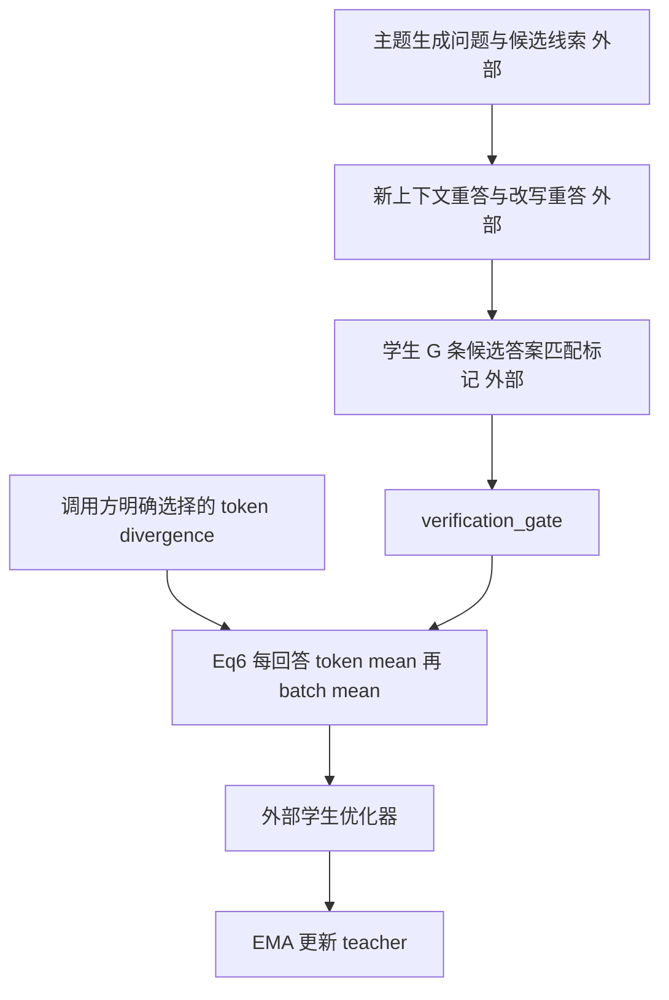

# OPST：自生成课程的验证门、逐响应归一化与 EMA

OPST 从粗粒度主题生成问题和特权解题线索，经独立重答、改写重答与学生难度门过滤后，通过特权 EMA 教师进行多轮自蒸馏。本地只实现确定无歧义的过滤、外部逐 token divergence 的 Eq.6 归一化和 EMA 更新；**不实现存在原文矛盾的 canonical JSD loss，不代表完整 OPST 模型或能力复现**。

## 论文信息

| 字段 | 内容 |
|---|---|
| 论文 | [On-Policy Self-Training: Data-Free Self-Improvement in Large Language Models](https://arxiv.org/abs/2610.32770v1) |
| 公司 / 作者机构 | 一作 **Leon Sick 的第一机构为 Google**，第二机构为 Ulm University；固定 v1 首页的上标为 1,2，1=Google |
| 原始发布日期 | **2026-10-23 15:12:03 UTC**，arXiv v1；2026-10-26 公告，不是 Oct26 首发 |
| 原作者代码 | **未找到**：截至 2026-10-26，固定 v1 摘要 / HTML 未提供作者实现链接；不把引用的 OPSD 或评测 harness 当作者源码 |
| 源码固定版本 / 许可 | 无可核验作者仓库，SHA 与源码许可不适用；本地据论文独立重写。论文许可 CC BY 4.0 |
| 本地 Adapter / key | `opst`；独立 L1 机制组件，非能力 adapter |
| 本地代码 | `src/auto_research/post_training/opst.py` |
| 本地入口 | `verification_gate`、`masked_divergence_mean`、`ema_update`、`diagnostic(seed, device='cpu')` |
| 完整实验 | **成本过高，不复现（审查 DONE）**；不自动重试，不阻塞审查水位 |

## 原始论文总结

### 背景与主要改动

通常的 on-policy self-distillation 仍需要人工问题集。OPST 按主题自生成问题和特权解题线索，经独立重答、改写与学生难度门过滤，再由额外看到线索的 EMA 教师在学生实际生成的前缀上提供分布监督，而不是要求学生直接模仿生成器表述。

过滤分为两个方向：生成器在不含 $z$ 的新上下文中重答原题及保义改写题，两次都须匹配候选答案；学生的 $G$ 条 rollout 只有**全部匹配候选答案**时才作为过易题丢弃。“全部答成另一个答案”不能被泛化的 consensus 规则误删。跨轮去重由真实课程系统承担，本地只接收外部 duplicate 标记，不用字符串哈希冒充语义去重。

<!-- paper-figure:start -->
### 原论文关键图



图片来自[原论文](https://arxiv.org/pdf/2610.32770v1)，版权归原作者所有。此图是原 PDF 第 2 页 Figure 1 的直接 2x 栅格化裁切，保留原 caption，未重绘；裁切坐标、许可及 SHA-256 记录于 `assets/provenance.json`。图中 LLM 生成和完整训练循环并非本地已实现。

<!-- paper-figure:end -->



### 核心公式

过滤门直接执行 Sec.3.4：

$$
v=\mathbf1[\hat a(x)=a]\mathbf1[\hat a(x')=a],\qquad
\operatorname{keep}=v\land\neg\bigwedge_{g=1}^{G}[\hat a_g=a].
$$

Eq.6 的明确部分是先按每条回答的有效 token 数归一化，再等权平均回答：

$$
L=\frac1B\sum_i\frac{\sum_t M_{it}D_{it}}{\sum_t M_{it}},\qquad
\phi_k=(1-\beta)\phi_{k-1}+\beta\theta_k.
$$

$\beta$ 是**新学生权重**，不是旧教师的 momentum 系数；默认 $.05$。教师在每次学生优化后更新，最终评估的是 EMA 教师。空回答报错，padding 在算术前清理；教师更新返回 detached 新张量，不修改输入。模型非浮点 buffer 的策略不在此组件内。

#### 原文 Eq.5 的未解决歧义

固定 v1 **PDF 第 5 页和 HTML 均**打印混合分布 $\bar q=(1-\alpha)q+\alpha p$，却给出 $D=\alpha KL(q\|\bar q)+(1-\alpha)KL(p\|\bar q)$，并声称其上界为 $H(\alpha)$、两端恢复特定方向的 KL。该上界和端点性质需要与外权重匹配的 $\bar q=\alpha q+(1-\alpha)p$，两者不一致。

反例：$p=(1,0),q=(0,1),\alpha=.8$。按打印混合式计算，$D=1.332179$；按匹配权重的标准混合式计算，$D=H(.8)=.500402$。不是微小数值误差，也不能用 $\alpha=.5$ 的特例掩盖。本地**不选择其中一种替作者补正**，不实现 canonical JSD；`masked_divergence_mean` 只接收调用方显式构造的非负 token divergence。诊断直接使用合成 divergence 张量，不称为 OPST loss 复现。

### 论文离线与线上效果

Table 1 的 Gemma 4 E2B、无 thinking 配置：MMLU 从 37.5 到 47.7；E4B、thinking 配置的四任务平均分从 71.3 到 76.0。多域课程仍有外域退化，例如 MATH-500 存在下降，因此不能宣称完全不遗忘。原文未报告生产线上 A/B。本地张量测试不复现这些能力分数。

## 本地复现

本轮已在CPU及真实NVIDIA A100上执行同一冻结版本、42/43/44三个种子：[独立机制指标](metrics/component-cuda-seeds42-44.json)、[脱敏GPU凭证](../../gpu-validations/opst-a100-20261026.json)。仅验收下述L1组件，不宣称完整模型能力。

```bash
OMP_NUM_THREADS=1 MKL_NUM_THREADS=1 PYTHONPATH=src python -m pytest tests/post_training/test_oct26_post_agent_components.py -q
PYTHONPATH=src python -c 'from auto_research.post_training.opst import diagnostic; print(diagnostic(42))'
```

`verification_gate` 的 Boolean 是真实训练过程可观测的验证结果，不读取 gold，不生成自然语言验证器。`masked_divergence_mean` 可对外部 divergence 反传，但不包含规范 JSD。`ema_update` 仅处理权重张量。没有模型加载、训练数据生成、完整 teacher/student forward、课程控制器或 evolve 接入；`diagnostic_only=true`、`promotion_eligible=false`、`evolve_integrated=false`。

测试包括候选答案专属 consensus、改写失败、外部去重、逐回答与全局 token mean 的负控、padding NaN/零梯度、EMA 新旧权重方向和原式歧义反例。CPU与真实A100三个种子均已按同一冻结源码验收，见本节证据链接；没有执行完整模型课程训练。

### 高成本完整实验

Sec.4 与 Appendix A.2 涉及 Gemma 4 E2B/E4B、多数据域、thinking/非 thinking、SFT/GRPO/OPSD 对照及视觉扩展；默认 7 轮、每轮 285 合成样本，还要生成、改写、重复求解、采样学生 rollout 和双模型打分。E2B/E4B 是模型家族标签，不冒称总参数量精确为 2B/4B；原文未披露可据以承诺单卡耗时的完整硬件时长。

现有单张 A100/A30 或 Mac 不执行该模型矩阵、完整合成课程训练和 VQA 验证。**成本过高，不复现（审查 DONE）**；不下载权重、不先试跑昂贵配置、不自动重试。原式歧义也明确保留，不能以高成本标签掩盖方法缺口。
